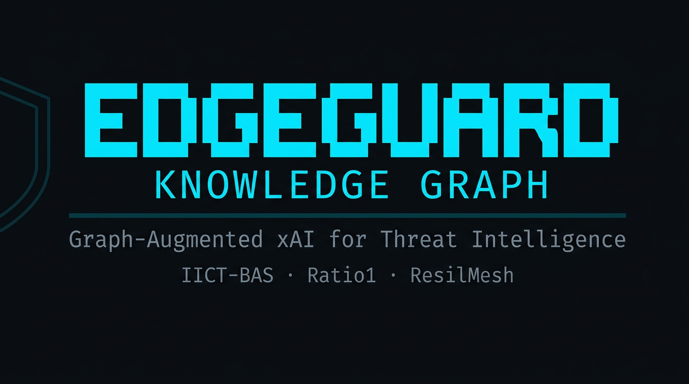

<p align="center">
  <!-- Replace the src below with your actual EdgeGuard logo URL once available -->
  
</p>

<h1 align="center">EdgeGuard</h1>

<p align="center">
  <strong>Graph-Augmented xAI for Threat Intelligence on Edge Infrastructure</strong>
</p>

<p align="center">
  <a href="https://github.com/Kopanov/EdgeGuard-Knowledge-Graph/actions/workflows/ci.yml"></a>
  
  
  
  
</p>

<p align="center">
  IICT-BAS + Ratio1 | financed by ResilMesh - open call 2
</p>

<p align="center">
  <em>This project has received funding through the <strong>ResilMesh Open Call 2</strong>,<br>
  supported by the European Union's Horizon Europe research and innovation programme.</em>
</p>

---

## 🤔 What is EdgeGuard?

As part of the EdgeGuard framework for Graph-Augmented xAI on edge infrastructure, **EdgeGuard-Knowledge-Graph** is the first module. It is responsible for collecting, linking, and enriching threat intelligence by merging data from 11+ collectors into MISP as the single source of truth, then linking the most important data from **Energy, Healthcare, and Finance** sectors, enriched with global intelligence, into a Neo4j knowledge graph. The architecture goes both ways: Neo4j is the linked intelligence layer for fast graph queries and cross-source correlation, while MISP holds the ground truth with full provenance, raw data, and audit trails. Every node in Neo4j traces back to its MISP source events, so analysts can always verify the raw evidence behind any graph insight.

### What it does

1. **Collects** threat intelligence from multiple external feeds (10 active collector types + 2 sector placeholders — see `docs/DATA_SOURCES.md`)
2. **Stages** everything in MISP — the single source of truth — with full provenance and timestamps
3. **Builds** a Neo4j knowledge graph that shows relationships between threats, actors, and sectors
4. **Enriches** the graph automatically: ages indicators by one rule from their latest report, groups actors into campaigns, merges duplicate actors under their MITRE aliases
5. **Filters** by sector (Healthcare, Energy, Finance) so you only see what matters for your industry
6. **Integrates** with ResilMesh/CRUSOE for network topology correlation

### The Workflow

```
External sources (10 active feeds + 2 opt-in: CISA ICS advisories, MalwareBazaar + 2 sector placeholders)
       │
       ▼
  Collectors ──────────────────────────────────────────────────────────────────┐
  (OTX, NVD, CISA, MITRE, VirusTotal, AbuseIPDB,                                │
   ThreatFox, URLhaus, Feodo, SSL BL, …)                                        │
       │                                                                        │
       ▼                                                                        │
  MISP  ◄────── Single Source of Truth ──────── all data lands here first      │
  (tagged: zone, source, TLP, confidence)                                       │
       │                                                                        │
       ▼                                                                        │
  MISP → Neo4j sync (attributes parsed and merged; no STIX bundle)              │
       │                                                                        │
       ▼                                                                        │
  Neo4j Knowledge Graph                                                         │
  (Indicators, CVEs, Actors, Techniques,                                        │
   Malware, Campaigns — all cross-linked)                                       │
       │                                                                        │
       ▼                                                                        │
  Enrichment Jobs (post-sync)                                                   │
  • Indicator aging (one rule from the latest report; retire after 730 d)       │
  • Campaign Node Builder (ThreatActor → Malware → IOC chains)                  │
  • CVE bridge, actor alias + Malware twin merge, FIRST EPSS (6 jobs)           │
       │                                                                        │
       ▼                                                                        │
  FastAPI REST API (port 8000) ────────────────────────────────────────────────┘
  GraphQL API (port 4001)       ← ISIM-compatible; ResilMesh queries EdgeGuard
  + NATS real-time alerts         the same way it queries ISIM
  + ResilMesh/CRUSOE integration
```

**Two operating modes:**
- **Baseline** (run once): Full historical load — up to the last 730 days by default (`BASELINE_DAYS`, the same window for every sector; CISA KEV and the NVD records of KEV CVEs whatever their age), unlimited items **per source** by default (`BASELINE_COLLECTION_LIMIT=0`), triggered manually
- **Incremental** (cron): each collector reads what changed since its own cursor or its feed's current window (OTX from its cursor, 3 days on the first run; MITRE the whole bundle when its ETag changes; MalwareBazaar the 48-hour export; VirusTotal hashes of the last 30 days), **200** items per source by default (`EDGEGUARD_INCREMENTAL_LIMIT`), runs on schedule via Airflow. NVD instead reads every CVE modified since its stored cursor, adds the new ones published within `EDGEGUARD_BASELINE_DAYS` (default 730; the Airflow Variable `BASELINE_DAYS` does not apply), on KEV or named in `EDGEGUARD_NVD_EXTRA_CVE_IDS`, and edits the MISP copy of CVEs NVD changed (at most `EDGEGUARD_NVD_MAX_PER_RUN` MISP writes per run); ThreatFox and URLhaus read their whole window (7 and 30 days) up to their own caps (`EDGEGUARD_THREATFOX_MAX_PER_RUN`, `EDGEGUARD_URLHAUS_MAX_PER_RUN`); Feodo Tracker and SSL Blacklist report their whole list up to theirs (`EDGEGUARD_FEODO_MAX_PER_RUN`, `EDGEGUARD_SSLBL_MAX_PER_RUN`), AbuseIPDB at most `EDGEGUARD_ABUSEIPDB_MAX_PER_RUN` (10,000) blacklist addresses per run, which AbuseIPDB chooses; CISA KEV compares the whole catalogue with MISP in every run, adding new entries and editing the copies of revised ones (at most `EDGEGUARD_KEV_MAX_EDITS_PER_RUN`); CISA ICS reads every advisory changed since its cursor, up to `EDGEGUARD_CISA_ICS_MAX_ADVISORIES_PER_RUN` (1,200) advisory files per run

**Limits are stage-specific** (baseline per-source caps ≠ MISP→Neo4j fetch ≠ Neo4j RAM chunking). See **[docs/COLLECTION_AND_SYNC_LIMITS.md](docs/COLLECTION_AND_SYNC_LIMITS.md)** and **§ Collection & sync limits** later in this README.

---

## 🎯 Why EdgeGuard?

| Problem | EdgeGuard Solution |
|---------|-------------------|
| Too much threat data | Filters by sector (Healthcare / Energy / Finance / Global) |
| Hard to see connections | Graph database maps actors → techniques → CVEs → IOCs |
| Stale indicators cluttering your graph | Indicator aging lowers the confidence of IOCs no source reported lately and retires them after 730 days without a report |
| Can't tell which intel is trustworthy | Every relationship states its evidence (`match_type`), its confidence and the sources that assert it (`sources[]`, with their record ids), so corroboration by independent sources is countable |
| Multiple disconnected data sources | All feeds flow through MISP as single source of truth |
| Need to integrate with existing platform | Full ResilMesh/CRUSOE schema interoperability |

### Deterministic ingest & linking (not fuzzy graph matching)

EdgeGuard **intentionally** uses **deterministic identity and merge rules** (Neo4j **`MERGE`** on agreed keys, **exact** identifiers such as **CVE** and **MITRE `mitre_id`**, and scoped co-occurrence where documented) instead of **fuzzy** string/graph inference (e.g. substring **`CONTAINS`** for production entity linking). That trade-off favors **auditability**, **repeatable** syncs, and **fewer false-positive edges** in threat intel (wrong actor ↔ technique ↔ IOC links are high impact). Relationship logic for critical edges (e.g. **`EMPLOYS_TECHNIQUE`** for actors, **`IMPLEMENTS_TECHNIQUE`** for malware/tools — two types, so that attribution and capability stay distinct, for clarity and GraphRAG retrieval quality) is spelled out in **[docs/ARCHITECTURE.md](docs/ARCHITECTURE.md)** and **[docs/KNOWLEDGE_GRAPH.md](docs/KNOWLEDGE_GRAPH.md)**; merge behavior, provenance, and the **exact-vs-fuzzy** matching rules live in **[docs/DATA_QUALITY.md](docs/DATA_QUALITY.md)**.

---

## 🗺️ Roadmap & Status

### ✅ Production-ready (today)

- **Local Docker Compose deployment** — single-host stack, all services bring up via `./install.sh && docker compose up -d`
- **Baseline workflow** — manual one-time historical load (additive `edgeguard baseline` or destructive `edgeguard fresh-baseline`)
- **Incremental sync workflow** — Airflow DAGs (`edgeguard_pipeline`, `edgeguard_medium_freq`, `edgeguard_low_freq`, `edgeguard_daily`, `edgeguard_neo4j_sync`) running on cron schedules
- **10 collectors** (OTX, NVD, CISA KEV, MITRE ATT&CK, VirusTotal, AbuseIPDB, ThreatFox, URLhaus, Feodo, SSL Blacklist) → MISP → Neo4j, plus CISA ICS advisories, ATT&CK for ICS and MalwareBazaar behind flags (off by default)
- **REST API** (FastAPI, port 8000) + **GraphQL API** (Strawberry, port 4001 — ISIM-compatible)
- **Auth** (`EDGEGUARD_API_KEY`, auto-generated by `install.sh`) + safety check refusing unauthenticated 0.0.0.0 binds
- **Airflow-aware baseline lock** — the `edgeguard_baseline` DAG acquires `checkpoints/baseline_in_progress.lock` with the DAG run as holder (`baseline_acquire_lock`, before `baseline_clean`) and releases it with `baseline_release_lock` after a successful run (a failed run keeps the lock so that clearing the failed task resumes under the mutex; a refusal of `baseline_clean` before the wipe releases it, and `baseline_clean` and `baseline_start` take it again); the scheduled DAGs check the holder's liveness through the Airflow REST API (run state) and fall back to the sentinel age (`EDGEGUARD_BASELINE_LOCK_MAX_AGE_SEC`, default 48 h), and every writing task of `edgeguard_neo4j_sync` checks it, not only `check_sync_needed`. Details: [§ Running the 730-day baseline](#-running-the-730-day-baseline)
- **Backup gate** — backup and recovery procedure in [docs/BACKUP.md](docs/BACKUP.md). `edgeguard fresh-baseline` refuses to run unless `EDGEGUARD_LAST_BACKUP_AT` records a backup within the freshness window (default 240h via `EDGEGUARD_BACKUP_MAX_AGE_HOURS`). The `baseline_clean` DAG task enforces the same gate, so destructive wipes triggered from the UI or the API cannot bypass it.
- **Audit trail for destructive operations** — JSONL written by `src/destructive_ops_audit.py` (`EDGEGUARD_DESTRUCTIVE_OPS_AUDIT_PATH`, default `logs/destructive_ops.jsonl`), and the Prometheus counter `edgeguard_destructive_ops_total{operation,target}` for the destructive code path
- **Healthchecks + Prometheus + Grafana monitoring stack** — pipeline metrics from every Airflow task process are aggregated by the `metrics` service on `127.0.0.1:8001` (multi-process mode); Prometheus, started together with the application stack (`make monitoring`), scrapes it as `metrics:8001` over the `edgeguard_net` network on every host. Per-DAG staleness alerts in `prometheus/alerts.yml`: `EdgeGuardDailyDAGStale` (25 h), `EdgeGuardNeo4jSyncStale` (122 h, from the 72 h schedule) and the per-DAG `EdgeGuardDAGLastSuccessStale` for `edgeguard_pipeline`, `edgeguard_medium_freq` and `edgeguard_low_freq`. `EdgeGuardDAGRunStuck` is duration-based, with a per-DAG limit of `dagrun_timeout` plus 15 minutes on the start time of the run in progress (marked and cleared by the listener plugin `plugins/edgeguard_dag_run_state.py` from the scheduler's and the API server's DAG run hooks). There is no heartbeat: a run whose tasks hang within their `execution_timeout` is reported only at that limit.
- **Direct test coverage of the incremental sync** — `tests/test_sync_run_incremental.py` covers `MISPToNeo4jSync.run(incremental=True)`

### 🚧 In Progress / Planned

- **Local operational hardening** — tracked in [issue #53](../../issues/53):
  - MISP session helper consolidation (8 `requests.Session()` sites → single helper)
  - `update_source_checkpoint` concurrency-safety tests — partial: `fcntl` lock release / exception tests exist (`tests/test_pr_k1_baseline_resume_robustness.py`, `tests/test_pr_n5_producer_hardening.py`); no two-writer race test yet
- **NATS alert loop** — inbound `resilmesh.alerts.zone.*` → `Alert` node + enrichment is implemented (`src/alert_processor.py`); publishing the enriched response back, a deployable consumer service, payload validation and auth / queue-group settings are not, and depend on ResilMesh's subjects, schema and hosting — see [docs/RESILMESH_INTEROPERABILITY.md](docs/RESILMESH_INTEROPERABILITY.md) § 8.6
- **Alertmanager delivery** — `prometheus/alertmanager.yml` loads without secrets and reads the Slack webhook URL from `prometheus/secrets/slack_api_url` when the file is provided (see [docs/PROMETHEUS_SETUP.md](docs/PROMETHEUS_SETUP.md) § Alertmanager notifications); the e-mail receivers (example mailboxes) and the PagerDuty key (un-rendered template) are placeholders, so a verified notification channel is required before any alert reaches an operator
- **External exposure of the APIs** — the REST and GraphQL services bind to loopback and the repository ships no TLS hostname or reverse proxy; partner access requires a proxy with per-partner API keys and an IP allowlist
- **Trivy supply-chain gate re-tightening** — re-tighten the airflow image scan to HIGH+CRITICAL once apache/airflow upstream catches up (tracked in [issue #52](../../issues/52))
- **Wipe loop simplification** — replace the string-match + page-advancement state machine with a tag-based filter (tracked in [issue #54](../../issues/54))
- **SoftwareVersion bridge**: `(Vulnerability)-[:IN]->(SoftwareVersion)-[:ON]->(Host)` — NVD `version_constraints` are collected and stored; CPE-to-SoftwareVersion mapping pending (see [`docs/RESILMESH_INTEROPERABILITY.md`](docs/RESILMESH_INTEROPERABILITY.md) §4.4)
- **ISIM GraphQL schema extension**: EdgeGuard types (Indicator, ThreatActor, Malware, Technique, Campaign, Tool) exposed via port 4001 — formal ISIM schema merge with ResilMesh team planned
- **Neo4j role separation**: the services share one set of Neo4j credentials; Neo4j Enterprise roles or GraphQL as the access layer are the target state
- **Healthcare and Energy sector-specific feed collectors**: placeholders only. Member-only ISAC feeds (HC3, Health-ISAC, EE-ISAC) are not planned and no ISAC membership is budgeted; public sector advisories arrive through the CISA KEV and CISA ICS collectors
- **`apoc.coll.toSet` → native-Cypher migration**: 47+ list-accumulator SET clauses go through two helper functions in `src/neo4j_client.py` (`_dedup_concat_clause` / `_dedup_concat_optional_clause`), and a Prometheus list-size histogram (`edgeguard_neo4j_list_dedup_size`, populated by `scrape_list_dedup_sizes`) reports the list sizes. The helper internals emit `apoc.coll.toSet(...)`. The next step switches those internals to native Cypher (likely `CASE WHEN $x IN coalesce(prop, []) THEN prop ELSE prop + $x END` for append-of-one, which is O(n) and matches the usage shape — `reduce(...)` is O(n²), measured at a 120× regression at n=500). The instrumentation validates the switch: the dedup-tripwire + order-preservation tests in `tests/test_dedup_clause_helpers.py` pin the contract any replacement must satisfy, and the Prometheus histogram shows the live p50/p95/p99 of `r.misp_event_ids` in production, which confirms that the O(n) form is sufficient before shipping. Driver: Neo4j 2026.x deprecates `apoc.coll.toSet` (warns; will be removed in a future major). A later step covers the Pattern E `apoc.coll.toSet`-wrapping-`reduce()` and Pattern D single-list dedup sites in `enrichment_jobs.py` (campaign alias merge), the read-side zone projection in `query_api.py`, and the load-bearing APOC liveness probe inside `Neo4jClient`'s connection verification (named by stable symbol references on purpose, not by line numbers).
  - **Health check with the switch**: when the helpers switch, the APOC liveness probe in `Neo4jClient`'s connection verification (`RETURN size(apoc.coll.toSet([1, 2, 2]))`) must change in the same commit — replace it with a smoke test of the chosen native-Cypher pattern, plus a separate `apoc.create.addLabels(...)` probe, so that the OTHER APOC dependency (sector labels) stays guarded.
- **Cloud deployment** (Aura Neo4j + cloud MISP + K8s) and **regular monitoring & incremental SLOs** — planned once local operational hardening is complete

#### 🛡️ Security roadmap — MISP trust boundary

Staged defense-in-depth for untrusted MISP inputs. Full design + threat model in [`docs/SECURITY_ROADMAP.md`](docs/SECURITY_ROADMAP.md).

- ✅ **Tier 1 — Defense machinery.** Creator-org allowlist check with Unicode-aware name normalization (NFKC + casefold), strict UUID validation, and log-injection-safe rejection logging. Rejections increment `edgeguard_source_truthful_creator_rejected_total`.
- ✅ **Tier 2 — Observability for the disabled state.** The defense-disabled state is always visible: a startup WARNING log fires in **all** environments, including the default `EDGEGUARD_ENV=dev`, and the Prometheus gauge `edgeguard_misp_tag_impersonation_defense_disabled` exposes the state to alert rules. See [`docs/PROMETHEUS_SETUP.md`](docs/PROMETHEUS_SETUP.md) for the suggested alert rule.
- 📋 **Tier 3 — Fail-closed boot refusal (planned, after Tier 2).** After operators have had a deployment cycle to configure the allowlists, `EDGEGUARD_ENV ∈ {prod, staging}` will switch to boot refusal: the process refuses to start unless an allowlist is configured OR `EDGEGUARD_ALLOW_UNTRUSTED_MISP=1` is set explicitly. Closes the "forgot to configure" footgun at deploy time.

#### 🛡️ MISP backend tuning (required for >50K-attr events)

When EdgeGuard is pushing into MISP events with >50,000 attributes
(typical for OTX / NVD baselines at 365-730 day lookback), the
default Docker MISP container's PHP / MySQL settings cause HTTP 500
errors per batch. EdgeGuard's `MISPWriter` adapts batch size +
throttle automatically (at 50K attrs → 100/batch + 15s
throttle; at 100K → 50/batch + 30s throttle), and inserts an
extended cooldown after sustained 5xx failures, but the **MISP
backend itself needs the settings below** for the adaptive scaling
to actually help:

```ini
# /etc/php/8.x/apache2/php.ini
memory_limit = 4096M
max_execution_time = 600
post_max_size = 256M
upload_max_filesize = 256M
max_input_vars = 50000

# /etc/mysql/mariadb.conf.d/50-server.cnf
[mysqld]
innodb_buffer_pool_size = 4G       # ~50% of host RAM
innodb_log_file_size = 512M
max_allowed_packet = 256M
wait_timeout = 600
```

Apply + restart with `docker compose restart misp misp_db` (in **your**
MISP compose dir — MISP is not vendored in EdgeGuard's
`docker-compose.yml`). Path varies by image:

- **`harvarditsecurity/misp:latest`** (currently deployed) — Apache
  mod_php → edit `/etc/php/8.x/apache2/php.ini` or mount a custom
  `*.ini` into `/etc/php/8.x/apache2/conf.d/zz-edgeguard.ini`.
- **`coolacid/misp-docker:latest`** — php-fpm → mount
  `php-overrides.ini` per the reference compose at
  [`docs/sources/MISP/docker-compose.yml`](docs/sources/MISP/docker-compose.yml).

Full playbook (image-aware paths, verification commands, prereq host
RAM ≥ 8GB, EdgeGuard env knobs with bounded validation, Prometheus
alerts, rollback steps, symptom→setting cheat-sheet) in
[**`docs/MISP_TUNING.md`**](docs/MISP_TUNING.md). Two metrics —
`edgeguard_misp_push_permanent_failure_total{source}` and
`edgeguard_misp_push_backoff_triggered_total{source}` — let operators
alert on the data-loss rate. They carry no `event_id` label, to keep
cardinality bounded, because each MISP run mints a date-stamped event.

#### 🕒 Timestamp semantic model

EdgeGuard carries **four distinct timestamps per indicator**, each
answering one specific question (when did the SOURCE first observe vs
when did EdgeGuard first ingest, etc.). The full model — including the
honest-NULL invariant, the tz-aware-UTC invariant, the per-collector
source-field mapping, and the STIX 2.1 export contract — is documented
in [**`docs/TIMESTAMPS.md`**](docs/TIMESTAMPS.md), the canonical
reference.

Quick consumer primer for STIX 2.1 bundles produced by EdgeGuard: a
CVE-2013 indicator ingested today emits `valid_from = "2013-..."`
(source-truthful) AND `created = "2026-04-21..."` (EdgeGuard import
time) — both meanings preserved, no field conflation. Indicators whose
source did not state the first-observation date carry
`x_edgeguard_first_seen_inferred=true` so analysts can filter for
source-truthful evidence.

#### 📊 Collector baseline limits — current & planned

Each collector's 730-day baseline is bounded by the upstream API's
documented quotas, not by artificial EdgeGuard caps. The full current
state plus planned follow-ups is tracked in
[**docs/COLLECTORS.md § Baseline collection limits**](docs/COLLECTORS.md#baseline-collection-limits--current--planned).
Highlights:

- **NVD** — full 120-day-window iteration, no artificial cap; a defensive guard ignores incremental-style `limit` envs in baseline mode.
- **OTX** — `EDGEGUARD_OTX_BASELINE_MAX_PAGES` (default 200) × `50/page` ≈ 10k pulses (produces ~100k graph nodes + relationships on a 730d run). A baseline that stops at the ceiling with a full last page logs a warning, since older pulses of the window were not read; raise the setting (forwarded by `docker-compose.yml`) for very active subscriptions.
- **VirusTotal** — the free tier offers lookups only (4/min, 500/day); the collector enriches hashes already in MISP within a persisted daily budget (`EDGEGUARD_VIRUSTOTAL_DAILY_BUDGET`, default 400; `EDGEGUARD_VIRUSTOTAL_MAX_LOOKUPS_PER_RUN`, default 60). Quota events are logged with the `[VT-QUOTA]` prefix and skip the task instead of failing it. Bulk or historical depth requires the Premium API (see docs/COLLECTORS.md § 6).
- **ThreatFox** — API hard-caps `days` at 7 (abuse.ch doc); the collector clamps the value and logs a pointer to the [ThreatFox JSON/CSV bulk export](https://threatfox.abuse.ch/export/). **Planned:** a dedicated bulk-import collector for >7d historical depth.
- **Energy & Healthcare sector feeds** — placeholders that return `skipped=True` with `skip_reason_class="placeholder"`, so they surface on the skip dashboard instead of as a silent zero count. No member-only ISAC feeds (HC3, Health-ISAC, EE-ISAC) are planned; public energy and healthcare advisories are covered by the CISA ICS Advisories collector.

#### 📋 Queued follow-ups

- **OOM-safe streaming reads for large MISP events.** `src/collectors/misp_writer.py` and `src/run_misp_to_neo4j.py` read full event payloads into memory; events with tens of thousands of attributes can balloon to multi-GB objects. Refactor hot paths to generator-based streaming so peak memory stays bounded during the 2-year historical baseline.
- **Observability polish.** Clamp `task_id` Prometheus label cardinality (unbounded today → Prometheus performance degrades over months of uptime).
- **Architecture flow diagrams.** `tests/test_architecture_flow_pins.py` checks in CI the references in `docs/*.md`, `README.md` and `CONTRIBUTING.md` ([`docs/ARCHITECTURE_FLOW.md`](docs/ARCHITECTURE_FLOW.md) included) against the code: `EDGEGUARD_*` env vars, container names in `docker` commands and `src/*.py` paths, and it fails when a document gives the removed command forms `python -m edgeguard baseline` / `python -m src.neo4j_client` as current; it does not check `edgeguard` subcommands or function names. Queued: authoring the eight Mermaid diagrams themselves — the doc holds scoped placeholders for baseline sequence, checkpoint state machine, collector→MISP→Neo4j data flow, MISP↔Neo4j traceability, incremental sync, deployment topology, STIX export, and zone detection.

---

## 🏢 Who is it for?

- **Hospitals** → Detects attacks on patient systems
- **Energy Companies** → Monitors grid security  
- **Banks** → Spots financial fraud
- **Any organization** with edge infrastructure

---

## 🚀 Quick Start

### Prerequisites

- Docker + Docker Compose (recommended — Neo4j, **`airflow_postgres`**, Airflow, REST API, GraphQL)
- **or** **Python 3.12+** (required for pip/venv installs; `pyproject.toml` / CI match this) + Neo4j + MISP. For **pip-installed Airflow** with PostgreSQL metadata, use **`pip install ".[airflow]"`** or **`apache-airflow[postgres]~=3.3`** + **`apache-airflow-providers-standard~=1.5`** (see `requirements.txt`). *Note: Airflow 3.3 supports Python 3.10–3.14 upstream; EdgeGuard standardizes on 3.12+ and runs Airflow 3.3.2 (`apache/airflow:3.3.2-python3.12` base image).*

### Option A — One-line install (Docker, recommended)

```bash
git clone https://github.com/Kopanov/EdgeGuard-Knowledge-Graph.git
cd EdgeGuard-Knowledge-Graph
./install.sh          # detects Docker, copies .env, builds image, starts stack
```

`install.sh` handles everything: checks Docker, copies `.env.example → .env`, builds the image, and runs `docker compose up -d`. After it finishes, edit `.env` with your API keys and run `docker compose up -d` again (a plain `restart` does not re-read `.env`).

**Post-install validation (run this after any install method):**

The CLI reads its settings from the environment; it does not read `.env`. With the Docker install, run it in the `airflow` container, which receives the settings `docker-compose.yml` forwards from `.env` and the container addresses (`bolt://neo4j:7687`, your `MISP_URL`):

```bash
docker compose exec airflow python /opt/airflow/src/edgeguard.py preflight  # readiness check (env vars, APIs, Neo4j, MISP, Airflow, disk)
docker compose exec airflow python /opt/airflow/src/edgeguard.py doctor     # MISP, Neo4j, Airflow, NATS, schema, API keys, version compatibility
docker compose exec airflow python /opt/airflow/src/edgeguard.py stats      # node counts, last sync, pipeline runs
```

In the container the CLI reads the Airflow API password from the file `airflow standalone` generates; a host shell needs `AIRFLOW_API_PASSWORD` (see `AIRFLOW_API_USER` / `AIRFLOW_API_PASSWORD` under Settings), otherwise `preflight` warns "Could not query DAG list". The same warning appears while no EdgeGuard DAG is registered yet; `doctor` prints the reason. `doctor`'s NATS and memory-setting lines read variables Compose does not forward to `airflow`; check those with the host variant. On the host (Options B and C, or a host shell against the Docker stack), export `.env` first: `set -a; . ./.env; set +a`. Against the Docker stack, also point the host at the published ports (`export NEO4J_URI=bolt://localhost:7687`, and `MISP_URL` when it names a container). Then run `python src/edgeguard.py preflight` (and `doctor`, `stats`) from a venv with the requirements installed.

`preflight` runs 7 check categories (env vars/API keys, Neo4j + APOC, MISP health, Airflow, disk space, checkpoint state, circuit breakers) and exits 0 = ready or 1 = issues found. `stats` shows what data is in the system right now.

**EdgeGuard CLI quick reference:**

| Command | Purpose |
|---------|---------|
| `edgeguard preflight` | Pre-run readiness check (7 categories, `--strict` for CI) |
| `edgeguard stats` | Quick dashboard: node counts, last sync, pipeline runs |
| `edgeguard stats --full` | + node counts by zone and by source, and the MISP event summary |
| `edgeguard stats --by-zone` | Node counts per zone (shows multi-zone overlap) |
| `edgeguard stats --by-source` | Node counts per source (nvd, otx, cisa, etc.) |
| `edgeguard stats --misp` | MISP event/attribute counts by source (every page of `/events/index` matching `EdgeGuard`, up to 200 pages of 500 events; a warning names a stop at that cap) |
| `edgeguard dag status` | Airflow DAG run states (color-coded, `--state running` filter) |
| `edgeguard dag kill` | Force-fail stuck DAG runs (preserves checkpoints, `--dry-run`) |
| `edgeguard checkpoint status` | Per-source baseline progress + incremental cursors |
| `edgeguard checkpoint clear` | Clear baseline state (preserves incremental by default) |
| `edgeguard baseline --days N` | Additive baseline trigger — triggers the `edgeguard_baseline` DAG, no wipe |
| `edgeguard fresh-baseline --days N` | **Destructive** wipe + rebuild — typed confirmation, blast-radius display, backup-timestamp gate |
| `edgeguard clear neo4j` | Delete all graph data from Neo4j (keeps constraints). `--edgeguard-only` deletes only the nodes EdgeGuard created (`edgeguard_managed = true`); nodes a partner created first are kept even where EdgeGuard enriched them — use on a database shared with ResilMesh |
| `edgeguard clear misp` | Delete all EdgeGuard events from MISP |
| `edgeguard clear all` | Full reset: Neo4j + MISP + checkpoints (`--force` skips confirmation) |
| `edgeguard doctor` | Diagnose connectivity (MISP, Neo4j, Airflow, NATS, schema) |
| `edgeguard heal` | Resets the circuit breakers of its own CLI process, removes stale lock files and triggers the `edgeguard_pipeline` DAG (Airflow tasks start with every breaker closed) |
| `edgeguard validate` | Config validation (rate limits, passwords, Neo4j schema) |
| `edgeguard monitor` | Real-time health display |
| `edgeguard source list\|add\|remove` | Lists, adds or removes entries of the local registry `credentials/sources.yaml`; no collector or DAG reads it (collectors are selected with `EDGEGUARD_COLLECT_SOURCES` and the `EDGEGUARD_ENABLE_*` flags) |
| `edgeguard setup` | Prints the install pointers (`./install.sh`, `.env`, `doctor`); not an interactive wizard |
| `edgeguard update` | `git pull` and reinstall through `install.sh --update` (Docker Compose when available, else pip; `--docker` / `--python` force one) |
| `edgeguard version` | CalVer + git SHA |

All commands support `--help`. Data commands support `--json` for automation.

**Then (recommended order):** [docs/SETUP_GUIDE.md](docs/SETUP_GUIDE.md) (finish wiring) → [docs/AIRFLOW_DAGS.md](docs/AIRFLOW_DAGS.md) (run DAGs) → [docs/BASELINE_SMOKE_TEST.md](docs/BASELINE_SMOKE_TEST.md) (first baseline). See **§ Recommended reading order** below.

Or use `make` if you prefer explicit steps:

```bash
make install          # same as ./install.sh
make update           # git pull (ff-only) + auto: Docker Compose or pip path (see install.sh --help)
make start            # docker compose up -d (if already installed)
make stop             # docker compose down
make logs             # tail all service logs
make monitoring       # add Prometheus + Grafana (same Compose project as the stack)
make help             # list all available targets
```

Services started (`docker compose up -d`):
```
Neo4j Browser        →  http://localhost:7474
Airflow UI           →  http://localhost:8082   (8082 avoids ResilMesh Temporal conflict)
REST API             →  http://localhost:8000/health
GraphQL API          →  http://localhost:4001/graphql
Graph Explorer       →  http://localhost:3000/visualization.html after python3 -m http.server 3000 --bind 127.0.0.1 --directory docs;
                        connect to http://localhost:8000 (port 3001 while Grafana runs; docs/GRAPH_EXPLORER.md)
Metrics endpoint     →  http://localhost:8001/metrics   (`metrics` service: EdgeGuard pipeline metrics, scraped by the optional Prometheus)
airflow_postgres     →  PostgreSQL for Airflow metadata (Docker network only, not exposed)
```

Optional monitoring stack (`make monitoring` or `docker compose -f docker-compose.yml -f docker-compose.monitoring.yml up -d` — both files: Prometheus joins `edgeguard_net` to scrape the `metrics` service, and the monitoring file alone is rejected by Compose):
```
Prometheus           →  http://localhost:9090
Grafana              →  http://localhost:3000   (set GRAFANA_ADMIN_PASSWORD in .env)
AlertManager         →  http://localhost:9093
```
Airflow’s scheduler/UI state uses **`airflow_postgres`**; override credentials with **`AIRFLOW_POSTGRES_*`** in `.env` if needed. The **`airflow`** service image is **built** from **`Dockerfile.airflow`** (EdgeGuard Python deps such as **neo4j** / **pymisp**) and reads **`src/`** from a bind mount; the **`api`** and **`graphql`** image (**`Dockerfile`**) copies **`src/`** in at build time. After a pull or a dependency change, record the deployed commit and rebuild every image and recreate every container: **`scripts/record_deployed_commit.sh`** (writes the commit into `.env` as `EDGEGUARD_GIT_SHA`; `./install.sh` and `./install.sh --update` run it), then **`docker compose build && docker compose up -d --force-recreate`** (rebuilding only the Airflow image leaves REST, GraphQL and STIX on the old code; both `/health` responses report the commit as `git_sha`). **`docker-compose.yml`** `x-common-env` forwards MISP→Neo4j tuning from `.env` (**`EDGEGUARD_NEO4J_SYNC_CHUNK_SIZE`**, **`EDGEGUARD_REL_BATCH_SIZE`**, **`EDGEGUARD_DEBUG_GC`**, **`EDGEGUARD_MISP_EVENT_SEARCH`**, etc.) into **airflow** / **api** / **graphql**. Ops and troubleshooting: [`docs/AIRFLOW_DAGS.md`](docs/AIRFLOW_DAGS.md).

### Option B — Python / pip (no Docker)

```bash
git clone https://github.com/Kopanov/EdgeGuard-Knowledge-Graph.git
cd EdgeGuard-Knowledge-Graph
./install.sh --python           # creates .venv, installs api+graphql+monitoring extras (airflow extra is optional — install separately)
# or equivalently:
make install-py                 # same thing via Makefile
# or manually:
pip install ".[api,graphql,monitoring]"

cp .env.example .env            # fill in MISP_URL, MISP_API_KEY, NEO4J_PASSWORD
python src/health_check.py      # verify connectivity
```

For development (adds ruff, mypy, pytest):
```bash
./install.sh --python --dev
# or:
make install-dev
make ci                         # lint + type-check + tests in one command
```

**Already cloned?** Pull latest and refresh (auto-picks **Docker Compose** when `docker` + compose v2 + `docker-compose.yml` are available; otherwise **pip / .venv**):

```bash
./install.sh --update                    # auto (Docker or pip)
./install.sh --update --docker           # force Docker only (fail if unavailable)
./install.sh --update --python           # force pip / .venv
./install.sh --update --python --dev     # include dev extras
```

Every `collect_*` task runs in the Airflow pool `edgeguard_collectors`, which the Compose `airflow` service creates or resizes at every start (`EDGEGUARD_COLLECTOR_POOL_SLOTS`).

### Option C — Conda environment

```bash
conda create -n edgeguard python=3.12
conda activate edgeguard
git clone https://github.com/Kopanov/EdgeGuard-Knowledge-Graph.git
cd EdgeGuard-Knowledge-Graph
pip install ".[api,graphql,monitoring]"

cp .env.example .env            # fill in MISP_URL, MISP_API_KEY, NEO4J_PASSWORD
python src/edgeguard.py doctor  # validate setup
```

This requires **MISP and Neo4j running externally** (either as system services, Docker containers, or remote instances). Point to them via `MISP_URL` and `NEO4J_URI` in `.env`. See [`docs/ENVIRONMENTS.md`](docs/ENVIRONMENTS.md) for full conda/venv/edge setup details.

> **Multi-environment support:** EdgeGuard is designed to run in Docker (recommended), venv, conda, bare metal, or edge devices. The core pipeline (`src/`) has no Docker dependency — it uses standard Python, `requests` for MISP, `neo4j` driver for the graph database, and environment variables for all configuration. Docker Compose is a convenience layer for orchestrating Neo4j + Airflow + APIs together. If you run MISP and Neo4j externally (managed service, bare-metal install, or separate containers), just set `MISP_URL` and `NEO4J_URI` in `.env` and EdgeGuard works the same way.

Longer-form ops notes (CLI table, paths): [`docs/SETUP_GUIDE.md`](docs/SETUP_GUIDE.md).

### Auto-activate environment with direnv (recommended for daily dev)

[direnv](https://direnv.net) makes a virtualenv and `.env` activate automatically whenever you `cd` into the project — and deactivate when you leave. The `.envrc` line `layout python python3` creates and activates direnv's own virtualenv under `.direnv/python-3.x`, not the `.venv` that `./install.sh --python` / `make install-py` create; it starts empty, so install the dependencies into it once (for example `pip install ".[api,graphql,monitoring]"`).

```bash
# One-time setup (do this once on your machine)
brew install direnv              # macOS; or: apt install direnv
echo 'eval "$(direnv hook zsh)"' >> ~/.zshrc   # or bash / fish
source ~/.zshrc

# Inside the project — allow direnv once
cd EdgeGuard-Knowledge-Graph
direnv allow

# Afterwards: cd in → venv + .env auto-load. cd out → deactivate.
```

After `direnv allow`, `python` points to `.direnv/python-3.x/bin/python`, all `.env` variables are exported, and `src/` is on `PYTHONPATH` — no manual steps needed on any subsequent terminal session.

### Airflow DAG-based workflow (recommended for production)

EdgeGuard ships **6** primary DAGs in `dags/edgeguard_pipeline.py` (baseline + five incremental/sync schedules). Optional **metrics** DAGs live in `dags/edgeguard_metrics_server.py` (`edgeguard_metrics_server`, `edgeguard_metrics_server_scheduled`, plus the manual `edgeguard_metrics_helpers` test/health DAG; its `generate_test_metrics` task is for a single-process (bare-metal) metrics server only and records nothing when `PROMETHEUS_MULTIPROC_DIR` is set, as in the Compose deployment, where its fake series would be served as real ones). Once deployed:

```bash
# 1. Start the stack (includes Airflow + airflow_postgres)
docker compose up -d
#    Then open the Airflow UI (see “Services started” above). Pip-only Airflow: pip install ".[airflow]"
#    (installs apache-airflow[postgres]) and set AIRFLOW__DATABASE__SQL_ALCHEMY_CONN per Airflow DB docs.

# 2. Trigger the baseline DAG once (full historical load)
#    Airflow UI → DAGs → edgeguard_baseline → Trigger ▶
#    Optionally configure these Airflow Variables first:
#      BASELINE_DAYS = 730          (2 years of history)
#      BASELINE_COLLECTION_LIMIT = 0  (0 = unlimited)
#    Quick 7-day smoke test: set EDGEGUARD_BASELINE_DAYS=7 and
#      EDGEGUARD_BASELINE_COLLECTION_LIMIT=1000 in .env, run `docker compose up -d airflow`
#      (a plain restart keeps the old environment), then trigger. Afterwards remove both lines
#      and run `docker compose up -d airflow` again: a leftover EDGEGUARD_BASELINE_DAYS also
#      narrows the scheduled NVD runs. See docs/BASELINE_SMOKE_TEST.md
#
#    ⚠️  IMPORTANT — before you trigger the 730-day baseline, read the
#        "Running the 730-day baseline" section below. The baseline DAG
#        holds the baseline lock for the whole run and the 5 scheduled
#        DAGs skip while it is held; pausing them first is the
#        recommended extra step before a destructive fresh-baseline.

# 3. Incremental cron DAGs start automatically after baseline:
#    edgeguard_pipeline    → every 30 min  (OTX)
#    edgeguard_medium_freq → every 4 hours (CISA, VirusTotal)
#    edgeguard_low_freq    → every 8 hours (NVD)
#    edgeguard_daily       → daily 2 AM    (MITRE, AbuseIPDB, feeds)
#    edgeguard_neo4j_sync  → every 3 days  (MISP → Neo4j + enrichment)
```

### Manual / standalone commands

```bash
cd src

# Check system health
python health_check.py

# Run MISP → Neo4j sync (incremental — the last 4 days: EDGEGUARD_SYNC_INTERVAL_DAYS, default 3,
# plus 1 day; the Airflow task instead reads from the last sync's start minus
# EDGEGUARD_SYNC_WINDOW_OVERLAP_HOURS)
python run_misp_to_neo4j.py

# Run full historical sync
python run_misp_to_neo4j.py --full

# Run post-sync enrichment jobs manually
python enrichment_jobs.py

# Rebuild cross-source graph relationships
python build_relationships.py

# Check system health via CLI
python edgeguard.py doctor

# Auto-fix common issues
python edgeguard.py heal

# Pull latest from git + reinstall (from clone root; same as ./install.sh --update)
edgeguard update              # auto: Docker Compose if available, else pip
edgeguard --update            # synonym for the above
edgeguard update --docker     # force Docker only
edgeguard update --python     # force pip / .venv
edgeguard version             # release CalVer + git short SHA (no .env)
```

Release numbering uses **calendar versions** (`YYYY.M.D` in `pyproject.toml`). See [`docs/VERSIONING.md`](docs/VERSIONING.md).

---

## 🚀 Running the 730-day baseline

The 730-day baseline ingests ~2 years of threat intelligence (on the first hosted baseline, 13–14 October 2026: 361,546 MISP attributes, of which 139,862 NVD CVEs and about 219,000 indicator-feed attributes; see [`docs/DATA_SOURCES.md`](docs/DATA_SOURCES.md)) in a single run of up to 32 hours (the baseline DAG's `dagrun_timeout`). This section tells you **what to run, why, and which option to pick** — a wrong launch path can lose data.

### Why the launch path matters

The Airflow `edgeguard_baseline` DAG acquires the `baseline_lock` sentinel itself: the `baseline_acquire_lock` task writes `checkpoints/baseline_in_progress.lock` with the DAG run as holder before the destructive `baseline_clean` step, and `baseline_release_lock` removes it after a successful run. A failed run keeps the lock so that clearing the failed task resumes under the mutex, except after a refusal of `baseline_clean` before the wipe (a `fresh_baseline` typo, an invalid `wipe_scope`, the backup gate), which releases it so that the corrected trigger is not refused; `baseline_clean` (cleared) and `baseline_start` take it again before the run goes on, and the collectors refuse while no baseline holds it (another run's lock stands them down), and `full_neo4j_sync`, `build_relationships` and `run_enrichment_jobs` refuse unless this run holds it. The sentinel is reaped once the run state is `success`, after the age cap, or when the operator removes it. While the sentinel is held (from `baseline_acquire_lock` until `baseline_release_lock` after a successful run; a failed run, including one ended by the 32 h `dagrun_timeout`, keeps it until the run is resumed and succeeds or the sentinel reaches `EDGEGUARD_BASELINE_LOCK_MAX_AGE_SEC`, 48 h by default), the **5 scheduled DAGs** (`edgeguard_daily`, `edgeguard_medium_freq`, `edgeguard_pipeline`, `edgeguard_low_freq`, `edgeguard_neo4j_sync`) check it at task start and skip: a collector task succeeds with `skipped: true` (a green task, reason `baseline_in_progress`), and the tasks of `edgeguard_neo4j_sync` are skipped; in `edgeguard_neo4j_sync` every task that writes checks it, not only `check_sync_needed`. The collector tasks of the baseline run itself are exempt from the sentinel their own run holds (they identify themselves by DAG id and run id); `baseline_acquire_lock` verifies that exemption before the destructive step. The holder's liveness is the DAG-run state read through the Airflow REST API, with the sentinel age as fallback (48 h default, above the 32 h `dagrun_timeout`).

Pausing the 5 scheduled DAGs before a baseline launch is optional. It is the recommended extra step before a destructive `fresh-baseline`, because a scheduled task that is already running when the lock is acquired completes its current write. The full procedure is in [`docs/RUNBOOK.md`](docs/RUNBOOK.md#baseline-day-protocol).

### Step 1 — Preflight check

Run the preflight script first. It runs readiness checks `[1]` to `[12]` in a few seconds (`[12]` asks each provider whether it accepts the configured source API key):

```bash
# Standard (DAG-triggered) launch — includes DAG-pause state verification
./scripts/preflight_baseline.sh --launch-path=dag

# Legacy in-process CLI baseline (python src/run_pipeline.py --baseline) —
# skips the pause check because that path holds the baseline_lock sentinel
./scripts/preflight_baseline.sh --launch-path=cli
```

Exit 0 = safe to launch. Exit 1 = read the ✗ items and fix them first. The script verifies: required env vars, Neo4j + APOC reachability, MISP API auth, Airflow DAG pause state (if `--launch-path=dag`), worker RAM ≥ 4 GB, Prometheus alerts parse + alertmanager pager wiring not placeholder, no stale `baseline_lock` sentinel, kill-switch defaults, pytest collection, and the baseline hardening invariants (check `[11]`: retries=0 on the critical chain, fallback sentinel class, 48h lock max-age).

### Step 2 — Launch (DAG; optionally pre-pause the 5 scheduled DAGs)

> The `edgeguard_baseline` DAG acquires and releases the
> `baseline_in_progress.lock` sentinel itself, so the scheduled
> DAGs skip while a baseline runs. The `edgeguard baseline` and
> `edgeguard fresh-baseline` wrappers trigger this DAG and add safety UX;
> they do not pause anything.

Optionally pause the 5 scheduled DAGs first so that none of them is mid-write when the lock is acquired (they skip at task start while the baseline holds the lock) (see [`docs/RUNBOOK.md`](docs/RUNBOOK.md) § Baseline launch path for the full procedure):

```bash
# 1. Pause all 5 scheduled DAGs BEFORE triggering the baseline
for dag in edgeguard_daily edgeguard_medium_freq edgeguard_pipeline edgeguard_low_freq edgeguard_neo4j_sync; do
  docker compose exec airflow airflow dags pause "$dag"
done

# 2. Trigger the baseline (the DAG runs `misp_health_check → source_key_check →
#    baseline_acquire_lock → baseline_clean → baseline_start → tier1_core →
#    tier2_feeds → full_neo4j_sync → build_relationships → run_enrichment_jobs →
#    baseline_postcheck → baseline_complete → baseline_release_lock`)
docker compose exec airflow airflow dags trigger edgeguard_baseline

# 3. AFTER the baseline_complete task fires (check Airflow UI), unpause all 5
for dag in edgeguard_daily edgeguard_medium_freq edgeguard_pipeline edgeguard_low_freq edgeguard_neo4j_sync; do
  docker compose exec airflow airflow dags unpause "$dag"
done
```

### Step 3 — Monitor during the run

- **Prometheus**: watch the `edgeguard` alert groups (39 alert rules across 9 groups in `prometheus/alerts.yml`) — especially `edgeguard_pipeline_observability` (9 alerts) and the MISP fetch-fallback pair in `edgeguard_sync_integrity`. Any **critical** alert → pause the DAG, triage, resume.
- **Logs**: `docker logs edgeguard_airflow 2>&1 --follow | grep -vE 'DEBUG|INFO'` (single Airflow standalone container per Airflow 3.x — see `docker-compose.yml`).
- **Grep tokens for silent failures**: `[MERGE-REJECT]`, `[MERGE-RETURNED-FALSE]`, `[MERGE-INEFFECTIVE]`, `[BATCH-PERMANENT-FAILURE]`, `[honest-NULL]`, `[MISP-FETCH-FALLBACK-ACTIVE]` — each is documented in [`docs/RUNBOOK.md`](docs/RUNBOOK.md#top-8-failure-modes).

### Step 4 — Post-run validation

Run the 4 validation Cypher queries in [`docs/RUNBOOK.md § "After the run"`](docs/RUNBOOK.md#after-the-run). Any non-zero on queries #1–#3 means a regression — file an issue before starting incremental syncs.

### Retrieving raw MISP data from a Neo4j node

Every MISP-sourced node carries three back-pointers, so analysts can always trace a Neo4j finding back to the raw MISP evidence. ⚠️ Note: `n.uuid` is a deterministic UUIDv5 for cross-environment identity + STIX parity — it is **NOT** a foreign key into MISP.

| Retrieval path | Neo4j field | How to use |
|---|---|---|
| **Attribute-level** (most granular) | `n.misp_attribute_ids[]` — real MISP attribute UUIDs | `GET /attributes/<uuid>` on the MISP API |
| **Event-level** (coarser, per-event) | `n.misp_event_ids[]` — stringified MISP event IDs | `GET /events/<id>` on the MISP API |
| **Raw JSON on edge** (no network call) | `(n)-[r:SOURCED_FROM]->(:Source)` with `r.raw_data` | A JSON string of the source's parsed record (not the MISP attribute itself), per source. It is written when the edge is created; for a `CVE` every sync write replaces it, so it holds the source's latest record, while other labels keep the creating record. The same edge holds that source's `r.misp_event_ids[]`, record ids `r.source_refs[]`, the sectors its records gave (`r.zones`, `r.stated_zones`, `r.stated_refs`) and, on indicators, its latest report (`r.last_reported_at`, `r.last_reported_ref`, `r.last_reported_source`) |
| **Who asserts a relationship** | `r.sources[]`, `r.source_refs[]`, `r.misp_event_ids[]` on every relationship built from the sources | The sources (`mitre_attck`, `alienvault_otx`, `threatfox`, …), their own record ids (`alienvault_otx:<pulse id>`, `threatfox:<IOC id>`, `mitre_attck:G0016`) and the MISP events; see `docs/KNOWLEDGE_GRAPH.md` "Relationship provenance" |
| **What the source said** | `r.cited_ids[]` on technique links, `n.merged_from[]` on actors and malware, `r.evidence_types[]` on campaign links | The ATT&CK ids a source cited before ATT&CK revoked them into the link's technique (`["T1562"]` on a link to `T1685`), and the duplicate actor nodes folded into a canonical one (`["cl0p"]` on `clop`) or the ATT&CK-id twins folded into a malware node (`["cobalt strike - s0154"]` on `cobalt strike`), and the relationship types a campaign link rests on (`["ATTRIBUTED_TO", "USES_MALWARE"]`); see `docs/KNOWLEDGE_GRAPH.md` "Relationship provenance" |
| **Whose text a description is** | `n.description_source` on `CVE`, `Vulnerability`, `Malware`, `ThreatActor`, `Tool`, `Technique`, `Tactic` (REST, GraphQL `descriptionSource`, STIX `x_edgeguard_description_source`) | The source whose text `n.description` is, by a fixed ranking (CVE: NVD > CISA KEV > CISA ICS > any other source; the others: MITRE ATT&CK > a curated source > any other source), so the description does not depend on the order of arrival; every source's own text is the comment of its MISP attribute, in the events its `SOURCED_FROM` edge names; see `docs/KNOWLEDGE_GRAPH.md` "Descriptions and their source" |
| **Why an indicator has its age** | `n.last_reported_at`, `n.last_reported_source`, `n.last_reported_ref`, `n.last_reported_basis` (`source_date` / `misp_recorded`, the kind of date of the latest report; `aging_basis` is derived from it), `n.aging_basis`, `n.aging_tier`, `n.aging_evaluated_at` (the time at which the node's aging values were last written: by a write, or by a job run that changed them; a job run that changes nothing leaves it unchanged; the rule runs at the database's current time, lifted to it when it is later, so the age never moves backwards), `n.source_confidence` on `Indicator` (and the report times on its `SOURCED_FROM` edges; REST, GraphQL `lastReportedRef` …, STIX `x_edgeguard_last_reported_ref` …) | `last_reported_ref` is the MISP attribute uuid of the latest report: `GET /attributes/<uuid>` shows the source's record and its `last_seen`, the date the indicator ages from |
| **GraphQL, ready-made links** (Indicator) | `mispAttributeUrls[]`, `mispEventUrls[]` | `<MISP_URL>/attributes/view/<uuid>` names the one attribute behind the indicator; `<MISP_URL>/events/view/<id>` opens the whole source event (100,000+ attributes for OTX or NVD). A client sending a MISP API key gets the attribute as JSON; a browser needs a MISP login. Built from the API container's `MISP_URL`, so that address must be one the reader can reach; null when it is unset |

Example — fetch raw MISP data for an Indicator seen in Neo4j:

```cypher
MATCH (i:Indicator) WHERE i.value = '203.0.113.5'
RETURN i.misp_attribute_ids, i.misp_event_ids;
```

```bash
curl -H "Authorization: $MISP_API_KEY" -H "Accept: application/json" \
     "$MISP_URL/attributes/<uuid-from-query-above>"
```

Coverage: Indicator / CVE / Vulnerability / Malware / ThreatActor / Technique / Tactic / Tool all carry all three paths. Campaign is reachable via inbound edges only; Sector is a fixed vocabulary (healthcare/energy/finance/global), so no MISP back-pointer.

Full coverage matrix + operator protocol in [`docs/RUNBOOK.md § "Retrieving raw MISP data from a Neo4j node"`](docs/RUNBOOK.md#retrieving-raw-misp-data-from-a-neo4j-node).

---

## 📊 Key Features

### 1. Multi-Zone Threat Detection
- **Healthcare** (24 months of data)
- **Energy** (24 months of data)
- **Finance** (24 months of data)
- **Global** (24 months of data)
- Items can have **multiple zones** (e.g., `['finance', 'healthcare']`)

### 2. MISP as Single Source of Truth

All collectors write exclusively to MISP first. Neo4j is populated only from MISP — never directly. This gives you:
- Full audit trail and provenance for every piece of intelligence
- Ability to replay, audit, or re-sync the graph from MISP at any time
- A clean separation between raw collection and graph enrichment

### 3. Post-Sync Enrichment Pipeline

After every MISP → Neo4j sync, **six** enrichment jobs run automatically (`enrichment_jobs.run_all_enrichment_jobs`):

| Job | What it does |
|-----|-------------|
| **Indicator aging** | One rule for every `Indicator`, whoever supplied it or created the node (`decay_ioc_confidence`, `src/indicator_aging.py`): from the latest report of any source (`last_reported_at`: the source's own `last_seen` capped at the MISP timestamp; `first_imported_at` when no report dated it), `confidence_score = max(0.10, round(source_confidence × factor, 2))` with ×0.85 / ×0.70 / ×0.55 from 90 / 180 / 365 days, and retirement (`active = false`, `retired_by = 'decay'`, `retired_at` = basis + 730 days) from 730 days. Recomputed at the database's current time (lifted to a node's later `aging_evaluated_at`) before the campaign builder, only changed nodes written; a newer report reactivates a node in the same write, a re-sync changes nothing, a manual decommission (`retired_at` without that tag) stays. Each node shows `aging_basis`, `aging_tier`, `aging_factor`, `aging_since`, `last_reported_source`, `last_reported_ref` (the MISP attribute). No other label ages, and partner nodes get no EdgeGuard lifecycle property ([docs/KNOWLEDGE_GRAPH.md](docs/KNOWLEDGE_GRAPH.md#indicator-aging)). An indicator a collector run reports again has its stored MISP copy edited once MISP last wrote it more than `EDGEGUARD_MISP_REFRESH_LAST_SEEN_DAYS` (30) ago; it gets younger when the source's date moved |
| **Campaign Node Builder** | Creates `Campaign` nodes from ThreatActor → Malware → Indicator chains (`build_campaign_nodes`): an actor's malware are those attributed to it (`ATTRIBUTED_TO`) or used by it (`USES_MALWARE`, MITRE's `uses` and curated claims); each campaign link carries `campaign_grouping`, the confidence of the links it rests on and their types (`r.evidence_types`); a campaign whose actor has neither link left is deleted with its links, one whose indicators all expired stays inactive |
| **Vulnerability↔CVE bridge** | Idempotent `REFERS_TO` between `Vulnerability` and `CVE` (`bridge_vulnerability_cve`) |
| **Actor alias merge** | Folds a non-MITRE `ThreatActor` into its canonical actor when its name is an alias of exactly one MITRE actor, or when the canonical threat-actor reference resolves it to another actor that is a node (APOC `mergeNodes`, edges re-pointed). A MITRE-sourced node is never folded; a node the two rules give different canonicals, or that would be both a canonical and a duplicate, is skipped, and so is an ATT&CK-alias pair whose name the reference marks ambiguous or never_merge. `EDGEGUARD_ENABLE_ACTOR_ALIAS_MERGE=false` = dry run that only logs candidates (`merge_alias_duplicate_actors`, runs before the Campaign builder) |
| **Malware ATT&CK-id twin merge** | Folds a non-MITRE `Malware` node named after an ATT&CK software id (`cobalt strike - s0154`: OTX names families as the MISP ATT&CK galaxy does, `"Cobalt Strike - S0154"`) into the MITRE `Malware` node of that id, read from the record MITRE delivered, or of that base name when the id cannot be read; for software without such a node (an ATT&CK tool), into the `Malware` node of its base name once a pulse has created it; a twin with neither is left and counted. Same merge as the actor alias merge (`merge_malware_attack_twins`, runs before the Campaign builder; `EDGEGUARD_ENABLE_MALWARE_TWIN_MERGE=false` = dry run). The collectors and the sync name such a family by its base name; the job repairs graphs written by earlier versions |
| **FIRST EPSS** | The day's EPSS score and percentile on the `CVE` nodes that exist (`enrich_cve_epss`, `EDGEGUARD_ENABLE_EPSS`); see the data-source row below |

**Canonical threat actors.** `src/reference/canonical_threat_actors.json` names one canonical actor per threat actor, with its ATT&CK group id and the names that mean it. It is built by `scripts/build_canonical_threat_actors.py` from the MITRE ATT&CK groups (the copy in the public MISP galaxy and the version EdgeGuard loaded, with revoked groups folded into their successors) and the public MISP threat-actor galaxies (CC0), plus the curated override decisions in `src/reference/canonical_threat_actor_overrides.json`, and is versioned by its build date (CalVer `YYYY.MM.DD`). The actor alias merge uses it next to the ATT&CK aliases; when the file is missing or invalid the merge logs one warning and falls back to the ATT&CK aliases alone. `EDGEGUARD_CANONICAL_THREAT_ACTORS` overrides the path. Rebuilding and the check at each ATT&CK release: [docs/RUNBOOK.md](docs/RUNBOOK.md), "Canonical threat-actor reference".

### 4. ResilMesh Interoperability

EdgeGuard mirrors the ResilMesh/CRUSOE data model — `CVE`, `CVSSv2/v30/v31/v40`, `Vulnerability`, `Host`, `SoftwareVersion`, `ThreatActor`, `Technique`, `Campaign` nodes all match the upstream schema. All EdgeGuard-managed nodes carry an `edgeguard_managed = true` property for clean filtering in the shared graph. See [`docs/RESILMESH_INTEROPERABILITY.md`](docs/RESILMESH_INTEROPERABILITY.md) for full alignment details and work-in-progress items.

### 5. GraphQL API (ISIM-compatible, port 4001)

EdgeGuard exposes a Strawberry/FastAPI GraphQL endpoint on **port 4001** — the same port ISIM uses in ResilMesh deployments. This means ResilMesh can query EdgeGuard data the same way it queries ISIM, with no special integration work.

```graphql
# Example: critical vulnerabilities in healthcare sector (the CVE nodes, highest score first)
query {
  vulnerabilities(filter: { zone: "healthcare", minCvss: 9.0 }) {
    cveId description status severity cvssScore cvssVersion published tlp
  }
}

# Example: active indicators with full CVE chain
query {
  indicators(filter: { zone: "energy", activeOnly: true }) {
    value indicatorType confidenceScore
  }
  cve(cveId: "CVE-2024-12345") {
    cvssV31 { baseScore attackVector }
  }
}
```

All node types are available: `CVE`, `Vulnerability`, `Indicator`, `ThreatActor`, `Malware`, `Tool`, `Technique`, `Tactic`, `Campaign`. `vulnerabilities` lists the `CVE` nodes the sync writes (the sync does not write the `Vulnerability` label), every node type carries its `tlp` level, and an `indicators` filter on `md5` / `sha1` / `sha256` / `sha512` selects the stored `hash` indicators of that digest length. See [`docs/ARCHITECTURE.md`](docs/ARCHITECTURE.md) for the full type coverage table.

### 6. Data sources (see `docs/DATA_SOURCES.md`)

| Source | Type | What it provides |
|--------|------|------------------|
| **AlienVault OTX** | Threat Intelligence | Real-time indicator pulses, malware hashes, IPs, domains |
| **CISA KEV** | Vulnerabilities | Known exploited vulnerabilities catalog (US government) |
| **CISA ICS Advisories** | Vulnerabilities | ICS-CERT / ICS-medical advisories (CSAF 2.0, `cisagov/CSAF`) with CISA-asserted critical-infrastructure sectors → `energy` / `healthcare` / `finance` zones; flag-guarded (`EDGEGUARD_ENABLE_CISA_ICS`, default off), isolated daily + baseline tasks |
| **MITRE ATT&CK** | Tactics & Techniques | Enterprise matrix, groups, software; **ATT&CK for ICS** opt-in (`EDGEGUARD_ENABLE_MITRE_ICS`, default off) adds the ICS matrix with `attack_domain = ics` |
| **NVD** | Vulnerabilities | CVE database, severity scores (CVSS), CISA's SSVC decision points (exploitation, automatable, technical impact) |
| **FIRST EPSS** | Vulnerabilities | The day's probability of exploitation in the next 30 days, and its percentile, on the `CVE` nodes that exist, after every Neo4j sync and the baseline (`EDGEGUARD_ENABLE_EPSS`, default on); the one source written to Neo4j without MISP |
| **MISP** | Threat Sharing | Hub — all collectors land here first (your deployment) |
| **VirusTotal** | Malware Analysis | File/hash reputation, scan results (70+ AV engines); `vt_collector.py` enriches hashes already in MISP within the free-tier budget (`virustotal_collector.py` is not scheduled) |
| **AbuseIPDB** | Threat Intel | IP reputation and abuse reports |
| **Feodo Tracker** | Threat Intel | Banking trojan C&C server IPs |
| **SSL Blacklist** | Threat Intel | Malicious SSL certificate fingerprints |
| **URLhaus** | Threat Intel | Malicious URL database |
| **ThreatFox** | Threat Intel | IOCs with malware family context |
| **MalwareBazaar** | Threat Intel | sha256 hashes of recent malware samples with the family label (abuse.ch); flag-guarded (`EDGEGUARD_ENABLE_MALWAREBAZAAR`, default off), isolated daily + baseline tasks |
| **Energy / Healthcare feeds** | Threat Intel | Placeholder collectors: always skipped (`skip_reason_class="placeholder"`); member-only ISAC feeds are not planned |

**Curated packages.** Claims about actors and malware already in the graph (actor uses technique, malware or tool; malware implements technique; actor or malware exploits CVE) can be imported once through MISP with `scripts/import_curated_package.py` (validate, `--check-graph` to see which claims would attach, then `--push`). A package's source must be a registered curated source (`coreideas` for Core Ideas, or `misp_galaxy`), and the package must state a TLP level. The MISP → Neo4j sync writes each claim as a relationship of an existing type, matching both ends by exact canonical name or id; a package never creates nodes. A link a claim creates carries the package's curated label (`coreideas_curated`; `curated_other` for `misp_galaxy`) at confidence 0.85; a link that already exists keeps its label and confidence and gains the claim's source, record id and MISP event. Every link a claim touches carries the package's TLP level (`r.tlp`), which also marks the exported STIX relationship; a campaign built on a claim, and the campaign links that rest on it, carry that level too. Procedure: [`docs/RUNBOOK.md`](docs/RUNBOOK.md) § "Importing a curated package"; format: the script's docstring.

**Optional sources (all off by default).** Three sources are flag-guarded and ship disabled, so a baseline runs on the known feeds first and each can be switched on and measured on its own:

| Flag (`.env`) | What it adds | What a run loads |
|---|---|---|
| `EDGEGUARD_ENABLE_CISA_ICS=true` | CISA ICS-CERT / ICS-medical advisories (CSAF 2.0): one item per CVE (the advisories that name a CVE are merged, with the union of their sectors), source `cisa_ics`, with the sectors CISA names in the advisory (Energy → `energy`, Healthcare and Public Health → `healthcare`, Financial Services → `finance`) — CISA's statements of where the affected product is **deployed**, not of who is targeted (an OTX pulse's own industries state who is targeted: `otx_industries` on `TARGETS`): the CVE's `AFFECTS` link to the sector carries `advisory_sector` at 0.9 (never `TARGETS`) and cites the advisories that name that sector | **Baseline:** advisories whose `initial_release_date` falls inside the baseline window (730 days ≈ the last two years, not the 2010– archive; cap 1,200 per run). **Daily:** everything changed in `changes.csv` since the cursor, 30-day lookback on the first run. Enabling on an existing graph therefore needs one additive `edgeguard baseline --days 730` to load the history. |
| `EDGEGUARD_ENABLE_MITRE_ICS=true` | MITRE ATT&CK for ICS: ~97 techniques (T08xx), 12 tactics (TA01xx), 14 groups, 23 malware; techniques and tactics carry `attack_domain = ics` (groups and malware carry no domain: one in both ATT&CK bundles keeps the Enterprise item, so measure ICS through the links into ICS techniques); `IN_TACTIC` and `SUBTECHNIQUE_OF` join within a domain only, because 9 of the 12 ICS tactic names equal Enterprise ones | The whole current matrix, every time the Enterprise bundle changes (no time window; a baseline always fetches). On an existing graph, run a baseline or set `MITRE_FORCE_REFETCH=true` for one daily run. ICS techniques are not auto-tagged to `energy` (planned follow-up). |
| `EDGEGUARD_ENABLE_MALWAREBAZAAR=true` | MalwareBazaar (abuse.ch): one `sha256` indicator per recent malware sample, source `malwarebazaar`, with the family label (`signature`) as `malware_family` — linked to `Malware` nodes by `INDICATES` through the same path as the ThreatFox family; md5/sha1, file name, file type, reporter and the sample URL are carried along. No API key required (a configured `THREATFOX_API_KEY` is sent as the abuse.ch `Auth-Key`) | **Baseline and daily alike:** the public recent export (last 48 hours, about 1,000 samples), at most `EDGEGUARD_MALWAREBAZAAR_MAX_PER_RUN` (500) per run, labelled samples first. The full export is not used, so the history builds up over the daily runs. |

Set the flags in `.env` (`docker-compose.yml` forwards them into the `airflow` container through `x-common-env`), then run `docker compose up -d airflow`. Verify with `python scripts/verify_fresh_baseline.py --require-cisa-ics --require-ics --require-malwarebazaar`. Mechanics: [`docs/COLLECTORS.md`](docs/COLLECTORS.md) § 4, § 12 and § 13; launch order: [`docs/BASELINE_LAUNCH_CHECKLIST.md` § \[6\]](docs/BASELINE_LAUNCH_CHECKLIST.md).

**What each means for you:**
- *CISA KEV* = "these are the most dangerous vulnerabilities hackers actually use"
- *MITRE ATT&CK* = "these are the techniques hackers use to attack"
- *VirusTotal* = "we scanned this file with 70+ tools and here's what they found"
- *AbuseIPDB* = "this IP has been reported for bad behavior"

**History by sector:** the same for every sector — what the baseline window collects (`BASELINE_DAYS`, default 730 days = 24 months), plus every CVE on CISA's KEV list whatever its age. Collectors apply no per-sector age filter.

### 7. Graph Knowledge Base
- Nodes: `Indicator`, `CVE`, `Vulnerability`, `Malware`, `ThreatActor`, `Tool`, `Technique`, `Tactic`, `Campaign`, `Sector`, `Source`, and the CVSS sub-nodes `CVSSv2` / `CVSSv30` / `CVSSv31` / `CVSSv40`
- Relationships: `INDICATES` *(Indicator → Malware: IOC-level `malware_family` 0.8, or same-pulse `otx_pulse` 0.6 — the latter on the baseline and on regular updates alike; Indicator → CVE: named in the same OTX pulse, `otx_pulse` 0.6)*, `EXPLOITS` *(Indicator → CVE from the indicator's own CVE tag, which no collector writes; ThreatActor / Malware → CVE from curated packages)*, `EMPLOYS_TECHNIQUE` *(Actor/Campaign → Technique, attribution)*, `IMPLEMENTS_TECHNIQUE` *(Malware/Tool → Technique, capability)*, `USES_TECHNIQUE` *(Indicator → Technique: the indicator's OTX report lists the technique, not an observation)*, `ATTRIBUTED_TO`, `TARGETS`, `AFFECTS`, `USES_MALWARE` / `USES_TOOL` *(ThreatActor → Malware / Tool, MITRE explicit or curated packages)*, `SUBTECHNIQUE_OF` *(sub-technique → parent Technique)*, `IN_TACTIC`, `REFERS_TO`, `PART_OF_CAMPAIGN` *(campaign membership; `PART_OF` is ResilMesh's asset hierarchy)*, `RUNS`, `HAS_CVSS_*`
- Every relationship built from the sources carries `sources[]`, `source_refs[]` and `misp_event_ids[]` (who asserts it, their record ids, the MISP events); the linking relationships also carry `confidence_score` and the evidence label `match_type` (structural edges such as `REFERS_TO` and `HAS_CVSS_*` carry neither; the campaign links `RUNS` and `PART_OF_CAMPAIGN` carry `campaign_grouping` and the relationship types they rest on, `evidence_types`)
- See [docs/KNOWLEDGE_GRAPH.md](docs/KNOWLEDGE_GRAPH.md) for full relationship schema with confidence scores.

### 8. Real-Time Alerts (inbound, library code)
- NATS alert loop: an alert received on `resilmesh.alerts.zone.<zone>` becomes an `Alert` node with its enrichment (`src/alert_processor.py`); payloads failing validation are rejected with a reason
- Zone-based subjects — exact subject `resilmesh.threats.zone.<zone>` (e.g. `resilmesh.threats.zone.healthcare`) for the planned threat publication; wildcard consumers subscribe to `resilmesh.threats.zone.*`
- Not yet deployed: a consumer service, publishing the enriched response back, and the subjects, schema and hosting agreed with ResilMesh (see *In Progress / Planned*)

### 9. Production-Ready CLI
- `doctor` — Diagnose connectivity and config issues
- `heal` — Auto-repair common problems
- `validate` — Check configuration
- `monitor` — Health status dashboard

### 10. Interactive Graph Explorer

EdgeGuard ships with a browser-based graph visualization built on **Cytoscape.js**. It connects to the FastAPI backend (`GET /graph/explore`) and renders live data from Neo4j — no additional software required.

> **Note on Neo4j Bloom:** Bloom is a powerful graph visualization tool, but it requires a Neo4j **Enterprise** license. To ensure wider accessibility and alignment with the Community Edition used by default, EdgeGuard provides its own open-source graph explorer as the primary visualization layer. If your deployment uses Neo4j Enterprise, Bloom can be used alongside or instead of the built-in explorer.

| View | What it shows |
|------|---------------|
| **Malware** | Indicators → the malware families they indicate (`INDICATES`), with the indicators' sectors (hierarchical) |
| **Actors** | Threat actors → ATT&CK techniques → Tactics |
| **Indicators** | IOCs grouped and colored by zone |
| **CVEs** | Vulnerabilities sized by CVSS; CISA KEV entries highlighted in red |

**How to use:** serve the page from an origin in the API's CORS allowlist (`EDGEGUARD_CORS_ORIGINS`, default `http://localhost,http://localhost:3000`) — for example `python3 -m http.server 3000 --bind 127.0.0.1 --directory docs`, then open `http://localhost:3000/visualization.html` (a file opened from disk has the origin `null` and is refused). Enter the API URL (`http://localhost:8000`) and your API key, then click Connect. To present from another origin, append it to `EDGEGUARD_CORS_ORIGINS` in `.env` and recreate the API containers (`docker compose up -d api graphql`; both APIs read the list at start, and a plain restart keeps the old value). The optional monitoring stack binds Grafana to the same address and port (`127.0.0.1:3000`); while it runs, serve `docs/` on another port (`python3 -m http.server 3001 --bind 127.0.0.1 --directory docs`) and append `http://localhost:3001` to `EDGEGUARD_CORS_ORIGINS`. See [`docs/GRAPH_EXPLORER.md`](docs/GRAPH_EXPLORER.md) for full documentation.

---

## 📁 Project Structure

```
EdgeGuard/
├── src/
│   ├── config.py               # Zone keywords, sector limits, get_effective_limit()
│   ├── neo4j_client.py         # Graph MERGE logic, CVSS sub-nodes, relationship methods
│   ├── run_misp_to_neo4j.py    # MISP → Neo4j (attribute parse; Airflow path). Optional STIX conversion for the CLI --stix-flow
│   ├── run_pipeline.py         # CLI: run collectors → MISP; optional direct Neo4j path
│   ├── build_relationships.py  # Graph edges: EMPLOYS_TECHNIQUE / IMPLEMENTS_TECHNIQUE (mitre_explicit + otx_pulse), exact ATTRIBUTED_TO, cve_tag EXPLOITS, family-match INDICATES, sector edges — no event co-occurrence
│   ├── enrichment_jobs.py      # Post-sync jobs: indicator aging, Campaign nodes, Vulnerability-CVE bridge, actor alias merge, Malware ATT&CK-id twin merge
│   ├── cve_feed_enrichment.py  # Post-sync job: FIRST EPSS on CVE nodes
│   ├── indicator_aging.py      # The one aging rule for Indicator nodes (single Cypher definition, settings)
│   ├── query_api.py            # FastAPI REST API — sector-filtered queries (port 8000)
│   ├── graphql_api.py          # GraphQL API — ISIM-compatible endpoint (port 4001)
│   ├── graphql_schema.py       # Strawberry type definitions (CVE, Indicator, Actor …)
│   ├── health_check.py         # MISP + Neo4j connectivity checks
│   ├── resilience.py           # Circuit breakers and retry logic
│   ├── edgeguard.py            # CLI: preflight / stats / dag / checkpoint / doctor / heal / validate / monitor
│   ├── airflow_client.py       # Airflow REST API wrapper (used by CLI dag commands)
│   ├── stix_exporter.py        # Graph → STIX 2.1 bundles (deterministic UUIDv5 IDs)
│   ├── nats_client.py          # NATS pub/sub client (resilmesh.* topics, TLS)
│   ├── alert_processor.py      # Inbound ResilMesh alert enrichment (NATS → graph context)
│   └── collectors/             # One module per data source
│       ├── otx_collector.py
│       ├── nvd_collector.py    # Extracts CVSSv2, CVSSv30, CVSSv31, CVSSv40
│       ├── cisa_collector.py
│       ├── mitre_collector.py
│       ├── vt_collector.py
│       ├── virustotal_collector.py    # Optional VT enrichment variant (separate allowlist entry)
│       ├── abuseipdb_collector.py
│       ├── global_feed_collector.py   # ThreatFox, URLhaus, MalwareBazaar (flag-guarded)
│       ├── cisa_ics_collector.py      # CISA ICS advisories (flag-guarded)
│       ├── vulnerability_update.py    # Keeps the stored CISA KEV copies in MISP in step (additions, in-place edits)
│       ├── finance_feed_collector.py  # Feodo, SSL Blacklist
│       ├── misp_collector.py          # Reads existing MISP events (optional; not in default baseline)
│       ├── energy_feed_collector.py   # Sector feed placeholder (returns skipped=True)
│       ├── healthcare_feed_collector.py  # Sector feed placeholder (returns skipped=True)
│       └── misp_writer.py
├── dags/
│   ├── edgeguard_pipeline.py       # 6 DAGs: baseline, high/med/low/daily collectors, Neo4j sync
│   └── edgeguard_metrics_server.py # Optional Prometheus metrics DAG(s)
├── plugins/
│   └── edgeguard_dag_run_state.py  # Airflow listener plugin: DAG run in progress mark (Prometheus)
├── tests/                      # Pytest test suite (235 modules / 6,000+ tests, CI-gated at 30% coverage)
├── docs/                       # Full documentation set (architecture, collectors, Airflow, …)
├── docker-compose.yml          # Full stack: Neo4j + airflow_postgres + Airflow + REST + GraphQL
├── docker-compose.monitoring.yml  # Prometheus + Grafana overlay
├── install.sh                  # One-command installer (Docker path or --python pip path)
├── Makefile                    # Shortcuts: make install / update / start / test / lint / health
└── .env.example                # Annotated variable reference
```

---

## 📖 Recommended reading order (new operators)

Use this path **after** you clone the repo — it matches how the product is run (install → Airflow → first baseline):

| Order | Document | Purpose |
|-------|-----------|---------|
| **1** | **[docs/SETUP_GUIDE.md](docs/SETUP_GUIDE.md)** | **Start here** — full install (Docker Compose or venv), `.env`, MISP/Neo4j connectivity, health checks |
| **2** | **[docs/AIRFLOW_DAGS.md](docs/AIRFLOW_DAGS.md)** | Run and debug DAGs (CLI, restart after `.env`, troubleshooting) |
| **3** | **[docs/BASELINE_SMOKE_TEST.md](docs/BASELINE_SMOKE_TEST.md)** | First **`edgeguard_baseline`** safely (short window / limits) |

Then open **[docs/COLLECTION_AND_SYNC_LIMITS.md](docs/COLLECTION_AND_SYNC_LIMITS.md)** when numbers like **200** vs **500** confuse you, and **[docs/MISP_SOURCES.md](docs/MISP_SOURCES.md)** for MISP networking / sync discovery. If sync **succeeds in Neo4j** but the Airflow task is **red** or **zombie-killed**, read **[docs/HEARTBEAT.md](docs/HEARTBEAT.md)**.

**Full index:** § Documentation below.

**Quick reference:** Ports → see **§ Services started** above. CLI → see **EdgeGuard CLI quick reference** under [Option A](#option-a--one-line-install-docker-recommended). Limits → see [docs/COLLECTION_AND_SYNC_LIMITS.md](docs/COLLECTION_AND_SYNC_LIMITS.md). OOM/zombie → see [docs/HEARTBEAT.md](docs/HEARTBEAT.md).

This README stays the **short** entry (quick start, ports, env vars). Deep onboarding is **SETUP_GUIDE**.

---

## 📚 Documentation

### Getting Started
| Document | Description |
|----------|-------------|
| [docs/SETUP_GUIDE.md](docs/SETUP_GUIDE.md) | **Start here** — full install (Docker Compose, venv, or conda), `.env`, MISP/Neo4j connectivity |
| [docs/AIRFLOW_DAGS.md](docs/AIRFLOW_DAGS.md) | Run and debug Airflow DAGs — CLI, restart, troubleshooting |
| [docs/BASELINE_SMOKE_TEST.md](docs/BASELINE_SMOKE_TEST.md) | First baseline safely — short window, small limits |
| [docs/API_KEYS_SETUP.md](docs/API_KEYS_SETUP.md) | Step-by-step instructions for obtaining each API key |
| [docs/ENVIRONMENTS.md](docs/ENVIRONMENTS.md) | Environment flag (`EDGEGUARD_ENV`), Python 3.12+, conda/venv setup |
| [docs/DOCKER_SETUP_GUIDE.md](docs/DOCKER_SETUP_GUIDE.md) | High-RAM tuning, clean slate, workstation-specific setup |

### Reference
| Document | Description |
|----------|-------------|
| [docs/TECHNICAL_SPEC.md](docs/TECHNICAL_SPEC.md) | **Canonical schema** — complete node/relationship Cypher specs, property types, constraints |
| [docs/COLLECTORS.md](docs/COLLECTORS.md) | Per-collector behavior, zone detection, enrichment fields, example output |
| [docs/DATA_SOURCES.md](docs/DATA_SOURCES.md) | All 15 data sources (10 active, 2 placeholders, 2 flag-guarded collectors, FIRST EPSS) — inventory, classification, volume |
| [docs/DATA_SOURCES_RATE_LIMITS.md](docs/DATA_SOURCES_RATE_LIMITS.md) | API rate limits, costs, vendor endpoint reference |
| [docs/COLLECTION_AND_SYNC_LIMITS.md](docs/COLLECTION_AND_SYNC_LIMITS.md) | Which limit applies when — baseline vs incremental vs sync vs chunking |
| [docs/NEO4J_SAMPLE_QUERIES.md](docs/NEO4J_SAMPLE_QUERIES.md) | Cypher query examples for Neo4j Browser |

### Architecture & Design
| Document | Description |
|----------|-------------|
| [docs/ARCHITECTURE.md](docs/ARCHITECTURE.md) | Pipeline data flow, zone detection, chunking strategy |
| [docs/ARCHITECTURE_DIAGRAMS.md](docs/ARCHITECTURE_DIAGRAMS.md) | **Visual diagrams** (Mermaid) — system overview, graph schema, pipeline flow, retry logic, OOM guards |
| [docs/KNOWLEDGE_GRAPH.md](docs/KNOWLEDGE_GRAPH.md) | Zone/sector architecture, multi-zone support, example queries |
| [docs/METHODOLOGY.md](docs/METHODOLOGY.md) | Sector classification algorithm — keywords, scoring, thresholds |
| [docs/DATA_QUALITY.md](docs/DATA_QUALITY.md) | Deterministic MERGE strategy, exact matching rules |

### Operations
| Document | Description |
|----------|-------------|
| [docs/HEARTBEAT.md](docs/HEARTBEAT.md) | Airflow zombie tasks, OOM/SIGKILL, heartbeat timeout |
| [docs/PROMETHEUS_SETUP.md](docs/PROMETHEUS_SETUP.md) | Prometheus + Grafana monitoring stack |
| [docs/MISP_SOURCES.md](docs/MISP_SOURCES.md) | MISP as single source of truth, event discovery, metadata prefixes |
| [docs/MIGRATIONS.md](docs/MIGRATIONS.md) | Neo4j schema changes — the heal path (back up, then rebaseline against the current code) and the fresh-baseline acceptance script |
| [docs/RESILIENCE_CONFIG.md](docs/RESILIENCE_CONFIG.md) | Circuit breakers, retry logic, timeout tuning |
| [docs/SECRETS_MANAGEMENT.md](docs/SECRETS_MANAGEMENT.md) | Credential handling, env vars, key rotation |

### ResilMesh Integration
| Document | Description |
|----------|-------------|
| [docs/RESILMESH_INTEROPERABILITY.md](docs/RESILMESH_INTEROPERABILITY.md) | Integration contract — what EdgeGuard produces, what ResilMesh consumes |
| [docs/RESILMESH_INTEGRATION_GUIDE.md](docs/RESILMESH_INTEGRATION_GUIDE.md) | NATS messaging, Neo4j bridging, alert enrichment flow |
| [docs/RESILMESH_INTEGRATION_TESTING.md](docs/RESILMESH_INTEGRATION_TESTING.md) | Integration verification and test procedures |
| [docs/RESILMESH_QUICKSTART_STIX.md](docs/RESILMESH_QUICKSTART_STIX.md) | **STIX 2.1 export guide** for threat-intelligence platforms and ResilMesh — curl examples, `/stix/types` discovery, `scripts/resilmesh_stix_smoke.sh`, the design decisions and the open points |

### Tooling & Visualization
| Document | Description |
|----------|-------------|
| [docs/GRAPH_EXPLORER.md](docs/GRAPH_EXPLORER.md) | Interactive Cytoscape.js graph explorer — views, API, extending |
| [docs/DEMO.md](docs/DEMO.md) | Alert enrichment demo (`demo/alert_enrichment_demo.py`: EdgeGuard's enrichment, read-only, against the configured Neo4j) and the workflow demonstration checks |

### Project
| Document | Description |
|----------|-------------|
| [CONTRIBUTING.md](CONTRIBUTING.md) | PR checklist — lint, test, CI requirements |
| [docs/VERSIONING.md](docs/VERSIONING.md) | CalVer policy (`YYYY.M.D`) |
| [docs/PRODUCTION_READINESS.md](docs/PRODUCTION_READINESS.md) | Component status and go-live checklist |
| [docs/DEPLOYMENT_READINESS_CHECKLIST.md](docs/DEPLOYMENT_READINESS_CHECKLIST.md) | Ordered deployment gates (`make deploy-check`) |
| [docs/DOCUMENTATION_AUDIT.md](docs/DOCUMENTATION_AUDIT.md) | Historical record: doc ↔ code traceability tables and the “what to skip” list of a documentation check |

---

## 🔒 Security

- API keys stored in environment variables (never hardcoded)
- All Cypher **values** are parameterised; labels/relationship types/property names (which Cypher cannot parameterise) are interpolated only through strict allowlist/regex validators (`_validate_label` / `_validate_prop_name`) — injection-safe
- SSL/TLS: see **[SSL/TLS (MISP vs Neo4j)](#ssltls-misp-https-vs-neo4j-bolt)** below — `EDGEGUARD_SSL_VERIFY` controls **HTTPS** to MISP and collectors, **not** Neo4j Bolt trust
- Credentials gitignored; Docker image never bakes in secrets
- Prometheus metrics endpoint bound to **loopback only** (`127.0.0.1:8001`) by default
- Airflow on port 8082 — intentionally avoids ResilMesh Temporal (8080)
- Circuit breakers for all external service calls

---

## 📝 License

MIT License - See LICENSE file for details.

---

## 🤝 Contributing

1. Fork the repo  
2. Create a feature branch  
3. Run **`make lint`** and **`make test`** (or see CI) before opening a PR  
4. Submit a pull request — **[`CONTRIBUTING.md`](CONTRIBUTING.md)** has the checklist; CI runs Ruff, Mypy, pytest, the Neo4j integration tests, the Docker build with Trivy scans and pip-audit

---

**EdgeGuard** — Sector-aware threat intelligence on edge infrastructure, built for ResilMesh interoperability.

---

## ⚖️ Collection & sync limits

Use this when **`200`** or **`500`** in docs/code look contradictory.

| Stage | Typical caps | Notes |
|-------|----------------|-------|
| **Baseline collectors** (Airflow `edgeguard_baseline`, `run_pipeline --baseline`) | **`BASELINE_COLLECTION_LIMIT`** / **`EDGEGUARD_BASELINE_COLLECTION_LIMIT`** — max **items per external source** (OTX, NVD, CISA, MITRE, feeds, …). **`0`** = unlimited. | Does **not** configure MISP→Neo4j sync. The baseline DAG does **not** run **`MISPCollector`**. |
| **Incremental collectors** (cron DAGs) | **`EDGEGUARD_INCREMENTAL_LIMIT`** (default **200**/source), optional **`EDGEGUARD_MAX_ENTRIES`** override | Per-source item cap each scheduled run; NVD, MalwareBazaar, ThreatFox, URLhaus, Feodo Tracker, SSL Blacklist, AbuseIPDB, CISA KEV and CISA ICS use their own caps (`EDGEGUARD_NVD_MAX_PER_RUN`, `EDGEGUARD_MALWAREBAZAAR_MAX_PER_RUN`, `EDGEGUARD_THREATFOX_MAX_PER_RUN`, `EDGEGUARD_URLHAUS_MAX_PER_RUN`, `EDGEGUARD_FEODO_MAX_PER_RUN`, `EDGEGUARD_SSLBL_MAX_PER_RUN`, `EDGEGUARD_ABUSEIPDB_MAX_PER_RUN`, `EDGEGUARD_KEV_MAX_EDITS_PER_RUN`, `EDGEGUARD_CISA_ICS_MAX_ADVISORIES_PER_RUN`). `docker-compose.yml` forwards the nine source caps, not `EDGEGUARD_INCREMENTAL_LIMIT` / `EDGEGUARD_MAX_ENTRIES` |
| **MISP → Neo4j sync** (`run_misp_to_neo4j`) | **Event list:** **`GET /events/index`** (then **`/events`**) with pagination (**500** rows/page, up to **100** pages) + client filter (**`info`** substring from **`EDGEGUARD_MISP_EVENT_SEARCH`**, default **EdgeGuard**, or **`org.name` == EdgeGuard**). Each event is listed once (rows de-duplicated by event id; a page with no new id, or with more rows than requested, ends the listing on a MISP that ignores query-string paging). An incomplete listing (a failed later page, an error or non-JSON page, the index page cap with a full last page, the fallback cap) fails the run instead of stamping the sync state. **Fallback:** PyMISP/requests **`restSearch`** for event headers only (**`metadata`**, **`eventinfo`** filter + the same client filter), paginated **500**/page up to **200** pages (~100K events; `_MispFallbackHardError` past the cap). **Per event:** parse → dedupe → **cross-item edges** → node merges → relationship batches. **Neo4j RAM:** **`EDGEGUARD_NEO4J_SYNC_CHUNK_SIZE`** / **`EDGEGUARD_REL_BATCH_SIZE`**. | Index page size ≠ Neo4j merge chunk **500** — see [COLLECTION_AND_SYNC_LIMITS.md](docs/COLLECTION_AND_SYNC_LIMITS.md) |
| **`MISPCollector`** (optional / not in default baseline step 2) | **`/events`** index cap **`min(3×limit, 2000)`** or **2000**; **500** attrs/event | Uses incremental-style **`resolve_collection_limit(..., baseline=False)`** — **not** baseline Airflow Variable |

**Full detail:** [docs/COLLECTION_AND_SYNC_LIMITS.md](docs/COLLECTION_AND_SYNC_LIMITS.md).

---

## 📋 Environment Variables

| Variable | Description | Default |
|----------|-------------|---------|
| `MISP_URL` | MISP server URL | `https://localhost:8443` |
| `MISP_API_KEY` | MISP API authentication key | *(required)* |
| `EDGEGUARD_MISP_EVENT_SEARCH` | Substring matched against **`Event.info`** when filtering index results and the **`restSearch`** fallback's rows; the fallback also sends it as **`eventinfo`** `%…%` (MISP 2.4.177 or later). Must align with titles (e.g. `EdgeGuard-…`) | `EdgeGuard` |
| `EDGEGUARD_MISP_HTTP_HOST` | Optional HTTP `Host` header when MISP vhost ≠ URL hostname | *(unset)* |
| `NEO4J_URI` | Neo4j connection URI (Compose **`x-common-env`** defaults to **`bolt://neo4j:7687`**; host scripts often use **`bolt://localhost:7687`**) | see **`.env.example`** |
| `NEO4J_USER` | Neo4j username | `neo4j` |
| `NEO4J_PASSWORD` | Neo4j password | *(required, no default)* |
| `NEO4J_DATABASE` | Database for every Neo4j session (multi-database servers only; unset = the server's default). Forwarded by Compose. | *(unset)* |
| `EDGEGUARD_SSL_VERIFY` | Verify TLS certificates for **HTTPS** (MISP API, collectors, MISP→Neo4j sync `requests` / PyMISP). Unset or missing defaults to **`true`**. If unset or empty, **`SSL_VERIFY`** is read as the same flag (`true`/`false`). **`SSL_CERT_VERIFY`** is **not** used — set **`EDGEGUARD_SSL_VERIFY`** instead. | `true` |
| `OTX_API_KEY` | AlienVault OTX API key | *(optional)* |
| `NVD_API_KEY` | NVD API key | *(optional)* |
| `VIRUSTOTAL_API_KEY` | VirusTotal API key | *(optional)* |
| `EDGEGUARD_VIRUSTOTAL_DAILY_BUDGET` | VirusTotal lookups per UTC day (free tier allows 500; the ledger lives in the state directory). See [docs/COLLECTORS.md](docs/COLLECTORS.md) | `400` |
| `EDGEGUARD_VIRUSTOTAL_MAX_LOOKUPS_PER_RUN` | VirusTotal lookups per run (six runs a day; capped at 200 so a run fits the task timeout) | `60` |
| `EDGEGUARD_VIRUSTOTAL_CANDIDATE_DAYS` | Age window of the SHA-256 hashes in MISP that VirusTotal enriches | `30` |
| `EDGEGUARD_KEV_BASELINE_WHOLE_CATALOGUE` | Every CISA KEV run, the baseline and the run every 4 hours, takes the whole catalogue (1,748 known-exploited CVEs on 2026-10-16, whatever their `dateAdded`) and compares it with EdgeGuard's MISP copies; `false` uses the baseline-length window instead, and an entry outside it then follows no revision (where NVD's record alone gives its KEV fields, it only fills them on the node). `EDGEGUARD_CISA_INCREMENTAL_DAYS` has no effect. See [docs/DATA_SOURCES.md](docs/DATA_SOURCES.md) | `true` |
| `EDGEGUARD_KEV_MAX_EDITS_PER_RUN` | Stored KEV copies a run edits at most when CISA revised their entries (ransomware use, due date, required action, name, description); the rest are deferred, not failed, and the next run edits them. Additions are not capped. See [docs/COLLECTORS.md § 3](docs/COLLECTORS.md#revisions-every-run-compares-the-catalogue-with-misp) | `500` |
| `EDGEGUARD_KEV_UPDATE_EXISTING` | KEV runs edit the stored MISP copy of an entry CISA revised (its `NVD_META` and tags, `ransomware:known` included); `false` only adds new entries | `true` |
| `EDGEGUARD_NVD_BASELINE_KEV_SWEEP` | Baseline also fetches the NVD record of every KEV CVE (NVD `hasKev`), whatever its publication date — CVSS, CWE and references for the KEV CVE nodes | `true` |
| `EDGEGUARD_NVD_EXTRA_CVE_IDS` | CVE ids a baseline fetches from NVD by id, whatever their publication date (separated by commas or spaces; at most 2,000, one request each) — e.g. CVEs a curated package or an analyst question names | *(empty)* |
| `EDGEGUARD_NVD_INCREMENTAL_DAYS` | How far back an NVD incremental run reads when no cursor is stored (after a wipe, or on the first run). See [docs/COLLECTORS.md § 2](docs/COLLECTORS.md) | `14` |
| `EDGEGUARD_NVD_CURSOR_OVERLAP_SEC` | NVD incremental runs start reading this much before the stored cursor (at least 60), so a record NVD lists late is still read | `3600` |
| `EDGEGUARD_NVD_MAX_PER_RUN` | MISP writes (new CVEs added plus stored CVEs edited) per NVD incremental run; it applies to NVD instead of `EDGEGUARD_INCREMENTAL_LIMIT`. A run that reaches it stops there and the next run continues | `5000` |
| `EDGEGUARD_NVD_UPDATE_EXISTING` | NVD incremental runs edit the MISP attribute of a CVE MISP already holds when NVD's data for it changed (CVSS, CPE, CWE, KEV fields, rejection); `false` only adds new CVEs | `true` |
| `ABUSEIPDB_API_KEY` | AbuseIPDB API key (free plan: 1 000 `check` requests and 5 `blacklist` requests per UTC day; a blacklist 429 means the day's 5 requests are spent and fails `collect_abuseipdb`, see [docs/RUNBOOK.md](docs/RUNBOOK.md), "AbuseIPDB daily blacklist quota") | *(optional)* |
| `EDGEGUARD_ABUSEIPDB_BLACKLIST_CACHE_HOURS` | Maximum age (hours) of the reused AbuseIPDB blacklist answer. A fetched, non-empty answer is kept in `<EDGEGUARD_STATE_DIR or ./state>/abuseipdb_blacklist_cache.json`; a run that asks for the same parameters reuses it, without a request, only on the UTC day it was fetched and within this age. `0` turns the cache off. Forwarded by `docker-compose.yml`. See [docs/COLLECTORS.md § 5](docs/COLLECTORS.md) | `20` |
| `THREATFOX_API_KEY` | Abuse.ch ThreatFox API key ([auth.abuse.ch](https://auth.abuse.ch/)). Without it, **`collect_threatfox`** skips (HTTP 401 if the task is forced to call the API without a key). | *(optional)* |
| `EDGEGUARD_COLLECT_SOURCES` | Optional comma-separated allowlist of collectors (e.g. `otx,nvd,cisa,mitre`). Unset = all enabled (subject to optional-key skips). See [docs/AIRFLOW_DAGS.md](docs/AIRFLOW_DAGS.md). | *(unset)* |
| `EDGEGUARD_COLLECTOR_POOL_SLOTS` | Slots of the Airflow pool `edgeguard_collectors` that every `collect_*` task of every DAG runs in, i.e. how many collectors run at once across all DAGs. The Compose `airflow` service creates or resizes the pool at every start; apply a change with `docker compose up -d airflow` (a restart keeps the old value). Without Compose, run `airflow pools set edgeguard_collectors 4 "Collector tasks"`, or collector tasks are never scheduled. See [docs/AIRFLOW_DAGS.md](docs/AIRFLOW_DAGS.md#collector-pool-setup-and-resizing) | `4` |
| `EDGEGUARD_SOURCE_KEY_CHECK` | Live check of the source API keys (`src/source_key_check.py`): one authenticated request per keyed source in `edgeguard preflight`, `scripts/preflight_baseline.sh` and the baseline DAG task `source_key_check`. `false` disables the requests (configured keys are reported as unverified). See [docs/AIRFLOW_DAGS.md](docs/AIRFLOW_DAGS.md). | `true` |
| `EDGEGUARD_BASELINE_REQUIRED_SOURCES` | Comma-separated keyed sources (`otx`, `nvd`, `virustotal`, `threatfox`, `abuseipdb`) a baseline must not start without. A listed source with no key, a rejected key, or switched off fails the `source_key_check` task before the lock and the wipe. | *(empty)* |
| `EDGEGUARD_ZONE_DETECT_THRESHOLD` | Minimum weighted score in **`detect_zones_from_text`** before a sector counts (default **1.5**). Raise for stricter tagging. Forwarded by `docker-compose.yml`. | `1.5` |
| `EDGEGUARD_ZONE_ITEM_THRESHOLD` | Minimum combined score in **`detect_zones_from_item`** (default **1.5**). Forwarded by `docker-compose.yml`. | `1.5` |
| `EDGEGUARD_MISP_PREFETCH_EXISTING_ATTRS` | Before **`push_items`**, load existing **`type`+`value`** on the target MISP event and skip duplicates (reruns, overlapping incremental windows). Forwarded by `docker-compose.yml`. | `true` |
| `EDGEGUARD_MISP_CROSS_EVENT_DEDUP` | Before a push, also load the **`type`+`value`** pairs the same source already holds in any EdgeGuard MISP event and skip them, so a source whose data lands in events of different days does not store duplicates. Forwarded by `docker-compose.yml` | `true` |
| `EDGEGUARD_MISP_MIN_SUCCESS_RATE` | Minimum share of attempted MISP pushes (`success / (success + failed)`; skipped duplicates are not attempts) that must succeed, or the collector run is marked failed and its task fails. `0` disables the check; a value that is not a number in [0, 1] falls back to the default with a warning | `0.95` |
| `EDGEGUARD_MISP_STRICT_PUSH_ACCOUNTING` | When true, attributes absent from the event MISP returns after a push count as failed pushes (and so feed `EDGEGUARD_MISP_MIN_SUCCESS_RATE`). Off by default because MISP normalises some values on save; enable it after a live check shows no spurious unconfirmed attributes | `false` |
| `EDGEGUARD_MISP_REFRESH_LAST_SEEN_DAYS` | An indicator a collector run reports again that MISP already holds for its source gets its stored copy edited when MISP last wrote it (attribute `timestamp`) more than this many days ago: `last_seen` becomes the source's claim when that is later than the stored one and otherwise stays as it is, and MISP stamps the copy anew, so the incremental sync reads it again; the indicator gets younger only when the source's date moved, or, for a source without one, to the time of the edit. The edit resets the timestamp, so a copy is edited at most once per interval; value, type, tags and comment are not changed. Only the indicators a run reports are refreshed (Feodo Tracker and SSL Blacklist report their whole list per run, up to their own caps, and AbuseIPDB at most 10,000 blacklist addresses, which AbuseIPDB chooses). `0` = no refresh. See [docs/COLLECTORS.md](docs/COLLECTORS.md) | `30` |
| `EDGEGUARD_AGING_TIER_DAYS` | Indicator aging: the ages in days from which the confidence factors apply, strictly ascending | `90,180,365` |
| `EDGEGUARD_AGING_FACTORS` | Indicator aging: one factor per tier day, each in (0, 1]; `confidence_score = max(0.10, round(source_confidence × factor, 2))` | `0.85,0.70,0.55` |
| `EDGEGUARD_AGING_RETIRE_DAYS` | Indicator aging: an indicator without a report for this many days is retired (`active = false`, `retired_by = 'decay'`); above the last tier day. A wrong value stops the indicator writes and the aging job with an error | `730` |
| `EDGEGUARD_MISP_REFRESH_MAX_PER_RUN` | Most refresh edits one collector run makes, the longest unwritten first; the rest wait for a later run that reports them again. `0` = no cap | `2000` |
| `EDGEGUARD_MISP_REFRESH_MAX_SECONDS` | Wall-clock seconds one collector run spends on refresh edits at most; no edit starts after it, the rest wait for a later run. The refresh also stops after 5 failed edits in a row. The same limit, timed separately, bounds the CISA KEV in-place edits of a run (`apply_vulnerability_edits`), with the same stop after 5 failed edits in a row; the edits not started are deferred to the next run. `0` = no limit | `600` |
| `EDGEGUARD_OTX_INCREMENTAL_LOOKBACK_DAYS` | First OTX incremental run (no checkpoint): **`modified_since`** = now minus this many days. Forwarded by `docker-compose.yml`. | `3` |
| `EDGEGUARD_OTX_INCREMENTAL_OVERLAP_SEC` | Subtract from stored OTX cursor when querying **`modified_since`** (clock skew / missed edge pulses). Forwarded by `docker-compose.yml`. | `300` |
| `EDGEGUARD_OTX_INCREMENTAL_MAX_PAGES` | Max OTX API pages per incremental run (each page then **2s** delay). | `25` |
| `EDGEGUARD_OTX_BASELINE_MAX_PAGES` | Max OTX API pages (50 pulses each) per baseline run; a baseline that stops at it with a full last page logs a warning. Forwarded by `docker-compose.yml`, like the incremental ceiling | `200` |
| `EDGEGUARD_MITRE_CONDITIONAL_GET` | MITRE STIX bundle: send **`If-None-Match`** on scheduled runs; **HTTP 304** skips re-parse/re-push. Baseline always full download. | `true` |
| `EDGEGUARD_NEO4J_SYNC_CHUNK_SIZE` | **MISP→Neo4j sync** (`run_misp_to_neo4j`): max **parsed graph items** merged **per Python chunk** (limits Airflow worker **RAM** during Neo4j writes). **Not** the MISP **event index** page size (**500** per page in code) or the paginated **`restSearch`** fallback (500/page) — see [COLLECTION_AND_SYNC_LIMITS.md](docs/COLLECTION_AND_SYNC_LIMITS.md). Default **`500`**. Lower (e.g. `250`) if **OOM** / **SIGKILL** after parse. **`0`** or **`all`** = **single pass** (high OOM risk). | `500` |
| `EDGEGUARD_REL_BATCH_SIZE` | Max **relationship definitions** per **`create_misp_relationships_batch`** UNWIND round-trip (embedded + cross-item edges). Lower if Neo4j **transaction timeouts** on huge events. | `500` |
| `EDGEGUARD_SYNC_ATTRIBUTE_FILTER` | Incremental MISP→Neo4j syncs write only the attributes whose MISP `timestamp` falls inside the window; `false` processes whole events. An edit that changes only event-level tags, and a Neo4j restored from a dump older than MISP, need a full sync (`NEO4J_FULL_SYNC=true`). See [docs/AIRFLOW_DAGS.md](docs/AIRFLOW_DAGS.md) | `true` |
| `EDGEGUARD_SYNC_MIN_EVENTS` | Minimum number of events the MISP→Neo4j sync window must return; a window with fewer is a failed run (nothing processed, no success recorded) instead of an empty success. `0` = disabled; a value that is not a non-negative integer falls back to `1` with a warning | `1` |
| `EDGEGUARD_SYNC_WINDOW_OVERLAP_HOURS` | Hours the incremental MISP→Neo4j window reaches back before the last sync's start (clock skew, in-flight writes); it is short so that the first sync after a baseline does not re-write the whole baseline. The default holds because the collectors and the sync use the same MISP (one `MISP_URL`) and the Airflow and MISP hosts keep their clocks synchronised (NTP; a clock difference larger than the overlap skips attributes); a sync that reads a MISP filled by MISP-to-MISP synchronisation or import keeps the origin's timestamps and needs an overlap above the copy delay. From 0 up to 60 s → 60 s; non-numeric, negative or above `720` → default. See [docs/AIRFLOW_DAGS.md](docs/AIRFLOW_DAGS.md) | `1` |
| `EDGEGUARD_NEO4J_READ_TIMEOUT` | Transaction timeout (seconds) of the pipeline's Neo4j statements, including the `build_relationships` steps: the Neo4j server aborts a statement that runs longer, and the task log shows `[NEO4J-TIMEOUT]` with the statement. A batch of the actor alias merge or the Malware twin merge is one transaction, which the limit covers as a whole. The limits are protection against a statement that hangs, set loose so a slow statement does not reach them; relationship batch writes use 600 s and the REST / STIX queries 300 s | `3600` |
| `EDGEGUARD_MISP_DELETE_TIMEOUT_SEC` | Read timeout (seconds) of one MISP event delete in the fresh-baseline wipe (`baseline_clean`), `edgeguard clear misp` and `scripts/clear_misp.py`; MISP deletes an event's attributes inside the request. Forwarded by `docker-compose.yml` | `900` |
| `EDGEGUARD_DEFAULT_TLP` | TLP level stamped as `tlp:<level>` on every MISP attribute and rehydrated as `n.tlp`. A source that states its own level (OTX `pulse_tlp`) overrides it per item. The sync also applies it to an attribute that arrives without a `tlp:` tag and logs that attribute's UUID (`[TLP]` warning). | `white` |
| `EDGEGUARD_ENABLE_MITRE_ICS` | Also ingest **MITRE ATT&CK for ICS** (97 techniques, 12 tactics, groups, malware) in the MITRE collector; items carry `attack_domain` so ICS techniques link only to ICS tactics. Failure of the ICS fetch never affects the Enterprise ingest. | `false` |
| `MITRE_ICS_ATTACK_URL` | Address of the ATT&CK for ICS bundle (a mirror or a pinned release); unset or empty = `https://raw.githubusercontent.com/mitre/cti/master/ics-attack/ics-attack.json` | *(the MITRE CTI address)* |
| `EDGEGUARD_ENABLE_CISA_ICS` | Enable the **CISA ICS advisories** collector (`cisa_ics`, daily DAG task): CVEs with the advisory's critical-infrastructure sectors (Energy → `energy`, Healthcare and Public Health → `healthcare`, Financial Services → `finance`). Flag-guarded, isolated, sanity floor + alerts. | `false` |
| `EDGEGUARD_CISA_ICS_INCREMENTAL_DAYS` | How far back a daily CISA ICS run reads `changes.csv` when no cursor is stored (the first run after enabling the flag) | `30` |
| `EDGEGUARD_CISA_ICS_MAX_ADVISORIES_PER_RUN` | Most CISA ICS advisory files one run fetches (a 24-month baseline is about 900). It is the per-run limit of the scheduled runs too: `EDGEGUARD_INCREMENTAL_LIMIT` does not apply to CISA ICS | `1200` |
| `EDGEGUARD_CISA_ICS_MIN_EXPECTED_ADVISORIES` | Baseline sanity floor: when at least this many advisories were attempted but fewer parsed, or the index lists none in the window, the run pushes nothing and raises `CISAICSBaselineFloorError`, a transient error: the task is skipped with an alert | `50` |
| `EDGEGUARD_ENABLE_MALWAREBAZAAR` | Enable the **MalwareBazaar** collector (`malwarebazaar`, daily DAG task + baseline tier 2): sha256 hashes of the last 48 hours of malware samples with the family label → `INDICATES` edges to `Malware` nodes. Flag-guarded, isolated; 429/5xx/timeouts skip the task with an alert. | `false` |
| `EDGEGUARD_MALWAREBAZAAR_MAX_PER_RUN` | Per-run cap on MalwareBazaar samples pushed to MISP; labelled samples (`signature` other than `n/a`) are kept first. `0` = no cap. | `500` |
| `EDGEGUARD_ENABLE_EPSS` | Post-sync job that writes FIRST EPSS scores and percentiles on the `CVE` nodes that exist (`enrich_cve_epss`, after every Neo4j sync and the baseline); a feed outage is logged and skipped | `true` |
| `EPSS_URL` | Address of the FIRST EPSS daily gzip CSV | `https://epss.empiricalsecurity.com/epss_scores-current.csv.gz` |
| `EPSS_MAX_BYTES` / `EPSS_DOWNLOAD_DEADLINE_SEC` | The EPSS download is aborted beyond this many compressed bytes or after this many seconds | `67108864` / `300` |
| `EDGEGUARD_THREATFOX_MAX_PER_RUN` | Per-run cap on ThreatFox IOCs, sized to the 7-day window the API serves (about 7,400); it applies to ThreatFox instead of `EDGEGUARD_INCREMENTAL_LIMIT`. A run that reaches it keeps the newest IOCs by `first_seen` and logs a warning. `0` = no cap. See [docs/COLLECTORS.md § 8](docs/COLLECTORS.md) | `10000` |
| `EDGEGUARD_URLHAUS_MAX_PER_RUN` | Per-run cap on URLhaus URLs, sized to the 30-day `csv_recent` file (about 34,000); it applies to URLhaus instead of `EDGEGUARD_INCREMENTAL_LIMIT`. A run that reaches it keeps the newest URLs by `dateadded` and logs a warning. `0` = no cap | `50000` |
| `EDGEGUARD_FEODO_MAX_PER_RUN` | Per-run cap on Feodo Tracker servers, about twice the complete C2 history a baseline reads (7,607 servers on 2026-10-12); it applies to Feodo Tracker instead of `EDGEGUARD_INCREMENTAL_LIMIT`, so every listed server is reported again. A run whose list is longer keeps the servers seen online most recently and logs a warning. `0` = no cap. See [docs/COLLECTORS.md § 7](docs/COLLECTORS.md) | `15000` |
| `EDGEGUARD_SSLBL_MAX_PER_RUN` | Per-run cap on SSL Blacklist certificates, about twice the blacklist (10,964 rows on 2026-10-12); it applies to SSL Blacklist instead of `EDGEGUARD_INCREMENTAL_LIMIT`. A run whose list is longer keeps the newest by `Listingdate` and logs a warning. `0` = no cap | `20000` |
| `EDGEGUARD_ABUSEIPDB_MAX_PER_RUN` | Per-run cap on AbuseIPDB blacklist addresses; it applies to AbuseIPDB instead of `EDGEGUARD_INCREMENTAL_LIMIT`. At most one blacklist request per run, none when the run reuses the answer fetched earlier on the same UTC day (`EDGEGUARD_ABUSEIPDB_BLACKLIST_CACHE_HOURS`; the daily and the baseline runs share one cache key): the cap is that request's `limit`, at most 10,000, the most one request returns on the free plan; a larger value has no effect. `0` = 10,000. See [docs/COLLECTORS.md § 5](docs/COLLECTORS.md) | `10000` |
| `EDGEGUARD_ENABLE_ACTOR_ALIAS_MERGE` | Post-sync job that merges non-MITRE `ThreatActor` nodes into their canonical actor: a name that is an alias of exactly one MITRE-sourced actor (e.g. `reddelta` → `mustang panda`), or that the canonical threat-actor reference resolves to another actor on the graph (e.g. `cl0p` → `clop`). `false` = report candidates only. | `true` |
| `EDGEGUARD_CANONICAL_THREAT_ACTORS` | Path of the canonical threat-actor reference the actor alias merge reads. Unset or empty = `src/reference/canonical_threat_actors.json`; a missing or invalid file makes the merge fall back to ATT&CK aliases alone, with one warning. Forwarded by `docker-compose.yml` | *(the shipped file)* |
| `EDGEGUARD_ENABLE_MALWARE_TWIN_MERGE` | Post-sync job that folds a non-MITRE `Malware` node named after an ATT&CK software id (`cobalt strike - s0154`) into the MITRE `Malware` node of that id, or, for software without one, into the node of its base name. `false` = report the pairs only. Forwarded by `docker-compose.yml`. | `true` |
| `EDGEGUARD_DEBUG_GC` | If set to a **truthy** value, run **`gc.collect()`** after each Neo4j **node** merge chunk (diagnostics only; can **increase** peak RSS on tight workers — leave unset in production unless profiling). | *(unset)* |
| `EDGEGUARD_INCREMENTAL_LIMIT` | Max items **per source** for regular cron runs. `0` = unlimited. NVD, MalwareBazaar, ThreatFox, URLhaus, Feodo Tracker, SSL Blacklist, AbuseIPDB, CISA KEV, CISA ICS and MITRE ATT&CK use their own caps (`OWN_RUN_CAP_SOURCES` in `src/config.py`). Not forwarded by `docker-compose.yml`: on that deployment set it in the `airflow` service environment, not in `.env` | `200` |
| `EDGEGUARD_MAX_ENTRIES` | Hard global override — overrides `INCREMENTAL_LIMIT` (and the per-source caps when lower) when non-zero. Leave at `0` to use per-mode defaults. Not forwarded by `docker-compose.yml` either | `0` |
| `EDGEGUARD_ENABLE_METRICS` | Start the in-process Prometheus metrics server on port 8001 (bare-metal single-process installs) | `false` |
| `PROMETHEUS_MULTIPROC_DIR` | Multi-process metrics directory shared by the Airflow task processes and the `metrics` service | unset (compose: `/opt/airflow/metrics_multiproc`) |
| `EDGEGUARD_METRICS_HOST` | Bind address for metrics endpoint | `127.0.0.1` |
| `EDGEGUARD_METRICS_PORT` | Port of the metrics endpoint. Fixed to `8001` in `docker-compose.yml` (the `airflow` and `metrics` services; a value in `.env` has no effect there) | `8001` |
| `EDGEGUARD_GRAPHQL_PORT` | Port for the GraphQL API | `4001` |
| `EDGEGUARD_GRAPHQL_PLAYGROUND` | Enable GraphiQL browser explorer | `false` (default), set `true` only in dev |
| `AIRFLOW__WEBSERVER__WEB_SERVER_PORT` | Airflow 2.x UI port, kept only for a 2.x rollback; Airflow 3 reads `AIRFLOW__API__PORT` (8082, avoids ResilMesh Temporal on 8080) | `8082` |
| `AIRFLOW_POSTGRES_USER` | **Docker Compose only** — PostgreSQL user for `airflow_postgres` (Airflow metadata) | `airflow` |
| `AIRFLOW_POSTGRES_PASSWORD` | **Docker Compose only** — password for that role (use a strong value in production) | `airflow` |
| `AIRFLOW_POSTGRES_DB` | **Docker Compose only** — database name | `airflow` |
| `AIRFLOW__DATABASE__SQL_ALCHEMY_CONN` | Bare-metal / custom Airflow: SQLAlchemy URI for metadata (PostgreSQL or MySQL). Compose sets this automatically. | *(Compose: set by `docker-compose.yml`)* |
| `EDGEGUARD_MISP_BATCH_THROTTLE_SEC` | Pause (seconds) between each batch of 500 attributes pushed to MISP, and after every 50 attribute edits of an NVD incremental run or a CISA KEV run. Prevents memory exhaustion on large events. | `5.0` |
| `EDGEGUARD_MISP_EVENT_FETCH_THROTTLE_SEC` | Pause (seconds) between fetching consecutive MISP events during sync. | `2.0` |
| `EDGEGUARD_MAX_EVENT_ATTRIBUTES` | MISP→Neo4j sync: events exceeding this attribute count are **deferred** to the end of the sync run (smaller events process first). Prevents large events from OOM-killing the worker before critical data lands. Set to `0` to disable. | `50000` |
| `EDGEGUARD_DEV_MODE` | Console span exporter of `init_tracing()` in `src/opentelemetry_config.py`; not wired (no service calls it), so it has no effect | *(unset)* |

#### REST + GraphQL API hardening

| Variable | Description | Default |
|----------|-------------|---------|
| `EDGEGUARD_API_HOST` | REST API bind address; host scripts default to loopback. In production (`EDGEGUARD_ENV`) the API refuses to start without `EDGEGUARD_API_KEY` whatever `EDGEGUARD_ALLOW_UNAUTH` says; in non-production it refuses on a non-loopback bind such as the Compose default `0.0.0.0` unless `EDGEGUARD_API_KEY` is set or `EDGEGUARD_ALLOW_UNAUTH=1`. | `127.0.0.1` (host) / `0.0.0.0` (Compose) |
| `EDGEGUARD_API_PORT` | REST API port | `8000` |
| `EDGEGUARD_API_WORKERS` | Uvicorn worker count for REST API. Compose sets `2` for production posture; `1` is reload-safe. | `1` (host) / `2` (Compose) |
| `EDGEGUARD_API_RELOAD` | Auto-reload on code change (dev only). Forces workers=1. | `false` |
| `EDGEGUARD_GRAPHQL_HOST` | GraphQL API bind address (parity with `EDGEGUARD_API_HOST`) | `127.0.0.1` (host) / `0.0.0.0` (Compose) |
| `EDGEGUARD_GRAPHQL_WORKERS` | Uvicorn worker count for GraphQL API | `1` (host) / `2` (Compose) |
| `EDGEGUARD_ALLOW_UNAUTH` | **Opt-in escape hatch** — set to `1` to start an unauthenticated API/GraphQL bound to non-loopback, only when `EDGEGUARD_ENV` is a non-production label (`dev`, `development`, `local`, `staging`, `test`); in production `EDGEGUARD_API_KEY` is required whatever it says. **Not recommended for any environment**; documented for completeness. | *(unset)* |
| `EDGEGUARD_ENV` | Deployment environment label. **Fail-closed:** the API/GraphQL require `EDGEGUARD_API_KEY` unless this is one of `dev`/`development`/`local`/`staging`/`test` — anything else (including unset, `stage`, `edge`) is treated as **prod**. | *(unset — treated as prod)* |
| `EDGEGUARD_MAX_BODY_BYTES` | Max HTTP request body size (DoS defense; `413 Payload Too Large` above) | `1048576` (1 MiB) |
| `EDGEGUARD_GRAPHQL_MAX_DEPTH` | Max nesting depth for GraphQL queries (DoS defense) | `8` |
| `EDGEGUARD_GRAPHQL_MAX_ALIASES` | Most root fields one GraphQL operation executes, aliases and fragment spreads expanded (each one is a Cypher statement; DoS defense) | `15` |
| `EDGEGUARD_GRAPHQL_MAX_SELECTIONS` | Expanded selection budget of a GraphQL operation, checked before validation (fragment-chain DoS defense) | `2000` |
| `EDGEGUARD_ENABLE_ADMIN_QUERY` | Enables `POST /admin/query` (read-only Cypher; write clauses are refused). A request needs the `X-Admin-Token` header and, when `EDGEGUARD_API_KEY` is set, the API key | `false` |
| `EDGEGUARD_ADMIN_TOKEN` | Token `POST /admin/query` expects in `X-Admin-Token`; with the endpoint enabled and no token set, it answers 503 | *(unset)* |
| `EDGEGUARD_RATE_LIMIT_READ` | Per-client-IP limit (slowapi) of the REST endpoints other than `/health` and `POST /admin/query`; empty = default; forwarded to the `api` service | `60/minute` |
| `EDGEGUARD_RATE_LIMIT_ADMIN` | Per-client-IP limit of `POST /admin/query`; empty = default; forwarded to the `api` service | `10/minute` |
| `EDGEGUARD_RATE_LIMIT_GRAPHQL` | Per-client-IP limit (slowapi) of every GraphQL route; empty or not a valid limit string = default (logged); forwarded to the `graphql` service. Behind a reverse proxy every client shares the proxy's address, so raise it for integrations (for example `600/minute`) | `120/minute` |

#### Neo4j memory tuning

These settings also appear in the "Recommended Memory Settings" table below; they are listed here as well so that operators checking `docker-compose.yml`'s `x-common-env` find them in one place.

| Variable | Description | Compose default | Recommended (baseline) |
|----------|-------------|-----------------|------------------------|
| `NEO4J_HEAP_INITIAL` | JVM heap initial size — set EQUAL to MAX per Neo4j Operations Manual to eliminate GC pauses from mid-run resizing | `512m` | `12g` |
| `NEO4J_HEAP_MAX` | JVM heap max size | `2g` | `12g` |
| `NEO4J_PAGECACHE` | Off-heap graph data cache | `1g` | `8g` |
| `NEO4J_TX_MEMORY_MAX` | Memory CAP of all running transactions together (`dbms.memory.transaction.total.max`; heap + off-heap combined; **NOT additive** to heap+pagecache — see DOCKER_SETUP_GUIDE.md memory-math note) | `4g` | `8g` |
| `NEO4J_CONTAINER_MEMORY_LIMIT` | Docker cgroup ceiling for the `neo4j` service. The Compose default is 8g because 4g is below `tx_memory` and runs out of memory on the first baseline. | `8g` | `32g` |
| `NEO4J_HTTP` | HTTP endpoint for Neo4j Browser / transactional API (separate from Bolt URI; used by some DAG diagnostic curls) | `http://neo4j:7474` (Compose) | — |
| `AIRFLOW_POSTGRES_MEMORY_LIMIT` | Docker cgroup ceiling for the `airflow_postgres` service. The Compose default is 2g because the Airflow 3.x heartbeat load on 24h+ baselines overruns 512m. | `2g` | `2g` |

#### Operator UX, runtime paths, alerting

| Variable | Description | Default |
|----------|-------------|---------|
| `EDGEGUARD_BASELINE_LOCK_PATH` | Cross-process baseline mutex lock file (written by the `edgeguard_baseline` DAG's `baseline_acquire_lock` task and by the in-process CLI baseline path) | `<repo_root>/checkpoints/baseline_in_progress.lock` (derived from the module location — independent of `EDGEGUARD_BASE_DIR`) |
| `EDGEGUARD_BASELINE_LOCK_MAX_AGE_SEC` | Stale-lock auto-clear timeout. After this, a leftover lock from a crashed baseline is treated as releasable (same-host PID-liveness check bypasses the age cap). | `172800` (48h, because the 32h baseline window outlives 24h) |
| `EDGEGUARD_LAST_BACKUP_AT` | Time of the last backup (ISO 8601 UTC, ISO 8601 with offset, or Unix epoch seconds). `edgeguard fresh-baseline` and the `baseline_clean` DAG task refuse a destructive wipe of non-empty stores unless it lies within `EDGEGUARD_BACKUP_MAX_AGE_HOURS` (`--skip-backup-check` bypasses the gate, with a logged warning); see [docs/BACKUP.md](docs/BACKUP.md) | *(unset: such a wipe is refused)* |
| `EDGEGUARD_BACKUP_MAX_AGE_HOURS` | Freshness window of `EDGEGUARD_LAST_BACKUP_AT` for the backup gate | `240` |
| `EDGEGUARD_MISP_HEALTH_REQUIRE_WORKERS` | When true, the MISP preflight of the DAGs also requires MISP's background workers to be up (by default API and database suffice) | `false` |
| `EDGEGUARD_SKIP_MISP_PREFLIGHT` | When true, the DAGs skip the MISP preflight (emergency use only; logged as a warning) | `false` |
| `EDGEGUARD_PARENT_DAG_LIVENESS_CHECK` | Orphan-process safeguard: a baseline collector checks between MISP write batches, through the Airflow REST API, that its DAG run is still running and stops cleanly when it is not. `false` disables the check | `true` |
| `EDGEGUARD_LIVENESS_CHECK_INTERVAL_SEC` | Least time (seconds) between two Airflow REST API calls of that check | `60` |
| `EDGEGUARD_CHECKPOINT_DIR` | Override default checkpoint directory (path-traversal guarded — must stay inside project root; host-side CLI, the Airflow container uses `/opt/airflow/checkpoints`, bind-mounted from `./checkpoints`) | `<project_root>/checkpoints/` |
| `EDGEGUARD_STATE_DIR` | Override default state directory (host-side CLI; the Airflow container uses `/opt/airflow/state`, bind-mounted from `./state`) | `<project_root>/state/` |
| `EDGEGUARD_BASE_DIR` | Override project root directory (used by DAGs for path resolution) | `<directory containing dags/>` |
| `EDGEGUARD_VERSION` | Sets only the `version` label on the Prometheus `APP_INFO` metric. Everywhere else (APIs, logs) the version comes from `package_meta.package_version()` (pyproject CalVer) and ignores this var. | `1.0.0` (metrics label fallback) |
| `EDGEGUARD_GIT_SHA` | Commit the containers were deployed from, kept in `.env`: `scripts/record_deployed_commit.sh` writes the checked-out commit there (`./install.sh` and `./install.sh --update` run it on a git checkout; a tarball deploy passes the commit as its argument). Run it at every deploy, before `docker compose build && docker compose up -d --force-recreate`, or `/health` reports the previous commit. Compose forwards it to `api` and `graphql` only (`airflow` does not read it, so a changed value never recreates `airflow`) and prefers a shell value to `.env`, so do not export it: a `docker compose` command from a shell with a different value recreates `api` and `graphql`. The REST and GraphQL `/health` responses report it as `git_sha` (`null` when unset) and STIX exports as the `X-EdgeGuard-Git-Sha` header (absent when unset). | *(unset)* |
| `EDGEGUARD_INSTALL_WAIT_SEC` | Seconds `./install.sh` waits after `docker compose up -d` for every service to become healthy (one-shot services that exited 0 count as done; one that exited otherwise is listed with its exit code); it then names the services that are not healthy instead of reporting success, and reports the health as not checked when `docker compose ps` fails. It stops waiting for `api` and `graphql` while `MISP_API_KEY` is a placeholder (empty, `your-misp-api-key-here`, `changeme` or `YOUR_API_KEY_HERE`, the values `src/config.py` rejects; a value exported in the shell counts before `.env`, as for Compose), because they cannot start before it is set. `0` checks once. Exit status: 0 also when services are not healthy after the wait (after a first install `.env` usually still needs editing); when `docker compose up -d` fails, the installer checks the services once, prints the summary and exits with that command's status. Read from the shell, not from `.env` | `300` |
| `EDGEGUARD_ENABLE_SLACK_ALERTS` | Enable Slack notifications on collector failure | *(unset)* |
| `SLACK_WEBHOOK_URL` / `AIRFLOW__SLACK__WEBHOOK_URL` | Slack incoming webhook URL for collector-failure alerts | *(unset)* |
| `NATS_URL` | NATS server URL — used only by the `edgeguard doctor` reachability check. Actual NATS publishing (`src/nats_client.py`) is configured via `NATSClient(servers=...)` and does not read this var. | *(unset)* |
| `EDGEGUARD_TRUSTED_MISP_ORG_UUIDS` | Comma-separated MISP org UUIDs trusted to set source-truthful timestamp claims (tag-impersonation defense) | *(unset)* |
| `EDGEGUARD_TRUSTED_MISP_ORG_NAMES` | Comma-separated MISP org names trusted (case-insensitive + NFKC; fallback when the UUID allowlist is not set) | *(unset)* |

#### Airflow service-side env vars (Compose only — `x-common-env` block)

These are typically set by `docker-compose.yml`; bare-metal Airflow operators set them in their Airflow installation. Documented here so operators checking the running container know what is wired up.

| Variable | Description | Compose default |
|----------|-------------|-----------------|
| `AIRFLOW__CORE__EXECUTOR` | Airflow task executor type | `LocalExecutor` |
| `AIRFLOW__CORE__LOAD_EXAMPLES` | Load Airflow example DAGs (always `false` in production) | `false` |
| `AIRFLOW__CORE__DAGS_FOLDER` | DAGs folder path inside the container | `/opt/airflow/dags` |
| `AIRFLOW__CORE__PLUGINS_FOLDER` | Airflow plugins folder (the repository's `plugins/`, mounted read-only). Holds the listener plugin that marks each DAG run in progress for `EdgeGuardDAGRunStuck` | `/opt/airflow/plugins` |
| `AIRFLOW__CORE__FERNET_KEY` (alias `AIRFLOW_FERNET_KEY`) | Airflow secrets encryption key. **Generate once and keep stable** — rotating breaks all stored Connections / Variables. | *(required for production; unset is dev-only)* |
| `AIRFLOW__API__PORT` | Airflow API server port (Airflow 3.x replacement for `AIRFLOW__WEBSERVER__WEB_SERVER_PORT`) | `8082` |
| `AIRFLOW__API__BASE_URL` | Airflow API base URL (used by Airflow's internal task↔API communication) | `http://localhost:8082` |
| `AIRFLOW__API_AUTH__JWT_SECRET` (set as `AIRFLOW_API_AUTH_JWT_SECRET` in `.env`) | JWT secret of the Airflow 3 API server: it signs the tokens of `POST /auth/token` and the execution-API tokens, whatever the auth manager (this stack runs the Simple auth manager); keep it stable so issued tokens stay valid | *(required; empty = the API server does not start)* |
| `AIRFLOW__LOGGING__LOGGING_LEVEL` | Airflow logging verbosity | `INFO` |
| `AIRFLOW__SCHEDULER__TASK_INSTANCE_HEARTBEAT_TIMEOUT` | Seconds after a task's last heartbeat at which the scheduler fails it (Airflow default 300). Airflow 3 does not read the Airflow 2 name `SCHEDULER_ZOMBIE_TASK_THRESHOLD` (there is no alias); check the value in effect with `docker compose exec airflow airflow config get-value scheduler task_instance_heartbeat_timeout` | `3600` |
| `AIRFLOW__SCHEDULER__TASK_INSTANCE_HEARTBEAT_TIMEOUT_DETECTION_INTERVAL` | How often (seconds) the scheduler looks for such tasks (Airflow default 10; Airflow 3 does not read the Airflow 2 name `ZOMBIE_DETECTION_INTERVAL`). The Airflow 3 task supervisor sends a heartbeat every `[workers] min_heartbeat_interval` (default 5 s), so Compose does not set the Airflow 2 option `LOCAL_TASK_JOB_HEARTBEAT_SEC` | `60` |
| `AIRFLOW_API_USER` / `AIRFLOW_API_PASSWORD` | Airflow REST API credentials of `src/airflow_client.py`: the `edgeguard dag` / `preflight` commands, the paused/active DAG list of `edgeguard doctor` (its reachability probe sends no credentials on Airflow 3), the baseline lock's holder check and the in-task orphan-process safeguard. Airflow 3 (`/api/v2`) exchanges them for a JWT at `POST /auth/token`; when the password is unset, processes inside the Airflow container read the password file generated by the Simple auth manager (`<AIRFLOW_HOME>/simple_auth_manager_passwords.json.generated`). Without credentials `doctor` reports the DAG list as skipped. | `admin` / *(unset: generated file inside the container; required on the host)* |
| `AIRFLOW_WEBSERVER_URL` | Airflow API base URL for the `edgeguard dag` CLI backend and the in-task liveness probe. The default works on the host (port published by docker-compose) and inside the Airflow container (standalone API server). | `http://localhost:8082` |
| `AIRFLOW_API_VERSION` | Airflow REST API generation: `v2` (Airflow 3, bearer token) or `v1` (Airflow 2, HTTP Basic). | `v2` |

#### Monitoring stack (Grafana / Prometheus — `docker-compose.monitoring.yml`)

| Variable | Description | Default |
|----------|-------------|---------|
| `GRAFANA_ADMIN_USER` (alias `GF_SECURITY_ADMIN_USER`) | Grafana admin username | `admin` |
| `GRAFANA_ADMIN_PASSWORD` (alias `GF_SECURITY_ADMIN_PASSWORD`) | Grafana admin password — **required**, no insecure fallback in production | *(required)* |
| `GRAFANA_ROOT_URL` (alias `GF_SERVER_ROOT_URL`) | Grafana root URL for back-links + alert payloads | `http://localhost:3000` |
| `GF_USERS_ALLOW_SIGN_UP` | Allow user self-signup in Grafana. **Fixed in compose** (hardcoded literal — edit `docker-compose.monitoring.yml` to change; setting it in `.env` has no effect). | `false` |
| `GF_INSTALL_PLUGINS` | Grafana plugins to install on startup. `grafana-simple-json-datasource` is not installed because Grafana 11 blocks Angular plugins by default. **Fixed in compose** (edit `docker-compose.monitoring.yml` to change). | `grafana-clock-panel` |
| `GF_DASHBOARDS_DEFAULT_HOME_DASHBOARD_PATH` | Default home dashboard. **Fixed in compose** (edit `docker-compose.monitoring.yml` to change). | `/var/lib/grafana/dashboards/edgeguard-overview.json` |
| `PROMETHEUS_ADMIN_PASSWORD` | **Not wired** — nothing in the repo consumes it (Prometheus basic auth needs a `--web.config.file` with bcrypt hashes, which is not shipped). Kept as a placeholder; to protect the admin API add a Prometheus web-config file or an auth proxy. | *(unset / unused)* |

#### MISP advanced sync

| Variable | Description | Default |
|----------|-------------|---------|
| `EDGEGUARD_MISP_PAGE_SIZE` | MISP `/events/index` page size for sync | `500` |
| `EDGEGUARD_MISP_MAX_PAGES` | Max pages of the MISP event index per sync run (rows before the EdgeGuard filter). A listing that reaches the cap with a full last page is incomplete: the run processes what it listed, is reported as failed and does not advance the sync state. Raise it when the index rows the listing returns exceed pages × `EDGEGUARD_MISP_PAGE_SIZE` | `100` |
| `EDGEGUARD_MISP_MAX_ATTR_VALUE_BYTES` | Max attribute value length before truncation | `4096` |
| `EDGEGUARD_MISP_PUSH_BATCH_SIZE` | Attributes per batch when pushing to MISP (adaptive scaling shrinks this on large events — see docs/MISP_TUNING.md) | `500` |
| `EDGEGUARD_MISP_RETRY_COOLDOWN_SEC` | Cool-off before the MISP→Neo4j **sync** retries events that failed on the first pass (not the collector→MISP push path) | `15.0` |

#### MITRE ATT&CK collector

| Variable | Description | Default |
|----------|-------------|---------|
| `EDGEGUARD_MITRE_MAX_RELATIONSHIPS` | Max relationship edges per MITRE ATT&CK sync (`0` = unlimited; the alias `MITRE_MAX_RELATIONSHIPS` is also read) | `0` |
| `MITRE_FORCE_REFETCH` | Bypass cache on MITRE STIX bundle fetch (debug only) | *(unset)* |

#### SSL_VERIFY env-var resolution

`EDGEGUARD_SSL_VERIFY` is the canonical knob. As a fallback, `SSL_VERIFY` is read with the same semantics — **only the literal string `"true"` (after `.strip().lower()`) enables verification; anything else disables**. This strict allow-list is intentional: a typo like `EDGEGUARD_SSL_VERIFY=tru` defaults to disabled, so the operator notices the misconfiguration when the probe fails on a self-signed cert.

### Recommended Memory Settings (730-day baseline)

A full 730-day baseline processes ~140K CVEs + ~220K indicator-feed attributes + CVSS sub-nodes (first hosted baseline, 13–14 October 2026; see [`docs/DATA_SOURCES.md`](docs/DATA_SOURCES.md)). These settings are tested on a 32 GB Mac Mini and Ratio1 infrastructure:

| Setting | Recommended | Where to set | Notes |
|---------|-------------|-------------|-------|
| **MISP PHP `memory_limit`** | `4096M` | MISP container PHP config | Large events (95K+ attributes) need 2–4 GB per request |
| **MISP `MaxRequestWorkers`** | `25` | `/etc/apache2/mods-enabled/mpm_prefork.conf` | Default 150 causes OOM — each worker can use 1–2 GB on large events |
| **MISP `MaxConnectionsPerChild`** | `500` | Same Apache config file | Recycles workers to free leaked memory |
| **`AIRFLOW_MEMORY_LIMIT`** | `12g` | `.env` or `docker-compose.yml` | MISP→Neo4j sync needs 8–12 GB for 100K+ attribute events |
| **`NEO4J_HEAP_INITIAL`** | `12g` | `.env` | Set EQUAL to `HEAP_MAX` (Neo4j docs guidance — eliminates GC pauses caused by mid-run heap resizing). |
| **`NEO4J_HEAP_MAX`** | `12g` | `.env` | Neo4j JVM heap for the 730-day baseline (~550K nodes and ~2.7M relationships on 2026-10-16) and relationship building |
| **`NEO4J_PAGECACHE`** | `8g` | `.env` | Graph data caching for fast queries |
| **`NEO4J_TX_MEMORY_MAX`** | `8g` | `.env` | Cap of all running transactions together (`dbms.memory.transaction.total.max`), which the `apoc.periodic.iterate` batches of `build_relationships` draw on (a baseline runs out of memory at the shipped Compose default of 4g, so you must set 8g in `.env` for baselines — see [DOCKER_SETUP_GUIDE.md](docs/DOCKER_SETUP_GUIDE.md#recommended-neo4j-memory-profiles)) |
| **`NEO4J_CONTAINER_MEMORY_LIMIT`** | `32g` | `.env` or `docker-compose.yml` | cgroup ceiling. Typical RSS during baseline is ~25g (12g heap + 8g pagecache + ~5g off-heap for Bolt buffers, thread stacks, Lucene mmap, metaspace, transaction off-heap); 32g gives ~7g headroom — comfortable, no OOM risk. NOTE: `tx_memory` is a CAP, not additive to heap+pagecache. |

Run `python src/edgeguard.py doctor` to verify settings before triggering a baseline. Full tuning guide: [docs/DOCKER_SETUP_GUIDE.md](docs/DOCKER_SETUP_GUIDE.md).

**MISP→Neo4j memory:** If sync **dies during Neo4j writes** with exit **-9**, check **Docker cgroup** limits. Raise **`AIRFLOW_MEMORY_LIMIT`** in **`.env`** or reduce **`EDGEGUARD_NEO4J_SYNC_CHUNK_SIZE`** / **`EDGEGUARD_REL_BATCH_SIZE`**. See [docs/SETUP_GUIDE.md](docs/SETUP_GUIDE.md), [docs/HEARTBEAT.md](docs/HEARTBEAT.md), [docs/AIRFLOW_DAGS.md](docs/AIRFLOW_DAGS.md). Do **not** set **`0`** / **`all`** for chunk size unless you understand the OOM tradeoff.

**Baseline collection** is controlled by Airflow Variables, with optional env-var overrides (precedence: `dag_run.conf` > env var > Airflow Variable > default). These caps apply to **each external collector** in the baseline DAG (OTX, NVD, …) — **not** to the MISP→Neo4j sync’s MISP event search (see [COLLECTION_AND_SYNC_LIMITS.md](docs/COLLECTION_AND_SYNC_LIMITS.md)).

| Airflow Variable | Description | Default |
|-----------------|-------------|---------|
| `BASELINE_COLLECTION_LIMIT` | Items **per external source** for baseline run. `0` = unlimited. | `0` |
| `BASELINE_DAYS` | How many days of history to fetch (NVD, OTX, CISA ICS; ThreatFox at most the 7 days its API serves; CISA KEV only with `EDGEGUARD_KEV_BASELINE_WHOLE_CATALOGUE=false`). | `730` |
| `EDGEGUARD_BASELINE_DAYS` | *(optional, **environment variable** — set in `.env`/scheduler env, not an Airflow Variable)* Overrides `BASELINE_DAYS` in the baseline DAG when set (e.g. `7` for a smoke test). It is also the scope of the scheduled NVD runs: they add only CVEs published within this many days (730 when unset; the Airflow Variable does not apply to them), on KEV, or named in `EDGEGUARD_NVD_EXTRA_CVE_IDS`. With `EDGEGUARD_KEV_BASELINE_WHOLE_CATALOGUE=false` it is also the window of the scheduled KEV runs. Remove a test value after the smoke test. | *(unset)* |
| `EDGEGUARD_BASELINE_COLLECTION_LIMIT` | *(optional, **environment variable** — set in `.env`/scheduler env, not an Airflow Variable)* Overrides `BASELINE_COLLECTION_LIMIT` in the baseline DAG when set. | *(unset)* |

### SSL/TLS: MISP (HTTPS) vs Neo4j (Bolt)

| Layer | What uses TLS | How to relax verification in dev |
|--------|----------------|-----------------------------------|
| **MISP & HTTP collectors** | `requests`, PyMISP, `MISPHealthCheck` | Set **`EDGEGUARD_SSL_VERIFY=false`** (e.g. internal MISP with self-signed cert). **Production: keep `true`** and install a proper CA or trust store. |
| **MISP → Neo4j sync** | Same **`EDGEGUARD_SSL_VERIFY`** for all MISP HTTP calls (`run_misp_to_neo4j.py` sets the sync session’s `verify` from this flag). | If sync tasks run under **Airflow**, set the variable on the **scheduler and workers** (same env as the task), not only on collector containers — otherwise Tier1 can pass while **`full_neo4j_sync`** fails MISP health check. |
| **Neo4j driver** | Bolt over **`NEO4J_URI`** — **separate** from `EDGEGUARD_SSL_VERIFY` | Use URI schemes: **`bolt://`** / **`neo4j://`** (typical local/LAN), **`bolt+s://`** / **`neo4j+s://`** (TLS + system CAs), **`bolt+ssc://`** / **`neo4j+ssc://`** (TLS, trust self-signed per driver semantics). Self-signed Neo4j is **not** fixed by turning off `EDGEGUARD_SSL_VERIFY`. |

More detail: **`docs/AIRFLOW_DAGS.md`** (troubleshooting), **`src/config.py`** (`SSL_VERIFY`).

### Example .env file

```bash
# MISP Configuration
export MISP_URL="https://misp.example.com:8443"
export MISP_API_KEY="your-misp-api-key-here"

# Neo4j Configuration
export NEO4J_URI="bolt://localhost:7687"
export NEO4J_USER="neo4j"
export NEO4J_PASSWORD="your-secure-password"

# Dev only: internal MISP with self-signed HTTPS (also set on Airflow workers for MISP→Neo4j sync)
# export EDGEGUARD_SSL_VERIFY=false

# Optional: External threat feeds
export OTX_API_KEY="your-otx-key"
export NVD_API_KEY="your-nvd-key"

# Docker Compose — optional overrides for Airflow metadata Postgres (defaults: airflow/airflow/airflow)
# AIRFLOW_POSTGRES_USER=airflow
# AIRFLOW_POSTGRES_PASSWORD=change-me-in-production
# AIRFLOW_POSTGRES_DB=airflow
```

---

## 🏥 Health Check

EdgeGuard provides a comprehensive health check module to monitor system status.

### Usage

```bash
# Run health check
python src/health_check.py
```

### Programmatic Usage

```python
from health_check import health_check, format_health_status

# Get health status
status = health_check()
print(status)
# {
#     'misp_healthy': True,
#     'neo4j_healthy': True,
#     'misp_details': {...},
#     'neo4j_details': {...},
#     'last_pipeline_run': '2024-01-15T10:30:00',
#     'node_counts': {...},
#     'timestamp': '2024-01-15T12:00:00',
#     'overall_healthy': True
# }

# Format as readable string
print(format_health_status(status))
```

### HTTP APIs (FastAPI)

| Service | URL | Behavior |
|---------|-----|----------|
| **REST** (`query_api`) | `GET /health` | **HTTP 200** when Neo4j is healthy, **HTTP 503** while degraded (no client, a reconnect in progress, or a failed `Neo4jClient.health_check()`: ping + APOC). Body in both cases: `status` (`ok` / `degraded`), `neo4j_connected`, `version`, `git_sha` (the deployed commit from `EDGEGUARD_GIT_SHA`; `null` when unset). |
| **GraphQL** (`graphql_api`) | `GET /health` | **HTTP 200** only when Neo4j is healthy (same check). **HTTP 503** if the driver is missing or `health_check()` fails (suitable for strict load-balancer / k8s probes). Body: `status`, `neo4j_connected`, `git_sha` (as on the REST API). |

Other routes on the REST API use a fast **`Neo4jClient.is_connected()`** (driver present) guard before running queries.

### Health Check Output (`health_check.py`)

- **MISP Status**: Connection health and response time
- **Neo4j Status**: Connection health, version, and response time
- **Node Counts**: Current counts of all node types in the graph
- **Last Pipeline Run**: Timestamp of the last successful sync

---

## 📊 Metrics

The metrics module tracks pipeline execution statistics.

### Usage

```bash
# View metrics summary
python src/metrics.py
```

### Programmatic Usage

```python
from metrics import PipelineMetrics

# Initialize metrics
metrics = PipelineMetrics()

# Start tracking a run
metrics.start_run()

# ... run your pipeline ...

# Record completion
metrics.end_run(
    success=True,
    nodes_created=150,
    relationships_created=75,
    events_processed=10,
    indicators_synced=100,
    vulnerabilities_synced=50
)

# Get summary
summary = metrics.get_summary()
print(f"Success rate: {summary['success_rate_percent']}%")

# Get recent runs
recent = metrics.get_recent_runs(5)
```

### Tracked Metrics

| Metric | Description |
|--------|-------------|
| Total Runs | Total number of pipeline executions |
| Success/Failure Count | Breakdown of successful vs failed runs |
| Success Rate | Percentage of successful runs |
| Duration | Time taken for each run |
| Nodes Created | Number of nodes created per run |
| Relationships Created | Number of relationships created per run |
| Events Processed | MISP events processed per run |
| By Type | Indicators, vulnerabilities, malware, actors, techniques |

### Metrics Storage

Metrics are exposed to Prometheus (multi-process directory served by the `metrics` compose service,
see [docs/PROMETHEUS_SETUP.md](docs/PROMETHEUS_SETUP.md)) and summarised in the task logs. There is no
JSON persistence of run metrics: the `data/metrics.json` writer in `src/metrics.py` has no caller.

---

## 📈 Current Status

EdgeGuard v2026.10.10 is **production-test ready**. Unit tests + lint + type-check + Docker build (Trivy on the `apache/airflow:3.3.2` base) + dependency scan (pip-audit with no ignore list) are all green on `main`. The MISP import rule, the source flags and the operator order for a fresh baseline (deploy `main` first) are in [`docs/BASELINE_LAUNCH_CHECKLIST.md` § \[6\]](docs/BASELINE_LAUNCH_CHECKLIST.md).

### ✅ Implemented

- **10 active source collectors** with enriched fields (+ optional VirusTotal enrichment module, + sector feed placeholders, + optional CISA ICS advisories `EDGEGUARD_ENABLE_CISA_ICS`, ATT&CK for ICS `EDGEGUARD_ENABLE_MITRE_ICS` and MalwareBazaar `EDGEGUARD_ENABLE_MALWAREBAZAAR`, all off by default): OTX, NVD (CVSSv2/v30/v31/v40 + CISA KEV + version constraints), CISA, MITRE ATT&CK (Techniques + Actors + Malware + **Tools**), VirusTotal (YARA rules, Sigma rules, sandbox verdicts), AbuseIPDB (abuse categories), ThreatFox, URLhaus (url_status, reporter), Feodo (last_online), SSL Blacklist
- **MISP as Single Source of Truth**: All collectors write to MISP first with full provenance tagging; OTX_META/TF_META/NVD_META comment prefixes for metadata round-trip; `alias:<name>` tags round-trip actor & malware aliases into Neo4j
- **Neo4j Knowledge Graph**: Production-ready graph with MERGE deduplication, 22 relationship types (16 threat-intel, provenance and bridge types; `PART_OF` and `INVOLVES` for ResilMesh's asset hierarchy and alerts; 4 CVSS; listed as `EDGEGUARD_REL_TYPES` in `scripts/verify_fresh_baseline.py`, besides the asset-model relationships the ResilMesh asset-layer helpers write) with single-key MERGE deduplication across sources; every edge stamped `edgeguard_managed`, the linking edges evidence-labelled (`match_type`), and every relationship built from the sources naming its sources, their record ids and the MISP events (`sources[]`, `source_refs[]`, `misp_event_ids[]`)
- **ResilMesh schema alignment**: `CVE`, `Vulnerability` (with `status: LIST`), `CVSSv2/v30/v31/v40` (bidirectional), `Tool`, `REFERS_TO` bridge, `edgeguard_managed` on every node EdgeGuard creates and `edgeguard_enriched` on partner-created nodes it writes to (ResilMesh asset-layer helpers included), no UNIQUE constraints on partner-owned labels, IP.tag as LIST — all matching the official ResilMesh data model
- **Shared-database safety**: ownership marker on the create path only, `edgeguard_enriched` for partner nodes EdgeGuard writes to, REST / GraphQL / STIX readers expose both, no UNIQUE constraints on partner labels, null-safe CVSS de-duplication, destructive-ops audit trail + Prometheus counter, REST ISO-8601 timestamps, null-safe ranking, `EDGEGUARD_OTX_BASELINE_MAX_PAGES`
- **STIX 2.1 export** (`/stix/export/{indicator,actor,technique,cve}/…`): deterministic bundles that parse under strict `stix2.parse` — every `created` / `modified` / `valid_from` comes from the graph, so re-exporting the same graph gives byte-identical JSON, and the build is the `X-EdgeGuard-Git-Sha` response header; indicators carry the standard `confidence` (the aged confidence) and `valid_until` (the retirement time of the aging rule); every graph relationship with a STIX form is exported, curated-package claims included, each SRO with its provenance (`confidence`, `external_references`, `x_edgeguard_match_type`, `x_edgeguard_sources`, `x_edgeguard_source_refs`, `x_edgeguard_misp_event_ids`). The EdgeGuard extension definition (version 1.7.0) also covers NVD's record status `x_edgeguard_status` on `vulnerability`, the explainability properties, FIRST EPSS and CISA's SSVC on `vulnerability`, `x_edgeguard_evidence_types` on campaign links, `x_edgeguard_description_source` on SDOs with a description, and the aging of indicators (`x_edgeguard_last_reported_at`, `x_edgeguard_last_reported_source`, `x_edgeguard_last_reported_ref`, `x_edgeguard_source_confidence`, `x_edgeguard_aging_basis`, `x_edgeguard_aging_tier`, `x_edgeguard_active`, `x_edgeguard_retired_by`); a curated-package link is marked with at least the package's TLP level — see [docs/RESILMESH_QUICKSTART_STIX.md](docs/RESILMESH_QUICKSTART_STIX.md). The Airflow MISP → Neo4j sync does not go through STIX; it parses MISP attributes directly
- **Baseline + Incremental Modes**: One-time deep historical load and scheduled incremental updates (collectors from their cursors or feed windows, MISP → Neo4j every 72 h); checkpoint file locking for concurrent Airflow workers
- **6 primary Airflow DAGs** in `edgeguard_pipeline.py` (+ optional metrics DAGs); UI on port **8082** (intentional vs Temporal); sync conflict guard between baseline and incremental
- **Post-Sync Enrichment** (six jobs): indicator aging (one rule for every indicator, from its latest report), Campaign node materialisation (with cleanup for retired indicators; resting on `ATTRIBUTED_TO` or `USES_MALWARE`, and deleted when neither is left), Vulnerability↔CVE bridge, actor alias de-duplication, Malware ATT&CK-id twin merge, FIRST EPSS on `CVE` nodes; no job or link is built from whole-event co-occurrence
- **Multi-Zone Sector Filtering**: Healthcare, Energy, Finance, Global — ~300 weighted keywords (including ICS/energy and payment/banking vendors and product families as they appear in NVD CPE strings) with negative exclusions, zone validation whitelist in Sector node creation
- **GraphQL API** (port 4001): Strawberry/FastAPI with CORS; all node types queryable including Tool; 14 enrichment fields resolved; GraphiQL opt-in via `EDGEGUARD_GRAPHQL_PLAYGROUND=true`
- **FastAPI REST API** (port 8000): Sector-filtered data endpoints, rate-limited and authenticated (`/health` is public); `/graph/explore` with 4 views (Malware, Actors, Indicators, CVEs)
- **Interactive Graph Explorer**: Browser-based Cytoscape.js visualization with live Neo4j data, CISA KEV highlighting, search, zone filtering ([docs/GRAPH_EXPLORER.md](docs/GRAPH_EXPLORER.md))
- **Full-stack Docker Compose**: Neo4j + Airflow + REST API + GraphQL in one `docker compose up -d`; also supports conda/venv/bare-metal with external MISP+Neo4j
- **CI/CD**: Lint (ruff), type-check (mypy), full pytest suite (6,000+ tests, 30% coverage gate), Docker build, pip-audit
- **Health Checks + Metrics**: MISP (with PyMISP version compatibility detection), Neo4j (with 30s timeout), Airflow, NATS; Prometheus/Grafana monitoring stack
- **Multi-process metrics exposure**: Airflow task processes write their metrics to `PROMETHEUS_MULTIPROC_DIR`; the `metrics` compose service aggregates and serves them on `127.0.0.1:8001`; gauges carry most-recent semantics; the directory is compacted by the tasks as it grows ([docs/PROMETHEUS_SETUP.md](docs/PROMETHEUS_SETUP.md) § Method 0)
- **Production CLI** (15 top-level commands, several with subcommands): `preflight` (7-category readiness check), `stats --full` (node counts by zone/source + MISP breakdown), `dag status/kill` (Airflow run monitoring + stuck-run recovery), `checkpoint status/clear` (baseline progress + incremental cursors), `baseline` / `fresh-baseline` (additive / destructive baseline trigger), `clear neo4j/misp/all`, `source list/add/remove`, `doctor`, `heal`, `validate`, `monitor`, `setup`, `update`, `version`
- **Circuit Breakers + Retry**: deadlock-free HALF_OPEN state, monotonic time, resilience patterns for all external service calls
- **UTC-aware timestamps**: All 70+ datetime instances across 24 files use `timezone.utc` (Python 3.12 compatible)

### 🛠️ Operator commands

- **`edgeguard fresh-baseline --days N`** — destructive baseline trigger. By default the Neo4j wipe deletes only EdgeGuard-managed nodes (shared-database contract); `--wipe-all` deletes every node. Probes Neo4j + MISP for blast radius, shows counts ("you will permanently delete 347,197 nodes / 8,247 events / 12 checkpoints"), asks for typed confirmation (`FRESH-BASELINE`), then triggers the Airflow `edgeguard_baseline` DAG with `dag_run.conf={"fresh_baseline": true, "baseline_days": N, "backup_check_passed_cli": true}` (the third key attests the CLI-side backup gate ran; with `--skip-backup-check` it sends `"skip_backup_check": true` instead so the DAG logs the bypass — see `docs/AIRFLOW_DAGS.md` conf table). Refuses to proceed if Neo4j or MISP is unreachable (exit 2 = preflight failed; informed-consent principle).
- **`edgeguard baseline --days N`** — additive baseline trigger. Existing data preserved. No confirmation prompt. Triggers the same DAG with `dag_run.conf={"baseline_days": N}` (no `fresh_baseline` key → DAG runs in additive mode).

Open work is tracked in a single list — see *Roadmap & Status → In Progress / Planned* at the top of this document.

---

_Last updated: 2026-10-21_

## History

- 2026-10-21 — A campaign and its `RUNS` / `PART_OF_CAMPAIGN` links carry the most restrictive TLP of the links they rest on (`build_campaign_nodes`): a campaign built on a curated-package claim was exported at the deployment default (TLP:WHITE) while its links named the package's source, claim ids and MISP event.
- 2026-10-19 — `./install.sh` waits for the services after `docker compose up -d` (`EDGEGUARD_INSTALL_WAIT_SEC`) and names those that are not healthy; it printed "EdgeGuard is running!" also while api and graphql crash-looped. It recognises the `MISP_API_KEY` placeholders `src/config.py` rejects, reports the health as not checked when `docker compose ps` fails, and after a failed `docker compose up -d` prints the summary and keeps that command's exit status. Its next step after a `.env` edit is `docker compose up -d`, which recreates every service whose settings changed (recreating only airflow left api and graphql on the old MISP values).
- 2026-10-19 — The post-install validation runs the CLI in the `airflow` container (`docker compose exec airflow python /opt/airflow/src/edgeguard.py …`); the documented host commands exited 1 with "Required environment variable NEO4J_PASSWORD is not set", because the CLI does not read `.env` and `.env` holds container addresses.
- 2026-10-19 — `USES_TECHNIQUE` (Indicator → Technique) is described as what it is: the OTX report the indicator came from lists the technique, not an observation that the indicator executed it.
- 2026-10-18 — `INDICATES` also links an indicator to a CVE named in the same OTX pulse (`otx_pulse`, 0.6).
- 2026-10-18 — `EDGEGUARD_RATE_LIMIT_GRAPHQL` sets the GraphQL rate limit (it was fixed at 120/minute in code).
- 2026-10-18 — The CISA ICS row no longer calls CISA's sectors the only sector statements in the graph: an OTX pulse's own industries are one too (`otx_industries`).
- 2026-10-18 — Deploy instructions rebuild every image (`docker compose build && docker compose up -d --force-recreate`; they rebuilt only the Airflow image, which left REST, GraphQL and STIX on the old code); `EDGEGUARD_GIT_SHA` forwarded by Compose, written into `.env` by `scripts/record_deployed_commit.sh` (run by `./install.sh`) and reported as `git_sha` by both `/health` responses.
- 2026-10-18 — `EDGEGUARD_SYNC_MIN_EVENTS` defaults to 1 (an empty sync window is a failed run).
- 2026-10-18 — MITRE ATT&CK uses its own per-run cap (the whole changed bundle) on scheduled runs instead of `EDGEGUARD_INCREMENTAL_LIMIT`.
- 2026-10-18 — STIX export: times only from the graph (byte-identical re-exports), indicator `confidence` and `valid_until`, malware as families, tools with their ATT&CK reference, the build as the `X-EdgeGuard-Git-Sha` header instead of producer identity properties; the design proposal folded into docs/RESILMESH_QUICKSTART_STIX.md and deleted; the MISP-event STIX file export of `run_pipeline.py` (`--stix`, `--stix-event`, `--stix-output`) removed, `GET /stix/export` being the STIX surface.
- 2026-10-18 — Six post-sync enrichment jobs: the co-occurrence calibration job was removed, because no current code writes the `misp_cooccurrence` / `misp_correlation` edges it rescored; Step 4 runs the four post-run validation queries (a non-zero on #1–#3 is a regression); the fresh-baseline launch order is § [6] of the launch checklist.
- 2026-10-18 — Removed the procedures for data written by earlier versions (the project re-baselines after larger changes).
- 2026-10-18 — Corrected against the code: the architecture pin test checks env vars, container names, `src/*.py` paths and the removed `python -m` command forms, not `edgeguard` subcommands; while a baseline holds the lock (until its successful end; a failed run keeps it until it is resumed and succeeds or the 48 h age limit) a scheduled collector task succeeds with `skipped: true` and the sync tasks are skipped; the baseline runs for up to 32 hours.
- 2026-10-17 — README restructured: the main text describes the current system only; the change history moved to this section and the steps for kept deployments to the appendix.
- 2026-10-17 — CISA ICS uses its own per-run cap (`EDGEGUARD_CISA_ICS_MAX_ADVISORIES_PER_RUN`) on scheduled runs instead of `EDGEGUARD_INCREMENTAL_LIMIT`.
- 2026-10-17 — Settings table completed: collector pool, GraphQL alias and selection limits, REST rate limits, every setting `docker-compose.yml` forwards, the Airflow 3 heartbeat option names (Airflow 3 ignores the names Compose set before), the required JWT secret and the Airflow API credentials of `edgeguard doctor`, whose DAG list called `/api/v1/dags`, which Airflow 3 does not serve.
- 2026-10-17 — Corrections: the 7-day smoke test is applied with `docker compose up -d airflow` and removed afterwards; `r.raw_data` is a JSON string of the source's parsed record (not a pickled MISP attribute); an incomplete MISP event listing fails the sync run; `edgeguard heal` resets only its own circuit breakers; `NEO4J_TX_MEMORY_MAX` caps all transactions together.
- 2026-10-16 — Indicator aging: one rule for every indicator from its latest report of any source (×0.85 / ×0.70 / ×0.55 from 90 / 180 / 365 days, retirement at 730 days); STIX extension definition 1.7.0 carries the aging properties.
- 2026-10-16 — Explainability: `n.description_source` by a fixed source ranking (STIX extension definition 1.6.0); campaigns rest on `ATTRIBUTED_TO` or `USES_MALWARE`, their links carry `evidence_types` (1.5.0), and a campaign without evidence is deleted.
- 2026-10-16 — Baseline lock: a refusal of `baseline_clean` before the wipe releases the lock, the collectors and the graph tasks of the baseline check the holder, and every writing task of `edgeguard_neo4j_sync` checks the lock (only `check_sync_needed` did before).
- 2026-10-16 — CISA KEV: every run compares the whole catalogue with MISP and edits the copies of revised entries (`EDGEGUARD_KEV_MAX_EDITS_PER_RUN`, `EDGEGUARD_KEV_UPDATE_EXISTING`); `EDGEGUARD_CISA_INCREMENTAL_DAYS` retired.
- 2026-10-16 — CISA ICS gives one item per CVE with the union of the advisories' sectors (it gave one per advisory × CVE); ATT&CK for ICS stamps `attack_domain` on techniques and tactics only; `--legacy-graph` acceptance flag.
- 2026-10-16 — Collector pool `edgeguard_collectors`; incremental sync overlap `EDGEGUARD_SYNC_WINDOW_OVERLAP_HOURS` (default 1 h) instead of a fixed day, which made the first sync after a baseline re-write the whole baseline.
- 2026-10-16 — Feodo Tracker and SSL Blacklist report their whole list per run under their own caps, and AbuseIPDB at most 10,000 blacklist addresses, which AbuseIPDB chooses (all three reported their first 200 entries before); AbuseIPDB blacklist cache; a refreshed indicator gets younger only when the source's date moved.
- 2026-10-16 — Actor alias and Malware twin merge batches run as one transaction each; `stats --misp` reads every index page (it read one page of 500 events); read-only alert enrichment demo; 39 alert rules (`EdgeGuardNeo4jFullSyncRequestPending` added).
- 2026-10-15 — Monitoring: Prometheus scrapes `metrics:8001` over `edgeguard_net`; `EdgeGuardDAGRunStuck` uses per-DAG limits from a listener plugin instead of the planned heartbeat-based rule; per-DAG staleness alerts; Alertmanager reads the Slack URL from a secret file.
- 2026-10-15 — ThreatFox and URLhaus per-run caps (the incremental default of 200 applied to them before); refresh of re-reported indicators in MISP (`EDGEGUARD_MISP_REFRESH_*`).
- 2026-10-15 — Seven post-sync enrichment jobs (Malware ATT&CK-id twin merge and FIRST EPSS added); canonical threat-actor reference for the actor alias merge; CISA's SSVC from NVD; STIX extension definitions 1.3.0 (explainability) and 1.4.0 (EPSS, SSVC).
- 2026-10-15 — Export paths: REST `/health` answers 503 while degraded (documented as 200 in every state); GraphQL `vulnerabilities` reads the `CVE` nodes (it read the unwritten `Vulnerability` label and returned an empty list); `tlp` on every GraphQL type; hash-length filters; Graph Explorer served from an origin in the CORS allowlist.
- 2026-10-15 — STIX export of every relationship with a STIX form, each with its provenance (extension definition 1.1.0); curated packages, `EXPLOITS` from actors and malware, `PART_OF_CAMPAIGN`, attribute-level incremental sync, configurable Neo4j transaction timeout (a fixed 300 s, then 900 s, before) and MISP delete timeout (30 s before), STIX extension definition 1.2.0; the sync described as attribute parsing, not a STIX conversion.
- 2026-10-14 — NVD incremental runs read every CVE modified since a stored cursor and edit the MISP copy of changed CVEs; `CVE` nodes carry NVD's `status`.
- 2026-10-14 — Relationship provenance: every relationship built from the sources carries `sources[]`, `source_refs[]` and `misp_event_ids[]`; the relationship properties `source_id`, `source_ids` and `report_ids` were dropped.
- 2026-10-12 — The `edgeguard_baseline` DAG acquires and releases the baseline lock itself (an earlier Airflow-side design was de-scoped for two architectural flaws), so pausing the scheduled DAGs became optional.
- 2026-10-12 — MalwareBazaar added as the third flag-guarded source.
- 2026-10-11 — Shared-database contract (`edgeguard_managed` on created nodes, `edgeguard_enriched` on partner nodes, no UNIQUE constraints on partner labels), destructive-operations audit trail and counter, direct incremental-sync tests; NATS alert loop stated as inbound-only; multi-process metrics through the `metrics` service.
- 2026-10-10 — Version 2026.10.10: Airflow base 3.2.0 → 3.3.2 for base-image CVEs, evidence labels `match_type`, report-scoped linking instead of whole-event co-occurrence, TLP, actor alias merge, ATT&CK for ICS and CISA ICS behind flags, `SUBTECHNIQUE_OF`, `USES_MALWARE` / `USES_TOOL`, CPE sector vocabulary; `docker-compose.yml` forwards the flags and collector settings (a value in `.env` did not reach the containers before).
- 2026-10 — Member-only ISAC feeds taken out of the plan.
- 2026-06-11 — Version 2026.6.11; `alias:<name>` MISP tags round-trip actor and malware aliases into Neo4j; the `baseline_clean` DAG task enforces the backup gate, so wipes triggered from the UI or the API cannot bypass it.
- 2026-04-26 — Version 2026.4.26 and the baseline launch checklist; edge provenance `r.misp_event_ids[]`, paginated MISP fetch fallback with `_MispFallbackHardError`, `retries=0` on the critical chain, baseline lock max age 48 h (24 h before), fallback counter, alerts and preflight invariants.
- 2026-04-20 — A full code audit led to the Tier 2 security observability (the startup warning fired only in prod/staging before), the backup guide and backup gate, and the queued follow-ups (streaming reads, observability polish, architecture flow diagrams).
- 2026-04-19 — Fresh-baseline workflow (`baseline_clean` task, `edgeguard fresh-baseline`, `edgeguard baseline`, `src/baseline_clean.py`); `install.sh` generates `EDGEGUARD_API_KEY`; Compose memory defaults raised (Neo4j container 4g → 8g, `airflow_postgres` 512m → 2g) and recommended memory raised after a baseline ran out of memory at 4g transaction memory; Trivy gate on the airflow image weakened; Grafana Angular plugin removed; a baseline without a lock lost NVD data (NVD-14.7% incident).
- 2026-04 — Airflow 2.11 → 3; `USES` split into `EMPLOYS_TECHNIQUE` and `IMPLEMENTS_TECHNIQUE`; security Tier 1 (creator-org allowlist); adaptive MISP batch size and throttle with two push-failure metrics (their `event_id` label later dropped); `docs/TIMESTAMPS.md` made canonical, closing 11 findings and 10 wall-clock leaks; baseline guards for NVD, ThreatFox and the placeholder feeds.
