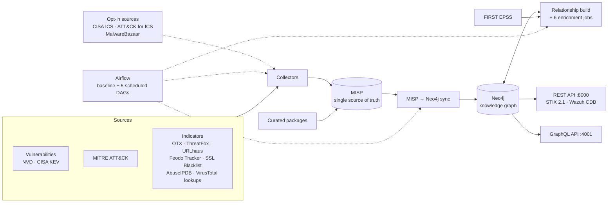

<p align="center">
  
</p>

<h1 align="center">EdgeGuard Knowledge Graph</h1>

<p align="center">
  <strong>Graph-Augmented xAI for Threat Intelligence on Edge Infrastructure</strong>
</p>

<p align="center">
  <a href="https://github.com/Kopanov/EdgeGuard-Knowledge-Graph/actions/workflows/ci.yml?query=branch%3Amain"></a>
  <a href="pyproject.toml"></a>
  
  <a href="LICENSE"></a>
</p>

<p align="center">
  <em>This project has received funding through the <strong>ResilMesh Open Call 2</strong>,<br>
  supported by the European Union's Horizon Europe research and innovation programme.</em>
</p>

<p align="center">
  <a href="#quick-start">Quick start</a> ·
  <a href="#running-the-730-day-baseline">730-day baseline</a> ·
  <a href="#interfaces">Interfaces</a> ·
  <a href="#operations">Operations</a> ·
  <a href="#configuration">Configuration</a> ·
  <a href="#documentation">Documentation</a>
</p>

---

## Overview

EdgeGuard Knowledge Graph collects public threat intelligence (ten sources by default and three opt-in, plus FIRST EPSS scores), stores every collected record in MISP as the single source of truth, and builds from it a Neo4j knowledge graph that links CVEs, indicators, threat actors, malware, tools, ATT&CK techniques and campaigns, labelled by sector (healthcare, energy, finance, global). Every node and relationship built from a source names the sources and MISP events behind it, and every linking relationship carries its match type and confidence. The graph is served through a REST API with STIX 2.1 and Wazuh CDB exports and a GraphQL API on port 4001, and its CVE and CVSS nodes follow the ResilMesh/CRUSOE data model. It is the first module of the EdgeGuard framework for graph-augmented explainable AI on edge infrastructure.

### What it does

- **Collects** vulnerabilities, ATT&CK data and indicators from external sources ([Sources](#sources)).
- **Stages** every collected record in MISP, tagged with its source, sector, TLP level and confidence.
- **Builds** the Neo4j graph from MISP and links it on exact keys: actors, malware and tools to techniques, indicators to malware and CVEs, everything to its sectors.
- **Enriches** the graph after every sync: indicator aging, actor merges (ATT&CK aliases and a shipped canonical threat-actor reference), ATT&CK malware twin merges, campaigns, the Vulnerability–CVE bridge and FIRST EPSS scores.
- **Serves** it through REST and GraphQL, and **exports** STIX 2.1 bundles and Wazuh CDB lists.
- **Imports** curated claim packages through MISP, so they carry the same provenance as the feeds.

### Two operating modes

- **Baseline** (manual): a full historical load, 730 days by default (`edgeguard baseline --days N`, `EDGEGUARD_BASELINE_DAYS` or the Airflow Variable `BASELINE_DAYS`), with no item cap per source. CISA KEV is taken whole, and NVD also fetches the record of every KEV CVE whatever its age.
- **Incremental** (Airflow schedules): each collector reads what changed since its cursor or its feed's current window, with its own per-run rule, and the MISP → Neo4j sync runs every 72 hours. Which limit applies where: [docs/COLLECTION_AND_SYNC_LIMITS.md](docs/COLLECTION_AND_SYNC_LIMITS.md).

### Who uses it

SOC teams, sector analysts (healthcare, energy, finance) and ResilMesh deployments that consume sector-labelled threat intelligence through REST, GraphQL, STIX 2.1 or Wazuh CDB lists. EdgeGuard supplies the intelligence; detection is done by the consumer, for example by Wazuh rules over the CDB lists.

---

## Architecture



Dashed arrows: opt-in sources and Airflow scheduling. MISP is not part of the EdgeGuard stack; you point `MISP_URL` at an existing instance.

**Design principles**

1. **MISP is the single source of truth for collected data.** Every collector writes to MISP, and the MISP → Neo4j sync builds the graph from it, so the graph can be rebuilt from MISP. FIRST EPSS scores are written to existing `CVE` nodes directly, and campaigns and merged nodes are derived in the graph by the enrichment jobs.
2. **Deterministic linking.** Nodes merge on agreed keys and links are built on exact identifiers (CVE ids, ATT&CK ids, canonical names); there is no fuzzy or substring matching, and items are paired only within one source report (an OTX pulse), never for sharing a MISP event. Rules: [docs/DATA_QUALITY.md](docs/DATA_QUALITY.md), [docs/KNOWLEDGE_GRAPH.md](docs/KNOWLEDGE_GRAPH.md).
3. **Provenance on every source-built node and link.** Relationships carry `sources[]`, `source_refs[]` and `misp_event_ids[]`; linking relationships also carry `match_type` and `confidence_score` ([Provenance](#provenance)).
4. **A shared database with ResilMesh.** Nodes EdgeGuard creates carry `edgeguard_managed = true`, and partner nodes it writes to carry `edgeguard_enriched = true`. `CVE` and its CVSS sub-nodes follow the ResilMesh/CRUSOE schema, the threat-intelligence labels are EdgeGuard extensions, and `Vulnerability`, `Host` and `SoftwareVersion` belong to ResilMesh; `REFERS_TO` links a ResilMesh `Vulnerability` to its `CVE` ([docs/RESILMESH_INTEROPERABILITY.md](docs/RESILMESH_INTEROPERABILITY.md)).

Component detail: [docs/ARCHITECTURE.md](docs/ARCHITECTURE.md) and the diagrams in [docs/ARCHITECTURE_DIAGRAMS.md](docs/ARCHITECTURE_DIAGRAMS.md).

---

## Knowledge graph

### Sources

| Group | Source | Provides | Default |
|---|---|---|---|
| Vulnerabilities | NVD | CVEs, CVSS v2 to v4.0, CISA SSVC | on |
| | CISA KEV | Known-exploited CVEs | on |
| | CISA ICS advisories | ICS CVEs with the sectors CISA names | opt-in |
| | FIRST EPSS | Exploitation score and percentile per CVE | on |
| ATT&CK | MITRE ATT&CK Enterprise | Techniques, tactics, groups, software | on |
| | MITRE ATT&CK for ICS | ICS techniques and tactics | opt-in |
| Indicators | AlienVault OTX | Pulses: indicators, actors, malware, CVEs | on, key |
| | ThreatFox | Indicators with malware family | on, key |
| | URLhaus | Malicious URLs | on, key |
| | Feodo Tracker | Botnet C2 servers | on |
| | SSL Blacklist | Malicious certificate fingerprints | on |
| | AbuseIPDB | IP blacklist with abuse score | on, key |
| | MalwareBazaar | SHA-256 of recent samples with family | opt-in, key |
| | VirusTotal | Lookups of hashes already in MISP | on, key |
| Curated | Curated packages | Claims about actors and malware | on demand |

- **Keys.** A source marked "key" is skipped while its key is missing (`OTX_API_KEY`, `THREATFOX_API_KEY` for ThreatFox, URLhaus and MalwareBazaar, `ABUSEIPDB_API_KEY`, `VIRUSTOTAL_API_KEY`). NVD works without `NVD_API_KEY` at a lower request rate. `edgeguard preflight` and the baseline ask each provider whether it accepts the configured key. How to obtain each key: [docs/API_KEYS_SETUP.md](docs/API_KEYS_SETUP.md).
- **History per source.** A baseline reaches back 730 days wherever the source's API does. ThreatFox's API returns at most the last 7 days, URLhaus its recent export (about 63,000 URLs on 2026-10-24), MalwareBazaar's export the last 48 hours and AbuseIPDB its current blacklist; ATT&CK has no time window.
- **VirusTotal.** The free tier allows lookups only (4 per minute, 500 per day). EdgeGuard looks up the hashes already in MISP within a daily budget of 400 lookups and 60 per run; it scans and uploads nothing.
- **Feodo Tracker.** A baseline loads the complete C2 history; the daily runs read the list of the last 30 days, and the collector logs a warning when the feed's own header is older than 7 days ([docs/COLLECTORS.md § 7](docs/COLLECTORS.md#7-finance-feed-collector)).
- **Placeholders.** The energy and healthcare sector modules are placeholders that no DAG task runs; member-only ISAC feeds are not collected. Sector labels come from keyword detection in every collector, from the industries an OTX pulse names and, with CISA ICS enabled, from the sectors CISA names.
- **FIRST EPSS** is not collected into MISP: the last enrichment job writes the day's scores to the `CVE` nodes that exist.
- **Curated packages** are imported through MISP with `scripts/import_curated_package.py` after the baseline, and again after every fresh baseline, whose wipe deletes their MISP event; their claims attach to nodes that already exist ([docs/RUNBOOK.md § Importing a curated package](docs/RUNBOOK.md#importing-a-curated-package)).
- **Opt-in sources** are switched on with flags ([Configuration](#configuration)).

Per-source detail: [docs/DATA_SOURCES.md](docs/DATA_SOURCES.md) and [docs/COLLECTORS.md](docs/COLLECTORS.md).

### Graph model

- **Nodes:** `Indicator`, `CVE` (with the CVSS sub-nodes `CVSSv2`, `CVSSv30`, `CVSSv31`, `CVSSv40`), `Malware`, `ThreatActor`, `Tool`, `Technique`, `Tactic`, `Campaign`, `Sector` and `Source`. `Vulnerability` is ResilMesh's label, bridged to `CVE` by `REFERS_TO`.
- **Relationships:** attribution and use (`ATTRIBUTED_TO`, `USES_MALWARE`, `USES_TOOL`), techniques (`EMPLOYS_TECHNIQUE` for actors, `IMPLEMENTS_TECHNIQUE` for malware and tools, `USES_TECHNIQUE` for an indicator's report, `IN_TACTIC`, `SUBTECHNIQUE_OF`), indicators (`INDICATES`, `EXPLOITS`), sectors (`TARGETS`, `AFFECTS`), campaigns (`RUNS`, `PART_OF_CAMPAIGN`), CVSS (`HAS_CVSS_*`) and provenance (`SOURCED_FROM`).
- **Sectors:** every item carries one or more sectors in its `zone` list (for example `['finance', 'healthcare']`), nodes also carry the sector as a label (`:Healthcare`, `:Energy`, `:Finance`), and sector links say whether the source stated the sector or keyword detection assigned it.
- **Enrichment jobs** run after every sync and after the baseline, in this order:
  1. Vulnerability–CVE bridge: `REFERS_TO` between a ResilMesh `Vulnerability` and its `CVE`.
  2. Actor alias merge: folds a duplicate actor into its canonical actor (ATT&CK aliases and the canonical threat-actor reference).
  3. Malware twin merge: folds a malware node named after an ATT&CK software id into the ATT&CK node.
  4. Indicator aging: confidence decays from the latest report; an indicator is retired after 730 days without one.
  5. Campaign builder: campaigns from actor → malware → indicator chains.
  6. FIRST EPSS: the day's score and percentile on existing `CVE` nodes.

Schema and rules: [docs/KNOWLEDGE_GRAPH.md](docs/KNOWLEDGE_GRAPH.md); Cypher specification: [docs/TECHNICAL_SPEC.md](docs/TECHNICAL_SPEC.md).

### Provenance

Every node built from MISP keeps three back-pointers to its raw evidence:

| Back-pointer | Field | MISP call |
|---|---|---|
| Attribute | `n.misp_attribute_ids[]` | `GET /attributes/<uuid>` |
| Event | `n.misp_event_ids[]` | `GET /events/<id>` |
| Source record | `raw_data` on the `SOURCED_FROM` edge | none (stored in Neo4j) |

`n.uuid` is not a MISP key: it is a deterministic UUIDv5 that keeps a node's identity across environments and matches its STIX id. Each `SOURCED_FROM` edge also names its source's MISP events and record ids, and the GraphQL `Indicator` type returns ready-made MISP links (`mispAttributeUrls`, `mispEventUrls`).

```cypher
MATCH (i:Indicator) WHERE i.value = '203.0.113.5'
RETURN i.misp_attribute_ids, i.misp_event_ids;
```

```bash
curl -H "Authorization: $MISP_API_KEY" -H "Accept: application/json" \
     "$MISP_URL/attributes/<uuid-from-query-above>"
```

Every retrieval path and its coverage per label: [docs/RUNBOOK.md § Retrieving raw MISP data from a Neo4j node](docs/RUNBOOK.md#retrieving-raw-misp-data-from-a-neo4j-node).

---

## Interfaces

| Interface | Address | Use |
|---|---|---|
| REST API | `127.0.0.1:8000` | Sector queries, indicator search, actor summaries |
| STIX 2.1 export | REST `/stix/export/…` | Bundles around an indicator, actor, technique or CVE |
| Wazuh CDB export | REST `/export/wazuh/cdb` | Indicator and CVE lists for Wazuh rules |
| GraphQL API | `127.0.0.1:4001` | CVEs, indicators, actors, malware, tools, techniques, campaigns |
| Neo4j | `127.0.0.1:7474`, `:7687` | Browser and Bolt, shared with ResilMesh |
| Metrics | `127.0.0.1:8001` | Prometheus endpoint of the pipeline |
| Graph Explorer | served by hand | Browser views of the graph |
| CLI | `edgeguard` | Readiness checks, statistics, baseline triggers |

- **Authentication.** REST and GraphQL require the `X-API-Key` header with `EDGEGUARD_API_KEY`; `GET /health` is public and answers 503 while Neo4j is degraded.
- **Exposure.** Docker Compose publishes every port on host loopback (127.0.0.1) only, and the repository ships no TLS endpoint. For access from other hosts, put a TLS reverse proxy in front of the APIs; behind a proxy every client shares the proxy's address, and so one rate limit.
- **GraphQL schema.** The GraphQL API runs on port 4001, the port ResilMesh's ISIM uses, and its CVE and CVSS types follow the ISIM data model. The schema itself is EdgeGuard's own (camelCase fields, `filter` inputs), so a client written for ISIM's schema adapts its queries ([docs/RESILMESH_INTEROPERABILITY.md § 8.2](docs/RESILMESH_INTEROPERABILITY.md#82-preferred-access-method--isim-graphql)).
- **Alert enrichment over NATS.** `src/alert_processor.py` and `src/nats_client.py` are library code for ResilMesh alerts; the stack runs no NATS consumer ([docs/RESILMESH_INTEGRATION_GUIDE.md](docs/RESILMESH_INTEGRATION_GUIDE.md)).

Endpoint reference: [docs/TECHNICAL_SPEC.md § API Endpoints](docs/TECHNICAL_SPEC.md#api-endpoints).

### GraphQL example

```graphql
# Example: critical vulnerabilities in healthcare sector (the CVE nodes, highest score first)
query {
  vulnerabilities(filter: { zone: "healthcare", minCvss: 9.0 }) {
    cveId description status severity cvssScore cvssVersion published tlp
  }
}
```

```bash
curl -s -H "X-API-Key: $EDGEGUARD_API_KEY" -H "Content-Type: application/json" \
     -d '{"query": "{ vulnerabilities(filter: {zone: \"healthcare\", minCvss: 9.0}) { cveId cvssScore } }"}' \
     http://localhost:4001/graphql
```

The root fields are `cve`, `vulnerabilities`, `indicators`, `threatActors`, `malware`, `tools`, `techniques`, `tactics` and `campaigns`; every type carries its node's `tlp`. GraphiQL is served only with `EDGEGUARD_GRAPHQL_PLAYGROUND=true`.

### STIX 2.1 example

```bash
curl -s -H "X-API-Key: $EDGEGUARD_API_KEY" \
     "http://localhost:8000/stix/export/actor/APT28"
```

The export returns a deterministic STIX 2.1 bundle (strict `stix2.parse`): every relationship keeps its provenance, the EdgeGuard extension definition declares the `x_edgeguard_*` properties, and TLP markings come from the graph. Guide for consumers: [docs/RESILMESH_QUICKSTART_STIX.md](docs/RESILMESH_QUICKSTART_STIX.md).

### Graph Explorer

`docs/visualization.html` draws the graph from `GET /graph/explore` with Cytoscape.js, loaded from a CDN, in four views: malware, actors, indicators and CVEs. The page must be served from an origin in the APIs' CORS allowlist (`EDGEGUARD_CORS_ORIGINS`, default `http://localhost,http://localhost:3000`); a file opened from disk is refused:

```bash
python3 -m http.server 3000 --bind 127.0.0.1 --directory docs
```

Open `http://localhost:3000/visualization.html`, enter the API URL (`http://localhost:8000`) and your API key. While the monitoring stack runs, Grafana holds port 3000: serve `docs/` with `python3 -m http.server 3001 --bind 127.0.0.1 --directory docs`, append `http://localhost:3001` to `EDGEGUARD_CORS_ORIGINS` in `.env` and recreate the APIs with `docker compose up -d api graphql`. Detail: [docs/GRAPH_EXPLORER.md](docs/GRAPH_EXPLORER.md).

---

## Quick start

### Prerequisites

- **A reachable MISP instance and its API key.** EdgeGuard does not ship MISP; the containers must reach `MISP_URL`. Large baselines need raised PHP and MySQL limits on the MISP server ([docs/MISP_TUNING.md](docs/MISP_TUNING.md)).
- **Docker with Compose v2** (`docker compose`). The stack runs Neo4j with APOC, Airflow with its PostgreSQL, the metrics service, the REST API and the GraphQL API.
- **Host memory.** 16 GB is enough only for a short smoke test with lowered memory limits. A 730-day baseline needs the 730-day memory profile ([Steps](#steps), step 1) and about 48 GB of host RAM, more when MISP runs on the same host ([docs/MEMORY_TUNING.md](docs/MEMORY_TUNING.md)).
- **Host-side tools.** `scripts/preflight_baseline.sh`, `edgeguard baseline`, `edgeguard fresh-baseline` and `edgeguard doctor --memory` run on the Compose host and need Python 3.12 or later with the project installed in the repository's `.venv`. `./install.sh --python` creates it; it starts no container and leaves the running stack as it is.

Without Docker, Python 3.12 or later with Neo4j and APOC works too: [docs/SETUP_GUIDE.md § 4](docs/SETUP_GUIDE.md#4-path-b--python--venv-no-docker); conda and edge devices: [docs/ENVIRONMENTS.md](docs/ENVIRONMENTS.md).

### Install

```bash
git clone https://github.com/Kopanov/EdgeGuard-Knowledge-Graph.git
cd EdgeGuard-Knowledge-Graph
./install.sh
```

`./install.sh` checks Docker and Compose v2, creates `.env` from `.env.example` (mode 600), generates the secrets that are blank, records the deployed commit, builds the images, runs `docker compose up -d` and waits for the services to become healthy. The REST and GraphQL services exit at start while `MISP_API_KEY` is empty or the template placeholder: set it, and `MISP_URL` to an address the containers reach, then run `docker compose up -d`.

### Configure

Edit `.env`:

| Variable | Set by | Purpose |
|---|---|---|
| `MISP_URL` | you | Base URL of your MISP, reachable from the containers |
| `MISP_API_KEY` | you | MISP automation key |
| `NEO4J_PASSWORD` | `install.sh` | Neo4j password (Neo4j keeps the one of its first start) |
| `EDGEGUARD_API_KEY` | `install.sh` | Key the REST and GraphQL APIs require |
| `AIRFLOW_API_AUTH_JWT_SECRET` | `install.sh` | Signing secret of the Airflow API server |
| `AIRFLOW_FERNET_KEY` | `install.sh` | Encryption key of Airflow's stored secrets |
| `GRAFANA_ADMIN_PASSWORD` | `install.sh` | Grafana admin password |
| Source keys | you, optional | `OTX_API_KEY`, `THREATFOX_API_KEY`, and others |
| `EDGEGUARD_ENV` | you, optional | Unset means production |

- `install.sh` never replaces a value you set. It generates `NEO4J_PASSWORD` only before Neo4j's first start, and `GRAFANA_ADMIN_PASSWORD` only when it creates `.env` itself.
- `EDGEGUARD_ENV` unset, empty or any value other than `dev`, `development`, `local`, `staging` or `test` counts as production: the APIs then refuse to start without `EDGEGUARD_API_KEY`.
- Apply a change with `docker compose up -d`; a plain `docker compose restart` keeps the old values.

Every setting: [docs/CONFIGURATION.md](docs/CONFIGURATION.md).

### Verify

The CLI reads its settings from the environment, not from `.env`. On the Docker install, run it in the `airflow` container, which receives the settings Compose forwards:

```bash
docker compose ps
docker compose exec airflow python /opt/airflow/src/edgeguard.py preflight
docker compose exec airflow python /opt/airflow/src/edgeguard.py doctor
curl -s http://localhost:8000/health
```

`preflight` checks the settings and source keys, Neo4j and APOC, MISP, Airflow, disk space and checkpoints, and exits 1 when a check fails; `doctor` diagnoses connectivity, the Neo4j schema and version compatibility; the memory check runs on the host ([Backup and sizing](#backup-and-sizing)). From a host shell, export the settings first and use the published ports:

```bash
set -a; . ./.env; set +a
export NEO4J_URI=bolt://localhost:7687
```

Host-shell detail (the Airflow API password, a `MISP_URL` that names a container): [docs/SETUP_GUIDE.md § 3.6](docs/SETUP_GUIDE.md#36-verify-connectivity). Every command: [docs/CLI.md](docs/CLI.md).

### Services and ports

```
Neo4j Browser        →  http://localhost:7474
Neo4j Bolt           →  bolt://localhost:7687
Airflow UI           →  http://localhost:8082   (8082 avoids ResilMesh Temporal on 8080)
REST API             →  http://localhost:8000/health
GraphQL API          →  http://localhost:4001/graphql
Metrics endpoint     →  http://localhost:8001/metrics
airflow_postgres     →  Airflow metadata database (Docker network only)
```

Every port is published on 127.0.0.1. The first Airflow login is `admin`; its password is in `docker compose logs airflow` after the first start, and afterwards in the file the Simple auth manager generates:

```bash
docker compose exec airflow cat /opt/airflow/simple_auth_manager_passwords.json.generated
```

The Graph Explorer is served by hand ([Graph Explorer](#graph-explorer)), and the monitoring stack is started separately ([Monitoring](#monitoring)).

### Update

```bash
./install.sh --update
```

It pulls the branch (fast-forward only), records the commit in `.env` as `EDGEGUARD_GIT_SHA` with `scripts/record_deployed_commit.sh`, rebuilds the images and starts the stack; both `/health` responses report the commit as `git_sha`. Run it only while no baseline runs, because recreating the `airflow` container stops its tasks. The manual equivalent, which rebuilds every image and recreates every container:

```bash
git pull --ff-only
scripts/record_deployed_commit.sh
docker compose build && docker compose up -d --force-recreate
```

Rebuilding only the Airflow image leaves REST, GraphQL and STIX on the old code, because the `api` and `graphql` images contain `src/`.

### First query

The graph stays empty until a baseline or the scheduled DAGs fill it. Read the [baseline procedure](#running-the-730-day-baseline) before you trigger the first baseline, or start with a 7-day smoke baseline ([docs/BASELINE_SMOKE_TEST.md](docs/BASELINE_SMOKE_TEST.md)). Then:

```bash
set -a; . ./.env; set +a
curl -s -H "X-API-Key: $EDGEGUARD_API_KEY" "http://localhost:8000/indicators?zone=healthcare&limit=5"
```

---

## Running the 730-day baseline

The baseline loads about two years of history in one run of the `edgeguard_baseline` DAG, which may take up to 32 hours (its `dagrun_timeout`). The DAG runs `misp_health_check`, `source_key_check`, `baseline_acquire_lock`, `baseline_clean`, `baseline_start`, the collector groups `tier1_core` and `tier2_feeds`, `full_neo4j_sync`, `build_relationships`, `run_enrichment_jobs`, `baseline_postcheck`, `baseline_complete` and `baseline_release_lock`.

### How the baseline lock protects the run

The `edgeguard_baseline` DAG holds a lock for the whole run: the `baseline_acquire_lock` task writes `checkpoints/baseline_in_progress.lock`, with the DAG run as holder, before the destructive `baseline_clean` step, and `baseline_release_lock` removes it after a successful run. The in-process `python src/run_pipeline.py --baseline` takes the same lock, so every launch path is protected.

- While the lock is held, the five scheduled DAGs skip at task start: a collector task succeeds with `skipped: true` (a green task, reason `baseline_in_progress`), and every writing task of `edgeguard_neo4j_sync` skips.
- A failed run keeps the lock, so clearing the failed task resumes under it. A refusal of `baseline_clean` before the wipe (a misspelt `fresh_baseline` key, an invalid `wipe_scope`, the backup gate) releases it, so the corrected trigger is not refused.
- The lock ends with a successful run, after `EDGEGUARD_BASELINE_LOCK_MAX_AGE_SEC` (48 hours by default, above the 32-hour run limit) or when the operator removes the file. The scheduled DAGs read the holder's run state through the Airflow REST API and fall back to the file's age.
- Pausing the scheduled DAGs first is optional. It is recommended before a fresh baseline, because a scheduled task that is already running when the lock is taken completes its current write.

Full lock semantics: [docs/RUNBOOK.md § Baseline-day protocol](docs/RUNBOOK.md#baseline-day-protocol).

### Additive or fresh baseline

| Mode | Neo4j and MISP | Backup gate |
|---|---|---|
| Additive | Kept; the baseline adds to them | Not applied |
| Fresh | EdgeGuard data deleted, then reloaded | Applied |

- A fresh baseline deletes the EdgeGuard-managed nodes in Neo4j (every node with `--wipe-all`), the EdgeGuard events in MISP and the collector checkpoints. Nodes a partner created stay, so a database shared with ResilMesh keeps its data.
- The backup gate refuses a wipe of non-empty stores unless `EDGEGUARD_LAST_BACKUP_AT` records a backup within `EDGEGUARD_BACKUP_MAX_AGE_HOURS` (240 hours by default). Its bypasses are explicit and logged (`--skip-backup-check`, or `skip_backup_check: true` in the DAG run configuration); an empty Neo4j and MISP need no backup. Backup and restore: [docs/BACKUP.md](docs/BACKUP.md).
- `edgeguard baseline --days N` and `edgeguard fresh-baseline --days N` trigger the same DAG from the Compose host; `fresh-baseline` shows what it would delete, asks for a typed confirmation and runs the backup gate first.
- Before a fresh baseline, deploy the current commit, keep MISP's default Import Regexp rules, take a snapshot, and start with the opt-in sources off, enabling them one at a time afterwards: [docs/BASELINE_LAUNCH_CHECKLIST.md § 6](docs/BASELINE_LAUNCH_CHECKLIST.md#6-fresh-baseline-deploy-misp-import-rule-flags-re-feed).

### Steps

**1. Size the stack.** Set the 730-day memory profile in `.env`:

```bash
NEO4J_HEAP_INITIAL=12g
NEO4J_HEAP_MAX=12g
NEO4J_PAGECACHE=8g
NEO4J_TX_MEMORY_MAX=8g
NEO4J_CONTAINER_MEMORY_LIMIT=32g
```

Run `docker compose up -d` to recreate the services with these values, apply the MISP server settings for large events ([docs/MISP_TUNING.md](docs/MISP_TUNING.md)), and start the monitoring stack with `make monitoring` ([Monitoring](#monitoring)), so Prometheus watches the run. The reasoning behind each value: [docs/MEMORY_TUNING.md § 730-day baseline profile](docs/MEMORY_TUNING.md#730-day-baseline-profile).

**2. Preflight.** From a host shell in the repository directory, with the settings exported:

```bash
set -a; . ./.env; set +a
./scripts/preflight_baseline.sh --launch-path=dag
```

It runs checks `[1]` to `[12]`: settings, Neo4j and APOC, MISP, the pause state of the scheduled DAGs, worker memory, the alert rules and the Alertmanager wiring, a leftover lock, the operations-only switches, the test collection, the baseline invariants in the code, and whether each provider accepts its source key. Exit 0 means ready; on exit 1, fix the items marked ✗. Check by check: [docs/BASELINE_LAUNCH_CHECKLIST.md](docs/BASELINE_LAUNCH_CHECKLIST.md).

- Checks `[10]` to `[12]` use the repository's `.venv` ([Prerequisites](#prerequisites)). Without it, check `[11]` reports the three critical-chain tasks as missing `retries=0`, the test-collection check `[10]` is skipped, and the source-key check `[12]` falls back to the system `python3`.
- With the shipped `prometheus/alertmanager.yml`, check `[7b]` fails until its PagerDuty `service_key` is rendered with a real key or the PagerDuty receiver is removed ([docs/PROMETHEUS_SETUP.md](docs/PROMETHEUS_SETUP.md#alertmanager-notifications)).

**3. Launch.** After a smoke test, remove `EDGEGUARD_BASELINE_DAYS` and `EDGEGUARD_BASELINE_COLLECTION_LIMIT` from `.env` and run `docker compose up -d airflow` first: a trigger without a run configuration takes the window and the item limit from them. Optionally pause the five scheduled DAGs, trigger the baseline, and unpause them once its `baseline_complete` task has succeeded:

```bash
# 1. Pause the five scheduled DAGs (optional; recommended before a fresh baseline)
for dag in edgeguard_daily edgeguard_medium_freq edgeguard_pipeline edgeguard_low_freq edgeguard_neo4j_sync; do
  docker compose exec airflow airflow dags pause "$dag"
done

# 2. Trigger the baseline (additive)
docker compose exec airflow airflow dags trigger edgeguard_baseline
#    or a fresh baseline:
#    docker compose exec airflow airflow dags trigger edgeguard_baseline --conf '{"fresh_baseline": true}'

# 3. After baseline_complete has succeeded (Airflow UI), unpause them
for dag in edgeguard_daily edgeguard_medium_freq edgeguard_pipeline edgeguard_low_freq edgeguard_neo4j_sync; do
  docker compose exec airflow airflow dags unpause "$dag"
done
```

For a fresh baseline triggered this way, set `EDGEGUARD_LAST_BACKUP_AT` in `.env` and run `docker compose up -d airflow` first, unless Neo4j and MISP are empty. The run configuration also takes `baseline_days` and `wipe_scope` ([docs/AIRFLOW_DAGS.md](docs/AIRFLOW_DAGS.md)).

**4. Monitor.** Watch the `edgeguard` alert groups in Prometheus at `http://localhost:9090` (39 alert rules across 9 groups in `prometheus/alerts.yml`), above all `edgeguard_pipeline_observability` and the MISP fetch-fallback pair in `edgeguard_sync_integrity`. On a critical alert, pause the DAG, triage, then resume. Logs:

```bash
docker logs edgeguard_airflow 2>&1 --follow | grep -vE 'DEBUG|INFO'
```

The log tokens of silent failures (`[MERGE-REJECT]`, `[BATCH-PERMANENT-FAILURE]`, `[MISP-FETCH-FALLBACK-ACTIVE]` and others) are explained in [docs/RUNBOOK.md § Top 8 failure modes](docs/RUNBOOK.md#top-8-failure-modes).

**5. Validate.** Run the post-run Cypher queries of [docs/RUNBOOK.md § After the run](docs/RUNBOOK.md#after-the-run), then the acceptance script against Neo4j's HTTP API. It reads the Compose Neo4j at `http://127.0.0.1:7474`; for another instance set `NEO4J_HTTP_URL` ([docs/CONFIGURATION.md](docs/CONFIGURATION.md#neo4j-connection-and-memory)):

```bash
set -a; . ./.env; set +a
python3 scripts/verify_fresh_baseline.py
```

Exit 0 means every mandatory check passed. After a baseline with CISA ICS enabled add `--require-cisa-ics`, and after one that collected OTX add `--require-otx-industries`.

---

## Operations

### Scheduled DAGs

| DAG | Schedule (UTC) | Work |
|---|---|---|
| `edgeguard_pipeline` | Every 30 minutes | OTX |
| `edgeguard_medium_freq` | Every 4 hours | CISA KEV, VirusTotal lookups |
| `edgeguard_low_freq` | Every 8 hours | NVD |
| `edgeguard_daily` | 02:00 daily | ATT&CK, AbuseIPDB and the abuse.ch feeds |
| `edgeguard_neo4j_sync` | Every 72 hours | MISP → Neo4j sync, relationships, enrichment |
| `edgeguard_baseline` | Manual | Full historical load |

- Airflow registers the five scheduled DAGs paused. Unpause them after the first baseline's `baseline_complete` task has succeeded; while a baseline holds the lock they skip.
- `edgeguard_daily` runs ATT&CK, AbuseIPDB, ThreatFox, URLhaus, Feodo Tracker and SSL Blacklist, plus CISA ICS and MalwareBazaar when they are enabled.
- Every collector task runs in the Airflow pool `edgeguard_collectors` (4 slots, `EDGEGUARD_COLLECTOR_POOL_SLOTS`), which the Compose `airflow` service creates at every start.

Task chains, run configuration and troubleshooting: [docs/AIRFLOW_DAGS.md](docs/AIRFLOW_DAGS.md).

### CLI

On the Docker install, run a command in the `airflow` container; after a pip install, `edgeguard` is on the path:

```bash
docker compose exec airflow python /opt/airflow/src/edgeguard.py <command>
```

| Command | Purpose |
|---|---|
| `preflight` | Readiness check; exit 0 when ready |
| `doctor` | Connectivity, schema and version diagnosis |
| `stats` | Node counts and the last sync |
| `dag status` | Airflow DAG run states |
| `checkpoint status` | Baseline progress and incremental cursors |
| `baseline --days N` | Trigger an additive baseline |
| `fresh-baseline --days N` | Trigger a destructive baseline |
| `version` | Release version and commit |

`baseline` and `fresh-baseline` run on the Compose host, because they trigger the DAG through `docker compose exec`. Every command, flag and caveat: [docs/CLI.md](docs/CLI.md).

### Monitoring

```bash
make monitoring
```

This starts Prometheus (`http://localhost:9090`) and Grafana (`http://localhost:3000`, user `admin`, password `GRAFANA_ADMIN_PASSWORD`) in the same Compose project, so Prometheus scrapes the `metrics` service. Alertmanager (`http://localhost:9093`) starts only with the `alerts` profile:

```bash
docker compose -f docker-compose.yml -f docker-compose.monitoring.yml --profile alerts up -d
```

The alert rules in `prometheus/alerts.yml` cover staleness and stuck runs per DAG, MISP and Neo4j write failures and the sync's MISP fetch. Once `prometheus/secrets/slack_api_url` holds a webhook URL, Slack receives the critical alerts and the collector alerts, PagerDuty the circuit-breaker alerts, and the default e-mail receiver every other alert. The e-mail and PagerDuty receivers are placeholders, so the alerts routed only to them reach no one until they are configured. Setup and the metric list: [docs/PROMETHEUS_SETUP.md](docs/PROMETHEUS_SETUP.md).

### Backup and sizing

- Backup and restore of Neo4j and MISP, and the backup gate: [docs/BACKUP.md](docs/BACKUP.md).
- Neo4j and host memory are checked with `edgeguard doctor --memory`, run with the pip-installed CLI on the Compose host from the repository directory: it reads the `neo4j` container's settings through `docker compose exec`, which the `airflow` container cannot run. The Airflow limit and the sizing: [docs/MEMORY_TUNING.md](docs/MEMORY_TUNING.md).
- MISP server settings for events with more than 50,000 attributes: [docs/MISP_TUNING.md](docs/MISP_TUNING.md).

---

## Configuration

All settings are environment variables. Docker Compose reads `.env` and forwards each setting to the services that use it (`x-common-env` and each service's `environment` in `docker-compose.yml`), so a value in `.env` reaches the containers only where Compose forwards it. A few values are fixed in `docker-compose.yml`, such as `NEO4J_URI=bolt://neo4j:7687` inside the stack and the API ports. Outside Docker, export the settings before you run any command (`set -a; . ./.env; set +a`).

**Optional sources**

| Flag | Default | Adds |
|---|---|---|
| `EDGEGUARD_ENABLE_CISA_ICS` | `false` | CISA ICS advisories with the sectors CISA names |
| `EDGEGUARD_ENABLE_MITRE_ICS` | `false` | MITRE ATT&CK for ICS |
| `EDGEGUARD_ENABLE_MALWAREBAZAAR` | `false` | MalwareBazaar sample hashes |
| `EDGEGUARD_ENABLE_EPSS` | `true` | FIRST EPSS scores on CVE nodes |

Set a flag in `.env` and run `docker compose up -d airflow`. On an existing graph, CISA ICS and ATT&CK for ICS load their history with an additive baseline (for ATT&CK for ICS, `MITRE_FORCE_REFETCH=true` for one daily run also works); MalwareBazaar builds up over the daily runs. `EDGEGUARD_COLLECT_SOURCES` limits collection to a comma-separated list of collectors.

**TLS.** `EDGEGUARD_SSL_VERIFY` (default `true`) controls certificate verification for MISP and the HTTPS feeds; set it to `false` only for a development MISP with a self-signed certificate. `true`, `1`, `yes` and `on` verify, `false`, `0`, `no` and `off` do not (case-insensitive); any other value keeps verification on and is reported in the log, by `edgeguard validate` and by the baseline preflight. Neo4j TLS is chosen by the `NEO4J_URI` scheme (`bolt+s://`, `bolt+ssc://`). A private CA goes into a bundle named by `REQUESTS_CA_BUNDLE` on a pip install; `docker-compose.yml` does not forward it.

| Topic | Document |
|---|---|
| Every setting, by area | [docs/CONFIGURATION.md](docs/CONFIGURATION.md) |
| Which limit applies where | [docs/COLLECTION_AND_SYNC_LIMITS.md](docs/COLLECTION_AND_SYNC_LIMITS.md) |
| Memory and host sizing | [docs/MEMORY_TUNING.md](docs/MEMORY_TUNING.md) |
| MISP server settings | [docs/MISP_TUNING.md](docs/MISP_TUNING.md) |
| Credentials and key rotation | [docs/SECRETS_MANAGEMENT.md](docs/SECRETS_MANAGEMENT.md) |

---

## Security and quality

### Security

- **API keys.** In production the REST and GraphQL APIs refuse to start without `EDGEGUARD_API_KEY`, which `./install.sh` generates; GraphQL introspection is then blocked, `/docs` and `/redoc` are off, and `/openapi.json` needs the key.
- **Loopback ports.** Every published port is bound to 127.0.0.1; external access goes through a TLS reverse proxy you provide.
- **Cypher injection.** Every Cypher value is a parameter; labels, relationship types and property names, which Cypher cannot parameterise, pass the allowlist validators `_validate_label`, `_validate_rel_type` and `_validate_prop_name`.
- **TLS verification** is on by default for MISP and every HTTPS source, and only a recognised "off" value of `EDGEGUARD_SSL_VERIFY` turns it off: a typo keeps it on. The CA bundle is `certifi`.
- **MISP trust boundary.** Source-stated timestamps are accepted only from the MISP organisations in `EDGEGUARD_TRUSTED_MISP_ORG_UUIDS` or `EDGEGUARD_TRUSTED_MISP_ORG_NAMES`; while both are empty, a startup warning and the gauge `edgeguard_misp_tag_impersonation_defense_disabled` report it ([docs/SECURITY_ROADMAP.md](docs/SECURITY_ROADMAP.md)).
- **Destructive operations.** A fresh baseline passes the backup gate, and the Neo4j wipes of a fresh baseline, of `edgeguard clear` and of `scripts/clear_neo4j.py` are recorded in `logs/destructive_ops.jsonl` and the counter `edgeguard_destructive_ops_total`.
- **Request limits.** Per-address rate limits (REST 60 per minute, admin queries 10, GraphQL 120), a request-body cap, and GraphQL depth and alias limits.
- **Secrets** live in the environment and `.env` (ignored by git); the images contain none.

### Quality

- **CI** (GitHub Actions) runs Ruff lint and format checks, Mypy on `src/` and `scripts/`, the unit tests with a 30% coverage floor, the Neo4j integration tests, both Docker image builds with Trivy scans, and `pip-audit`.
- **Documentation is pinned to the code** by tests: every `EDGEGUARD_*` variable, `src/*.py` path and container name in a `docker` command that the README, CONTRIBUTING or a page directly under `docs/` names must exist ([docs/ARCHITECTURE_FLOW.md](docs/ARCHITECTURE_FLOW.md)), and the README's launch commands and GraphQL example are checked by the test suite.
- **Acceptance.** `scripts/verify_fresh_baseline.py` checks a loaded graph: provenance on every source-built relationship, the sector evidence, the description sources and the indicator aging properties.
- **Resilience.** Circuit breakers guard the feed fetches and the sync's MISP and Neo4j connection checks; VirusTotal, AbuseIPDB, FIRST EPSS and the collectors' MISP writes have none ([docs/RESILIENCE_CONFIG.md](docs/RESILIENCE_CONFIG.md)). MISP pushes retry with backoff and adapt their batch size to large events.
- **Versions** are calendar versions (`YYYY.M.D`, [docs/VERSIONING.md](docs/VERSIONING.md)).

---

## Documentation

| I want to | Read |
|---|---|
| Install and connect MISP and Neo4j | [docs/SETUP_GUIDE.md](docs/SETUP_GUIDE.md) |
| Look up a setting | [docs/CONFIGURATION.md](docs/CONFIGURATION.md) |
| Look up a command | [docs/CLI.md](docs/CLI.md) |
| Run and debug the DAGs | [docs/AIRFLOW_DAGS.md](docs/AIRFLOW_DAGS.md) |
| Run a first short baseline | [docs/BASELINE_SMOKE_TEST.md](docs/BASELINE_SMOKE_TEST.md) |
| Prepare the 730-day baseline | [docs/BASELINE_LAUNCH_CHECKLIST.md](docs/BASELINE_LAUNCH_CHECKLIST.md) |
| Handle an alert or a failure | [docs/RUNBOOK.md](docs/RUNBOOK.md) |
| Understand the graph schema | [docs/KNOWLEDGE_GRAPH.md](docs/KNOWLEDGE_GRAPH.md) |
| Integrate with ResilMesh | [docs/RESILMESH_INTEROPERABILITY.md](docs/RESILMESH_INTEROPERABILITY.md) |
| Consume STIX 2.1 bundles | [docs/RESILMESH_QUICKSTART_STIX.md](docs/RESILMESH_QUICKSTART_STIX.md) |

Every document, by topic: [docs/README.md](docs/README.md).

---

## Project layout

```
EdgeGuard-Knowledge-Graph/
├── src/                     # Pipeline, sync, enrichment, APIs, CLI (edgeguard.py)
│   └── collectors/          # One module per source, and the MISP writer
├── dags/                    # Airflow DAGs (baseline, five schedules, metrics)
├── plugins/                 # Airflow listener plugin (DAG run in progress)
├── scripts/                 # Preflight, acceptance, curated import, wipe and deploy helpers
├── demo/                    # Alert enrichment demo
├── migrations/              # Historical schema migration notes
├── tests/                   # Pytest suite
├── docs/                    # Documentation (index: docs/README.md)
├── prometheus/, grafana/    # Alert rules, Alertmanager, dashboards
├── docker-compose.yml       # Neo4j, Airflow + PostgreSQL, metrics, REST, GraphQL
├── docker-compose.monitoring.yml  # Prometheus, Grafana, Alertmanager overlay
├── Dockerfile, Dockerfile.airflow # API image and Airflow image
├── install.sh, Makefile     # Installer and shortcuts
├── pyproject.toml           # Package, version, extras
└── .env.example             # Annotated settings template
```

Module map: [docs/ARCHITECTURE.md § Key Files](docs/ARCHITECTURE.md#key-files).

---

## Contributing

[CONTRIBUTING.md](CONTRIBUTING.md) has the checklist and the documentation rules. For a development install, run `./install.sh --python --dev`, then `source .venv/bin/activate` and `make ci` (lint, type check and tests).

## License and acknowledgements

MIT License; see [LICENSE](LICENSE).

EdgeGuard is developed by IICT-BAS and Ratio1 and financed by ResilMesh Open Call 2.

---

_Last updated: 2026-10-25_
