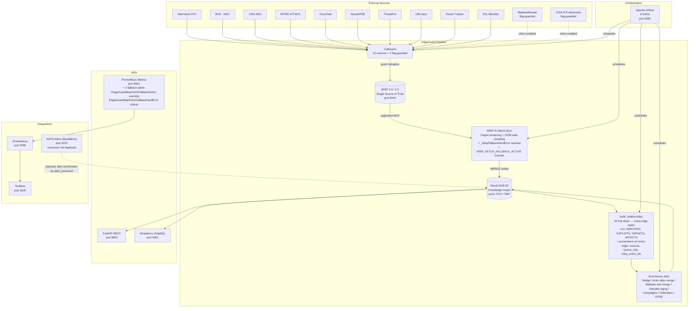
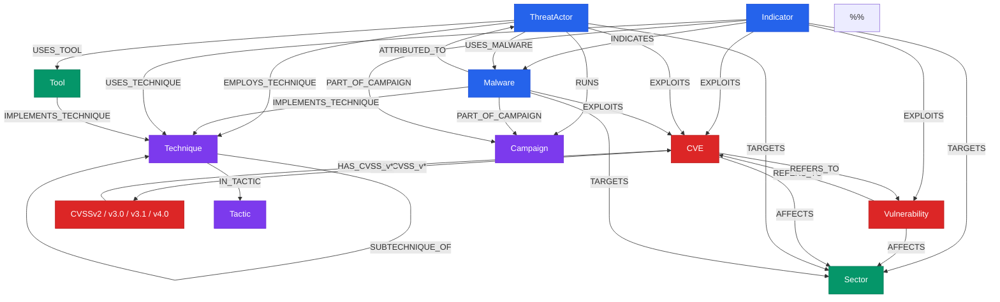
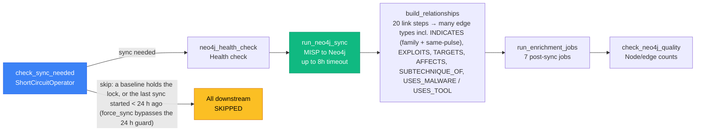
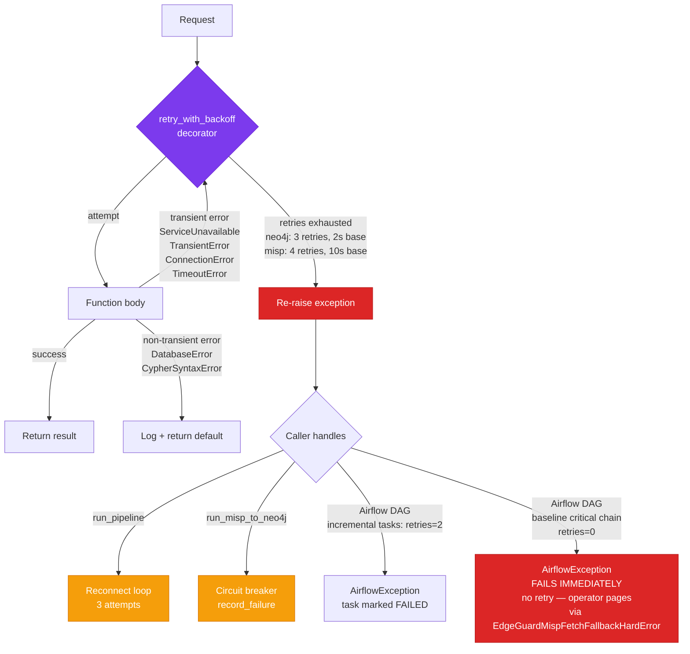
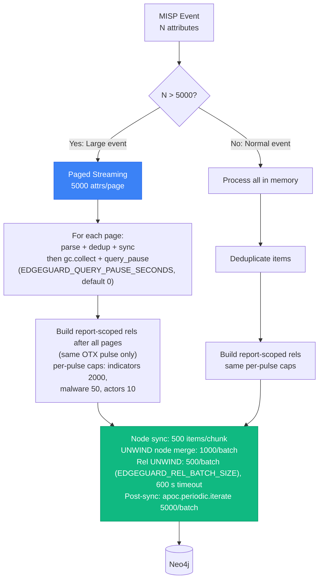
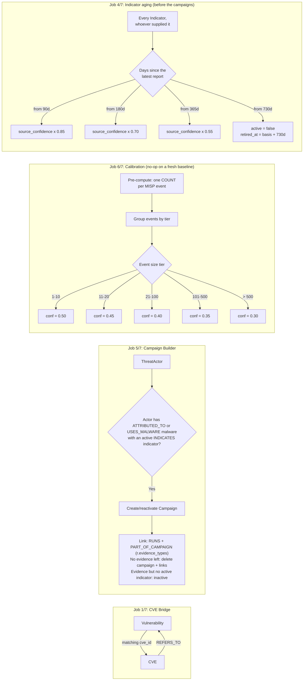

# EdgeGuard Knowledge Graph — Architecture Diagrams

> Graph-Augmented xAI for Threat Intelligence on Edge Infrastructure
> (IICT-BAS + Ratio1, funded by ResilMesh)

**Design philosophy:** Neo4j is the **linked intelligence layer** for fast graph queries and cross-source correlation. MISP holds the **ground truth** with full provenance, raw data, and audit trails. Every node in Neo4j traces back to its MISP source events via `misp_event_ids` and `SOURCED_FROM` relationships.

All diagrams are written in [Mermaid](https://mermaid.js.org/) and render natively on GitHub.
To export for papers: paste into [mermaid.live](https://mermaid.live) and download as PNG/SVG/PDF.

---

## 1. System Architecture Overview

---

## 2. Data Pipeline Flow

```mermaid
flowchart LR
    subgraph Step 2: Collection
        C1[OTX] --> MW[MISPWriter]
        C2[NVD] --> MW
        C3[CISA] --> MW
        C4[MITRE] --> MW
        C5["Others<br/>8 more (2 flag-guarded)"] --> MW
    end

    subgraph MISP
        MW -->|create events<br/>dedup attributes| MISP_DB[(MISP<br/>Events + Attributes)]
    end

    subgraph Step 3: Sync
        MISP_DB -->|paginated<br/>index fetch| FETCH[Fetch Events<br/>primary index: 500/page × 100 pages<br/>fallback PyMISP/restSearch: 500/page × 200 pages<br/>+ _MispFallbackHardError on cap-hit]
        FETCH --> PARSE[Parse Attributes<br/>per event]
        PARSE -->|< 5000 attrs| NORMAL[Normal Path]
        PARSE -->|> 5000 attrs| PAGED[Paged Streaming<br/>5000/page + gc.collect]
        NORMAL --> DEDUP[Deduplicate]
        PAGED --> DEDUP
        DEDUP --> CHUNK[Chunk at 500 items]
        CHUNK -->|UNWIND node merge<br/>1000/batch| NEO4J_MERGE["Neo4j MERGE<br/>Indicators, CVEs, techniques, tactics,<br/>actors, malware, tools"]
    end

    subgraph Step 4-5: Enrich
        NEO4J_MERGE --> REL[Build Relationships<br/>apoc.periodic.iterate<br/>batchSize 5000]
        REL --> BRIDGE[CVE Bridge]
        BRIDGE --> ALIAS[Actor alias merge]
        ALIAS --> TWIN[Malware twin merge]
        TWIN --> AGING[Indicator aging]
        AGING --> CAMP[Campaign Builder]
        CAMP --> CALIB["Co-occurrence calibration (no-op on a fresh baseline)"]
        CALIB --> EPSS[FIRST EPSS]
    end

    EPSS --> GRAPH[(Knowledge Graph)]
```

---

## 3. Knowledge Graph Schema

---

## 4. Airflow DAG Scheduling

```mermaid
gantt
    title EdgeGuard Airflow DAG Schedule (24h view)
    dateFormat HH:mm
    axisFormat %H:%M

    section High Frequency
    edgeguard_pipeline (OTX)        :active, 00:00, 00:05
    edgeguard_pipeline (OTX)        :active, 00:30, 00:35
    edgeguard_pipeline (OTX)        :active, 01:00, 01:05

    section Medium Frequency
    edgeguard_medium_freq (CISA+VT) :crit, 00:00, 00:15
    edgeguard_medium_freq (CISA+VT) :crit, 04:00, 04:15

    section Low Frequency
    edgeguard_low_freq (NVD)        :done, 00:00, 00:30
    edgeguard_low_freq (NVD)        :done, 08:00, 08:30

    section Daily
    edgeguard_daily (MITRE+7 more)  :02:00, 02:45

    section Neo4j Sync
    edgeguard_neo4j_sync (every 72 h) :03:00, 04:00
```

---

## 5. Neo4j Sync Task Chain

`run_neo4j_sync` (and its retries), `build_relationships` and `run_enrichment_jobs` each skip
(`AirflowSkipException`) when a baseline has taken the lock before they start; the
tasks downstream of a skipped task skip with it.

---

## 6. Retry and Resilience Architecture

**Baseline critical chain without retries (operator-relevant):** the four baseline critical-chain
tasks — `baseline_clean`, `full_neo4j_sync`, `build_relationships`,
`run_enrichment_jobs` (top-level task ids of `edgeguard_baseline`; only
`baseline_clean` carries the `baseline_` prefix) — override `retries=0` (see
their task definitions in `dags/edgeguard_pipeline.py`); `source_key_check`
also runs once. A single failure on any of these tasks immediately marks
the DAG run FAILED rather than auto-retrying. This is intentional: a 5–6h
critical-chain task that retries once would burn 12h of the 32h `dagrun_timeout`
cap and could leave the graph mid-mutated. Combined with the
`EdgeGuardMispFetchFallbackHardError` Prometheus alert, the operator
gets paged immediately when the `_MispFallbackHardError` sentinel raises.

---

## 7. OOM Protection Strategy

---

## 8. Enrichment Pipeline Detail

`run_all_enrichment_jobs` (`src/enrichment_jobs.py`) runs seven jobs in this order: 1/7 the CVE bridge,
2/7 the actor alias merge, 3/7 the Malware ATT&CK-id twin merge, 4/7 the indicator aging, 5/7 the
campaign builder, 6/7 the calibration and 7/7 FIRST EPSS. Jobs 2/7, 3/7 and 7/7 are not drawn above.

---

## Technology Stack

| Layer | Technology | Version |
|-------|-----------|---------|
| Graph Database | Neo4j Community | 2026.03 |
| Threat Intel Platform | MISP | 2.4 / 2.5 (hosted instance 2.5.45; the writer's exact `eventinfo` lookup needs 2.4.177 or later, older versions page through) |
| Orchestration | Apache Airflow | 3.3 (image 3.3.2) |
| REST API | FastAPI + Uvicorn | latest |
| GraphQL API | Strawberry | latest |
| Messaging | NATS | latest |
| Monitoring | Prometheus + Grafana | latest |
| Data Format | STIX 2.1 | standard |
| Language | Python | 3.12+ |
| Versioning | CalVer | 2026.10.x |

---

_Last updated: 2026-10-18_

## History

- 2026-10-18 — Removed the procedures for data written by earlier versions (the project re-baselines after larger changes).
- 2026-10-17 — Rewritten as a guide to current behaviour: change notes moved to this history, data from earlier versions to the appendix.
- 2026-10-17 — Corrected against the code: § 1 NATS has no deployed consumer and the APIs do not publish to it, MISP 2.4 / 2.5; § 2 the further collectors, the seven enrichment jobs and the labels the sync MERGE writes (it said indicators and vulnerabilities); § 3 `HAS_CVSS_v*` in both directions; § 4 MITRE + 7 daily collectors; § 5 task `neo4j_health_check`, the baseline-lock skips and `force_sync`; § 6 the baseline task ids; § 7 report-scoped linking with per-pulse caps, `query_pause` and the 600 s relationship timeout (no cross-product sampling); § 8 jobs numbered of seven and the campaign evidence; technology stack versions.
- 2026-10-16 — The sync DAG runs every 72 hours, skips its chain when the last sync started less than 24 hours ago, and its writing tasks skip while a baseline holds the lock.
- 2026-10-16 — One indicator aging rule for every Indicator from its latest report (×0.85 / ×0.70 / ×0.55 from 90 / 180 / 365 days, retired from 730; no Vulnerability tiers), run before the campaign builder; campaigns rest on `ATTRIBUTED_TO` or `USES_MALWARE`.
- 2026-10-15 — `run_neo4j_sync` timeout 8 h (was 4 h); seven post-sync jobs including the Malware ATT&CK-id twin merge (the count said five); § 3 `USES_MALWARE` / `USES_TOOL` drawn from `ThreatActor`, `EXPLOITS` and `TARGETS` from actors and malware, `AFFECTS` from `CVE`; the provenance note covers every relationship.
- 2026-10-14 — Campaign membership renamed `PART_OF_CAMPAIGN`; every relationship built from the sources carries `sources[]`, `source_refs[]` and `misp_event_ids[]`.
- 2026-10-10 — Whole-event co-occurrence `INDICATES` edges are no longer written, so the calibration job has nothing to change on a fresh baseline.
- 2026-04-28 — Corrected against the code: Neo4j retries 3 (it said 5) with a 2 s base; the `retries=0` branch of the baseline critical chain; the `build_relationships` label aligned with § 5 and the enrichment order; the fallback counter and alerts annotated; edge label `HAS_CVSS_v*` with the comment block on its four concrete types.
- 2026-04-25 — The MISP fetch fallback counter `MISP_FETCH_FALLBACK_ACTIVE` and the alerts `EdgeGuardMispFetchFallbackActive` / `EdgeGuardMispFetchFallbackHardError`.
- 2026-04-24 — Baseline critical-chain tasks run with `retries=0`; `_MispFallbackHardError` is raised when the fallback reaches its page cap.
- 2026-04-23 — `INDICATES`, `EXPLOITS`, `TARGETS` and `AFFECTS` carry `r.misp_event_ids[]`.
- 2026-04-15 — The generic `USES` technique edge split into `EMPLOYS_TECHNIQUE` (attribution) and `IMPLEMENTS_TECHNIQUE` (capability); `USES_TECHNIQUE` (Indicator) unchanged.
- 2026-03-30 — Mermaid architecture diagrams added.
