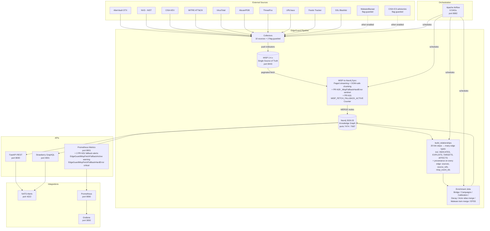
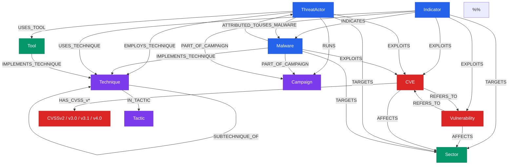
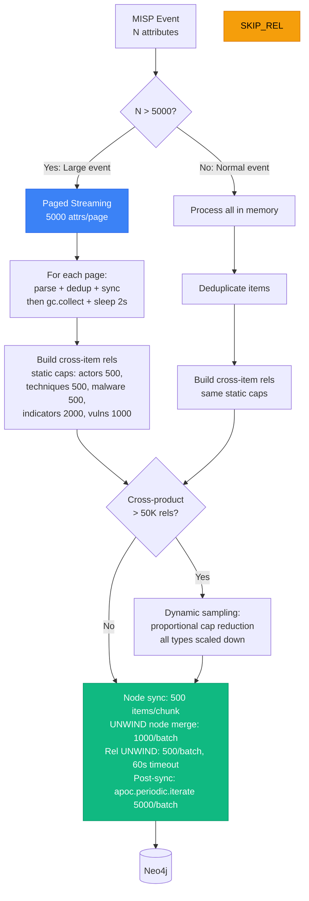
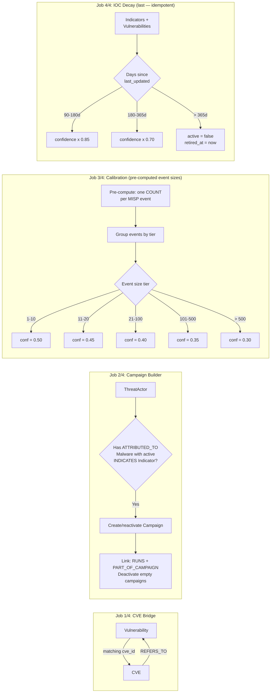

# EdgeGuard Knowledge Graph — Architecture Diagrams

> Graph-Augmented xAI for Threat Intelligence on Edge Infrastructure
> (IICT-BAS + Ratio1, funded by ResilMesh)

**Design philosophy:** Neo4j is the **linked intelligence layer** for fast graph queries and cross-source correlation. MISP holds the **ground truth** with full provenance, raw data, and audit trails. Every node in Neo4j traces back to its MISP source events via `misp_event_ids` and `SOURCED_FROM` relationships.

All diagrams are written in [Mermaid](https://mermaid.js.org/) and render natively on GitHub.
To export for papers: paste into [mermaid.live](https://mermaid.live) and download as PNG/SVG/PDF.

---

## 1. System Architecture Overview



---

## 2. Data Pipeline Flow

```mermaid
flowchart LR
    subgraph Step 2: Collection
        C1[OTX] --> MW[MISPWriter]
        C2[NVD] --> MW
        C3[CISA] --> MW
        C4[MITRE] --> MW
        C5[Others<br/>7 more] --> MW
    end

    subgraph MISP
        MW -->|create events<br/>dedup attributes| MISP_DB[(MISP<br/>Events + Attributes)]
    end

    subgraph Step 3: Sync
        MISP_DB -->|paginated<br/>index fetch| FETCH[Fetch Events<br/>primary index: 500/page × 100 pages<br/>fallback PyMISP/restSearch: 500/page × 200 pages<br/>+ _MispFallbackHardError on cap-hit PR-N29]
        FETCH --> PARSE[Parse Attributes<br/>per event]
        PARSE -->|< 5000 attrs| NORMAL[Normal Path]
        PARSE -->|> 5000 attrs| PAGED[Paged Streaming<br/>5000/page + gc.collect]
        NORMAL --> DEDUP[Deduplicate]
        PAGED --> DEDUP
        DEDUP --> CHUNK[Chunk at 500 items]
        CHUNK -->|UNWIND node merge<br/>1000/batch| NEO4J_MERGE[Neo4j MERGE<br/>Indicators + Vulnerabilities]
    end

    subgraph Step 4-5: Enrich
        NEO4J_MERGE --> REL[Build Relationships<br/>apoc.periodic.iterate<br/>batchSize 5000]
        REL --> BRIDGE[CVE Bridge]
        BRIDGE --> CAMP[Campaign Builder]
        CAMP --> CALIB[Legacy co-occurrence calibration (no-op since 2026-10)]
        CALIB --> DECAY[IOC Decay]
    end

    DECAY --> GRAPH[(Knowledge Graph)]
```

---

## 3. Knowledge Graph Schema



---

## 4. Airflow DAG Scheduling

```mermaid
gantt
    title EdgeGuard Airflow DAG Schedule (24h view)
    dateFormat HH:mm
    axisFormat %H:%M

    section High Frequency
    edgeguard_pipeline (OTX)        :active, 00:00, 00:05
    edgeguard_pipeline (OTX)        :active, 00:30, 00:35
    edgeguard_pipeline (OTX)        :active, 01:00, 01:05

    section Medium Frequency
    edgeguard_medium_freq (CISA+VT) :crit, 00:00, 00:15
    edgeguard_medium_freq (CISA+VT) :crit, 04:00, 04:15

    section Low Frequency
    edgeguard_low_freq (NVD)        :done, 00:00, 00:30
    edgeguard_low_freq (NVD)        :done, 08:00, 08:30

    section Daily
    edgeguard_daily (MITRE+6 more)  :02:00, 02:45

    section Neo4j Sync
    edgeguard_neo4j_sync            :03:00, 04:00
```



---

## 5. Neo4j Sync Task Chain

```mermaid
flowchart LR
    A[check_sync_needed<br/>ShortCircuitOperator] -->|sync needed| B[neo4j_preflight<br/>Health check]
    B --> C[run_neo4j_sync<br/>MISP to Neo4j<br/>up to 4h timeout]
    C --> D[build_relationships<br/>20 link steps → many edge types incl. INDICATES (family + same-pulse), EXPLOITS, TARGETS, AFFECTS, SUBTECHNIQUE_OF, USES_MALWARE / USES_TOOL]
    D --> E[run_enrichment_jobs<br/>5 post-sync jobs]
    E --> F[check_neo4j_quality<br/>Node/edge counts]

    A -->|skip: last sync < 72h| SKIP[All downstream<br/>SKIPPED]

    style SKIP fill:#fbbf24,stroke:#d97706,color:#000
    style A fill:#3b82f6,stroke:#2563eb,color:#fff
    style C fill:#10b981,stroke:#059669,color:#fff
```

---

## 6. Retry and Resilience Architecture


**PR-N29 H1 carve-out (operator-relevant):** the four baseline critical-chain
tasks — `baseline_clean`, `baseline_full_neo4j_sync`, `baseline_build_relationships`,
`baseline_run_enrichment_jobs` — override `retries=0` (`dags/edgeguard_pipeline.py:2772,
2927, 2953, 2971`). A single failure on any of these tasks immediately marks
the DAG run FAILED rather than auto-retrying. This is intentional: a 5–6h
critical-chain task that retries once would burn 12h of the 32h `dagrun_timeout`
cap and could leave the graph mid-mutated. Combined with the
`EdgeGuardMispFetchFallbackHardError` Prometheus alert (PR-N31), the operator
gets paged immediately when the `_MispFallbackHardError` sentinel raises.

---

## 7. OOM Protection Strategy



---

## 8. Enrichment Pipeline Detail



---

## Technology Stack

| Layer | Technology | Version |
|-------|-----------|---------|
| Graph Database | Neo4j Community | 2026.03 |
| Threat Intel Platform | MISP | 2.4.x |
| Orchestration | Apache Airflow | 3.2 |
| REST API | FastAPI + Uvicorn | latest |
| GraphQL API | Strawberry | latest |
| Messaging | NATS | latest |
| Monitoring | Prometheus + Grafana | latest |
| Data Format | STIX 2.1 | standard |
| Language | Python | 3.12+ |
| Versioning | CalVer | 2026.4.x |

---

*Last updated: 2026-10-15 — enrichment node lists the Malware ATT&CK-id twin merge. Same day: §3: `USES_MALWARE` / `USES_TOOL` start at the `ThreatActor` node (they pointed at an undefined node `A` and drew a second `Tool` node); `EXPLOITS` from actors and malware (curated packages) and `TARGETS` from actors and malware and `AFFECTS` from `CVE` added; the provenance note covers every relationship (`sources`, `source_refs`, `misp_event_ids`), not only the four PR-N26 types; §1 `build_relationships` label likewise. Prior: 2026-10-14 — campaign membership renamed `PART_OF_CAMPAIGN`.*

*Prior: 2026-04-28 — PR-N34 verification pass against code at HEAD. Fixed 6 drift findings:*

- *§6 (HIGH): `neo4j: 5 retries, 2s base` → `3 retries, 2s base` (matches `_run_with_retries` and `_retry_db_op` in `src/neo4j_client.py`).*
- *§6 (MED): added new branch + explanatory note for the PR-N29 H1 `retries=0` carve-out on the 4 baseline critical-chain tasks (`baseline_clean`, `baseline_full_neo4j_sync`, `baseline_build_relationships`, `baseline_run_enrichment_jobs`); operator now sees the immediate-fail path that pages via `EdgeGuardMispFetchFallbackHardError`.*
- *§1 (MED): aligned BREL block with §5's wording — "11 relationship types" → "12 link queries → many edge types incl. INDICATES, EXPLOITS, TARGETS, AFFECTS + PR-N26 r.misp_event_ids array on edges". Reordered ENRICH job list to match actual execution order in `run_all_enrichment_jobs` (Bridge → Campaigns → Calibration → Decay).*
- *§1 (LOW): added PR-N31 observability annotations on the SYNC node (`MISP_FETCH_FALLBACK_ACTIVE` Counter + `_MispFallbackHardError` sentinel) and METRICS node (the 2 fallback alerts).*
- *§3 (LOW): added comment block at the bottom of the schema explaining (a) `HAS_CVSS_v*` expands to four concrete edge types and (b) PR-N26 wired `r.misp_event_ids[]` onto the 4 build_relationships edges.*
- *§3 (LOW): edge label `HAS_CVSS` → `HAS_CVSS_v*` (matches `neo4j_client.py:_merge_cvss_node` which writes `HAS_CVSS_v2 / v30 / v31 / v40` with underscore + lowercase v + version).*

*Prior: 2026-04-26 PR-N33 docs audit; 2026-04-06.*
